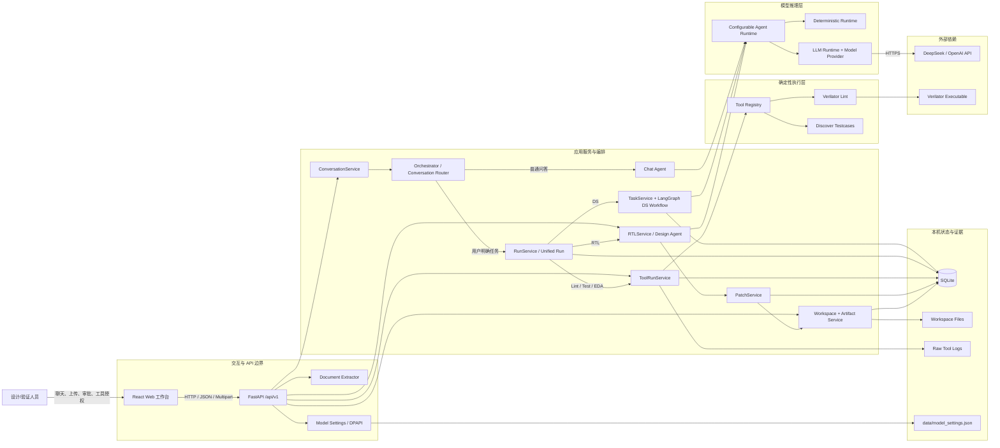
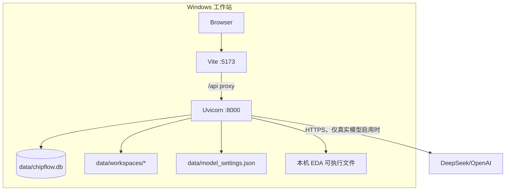
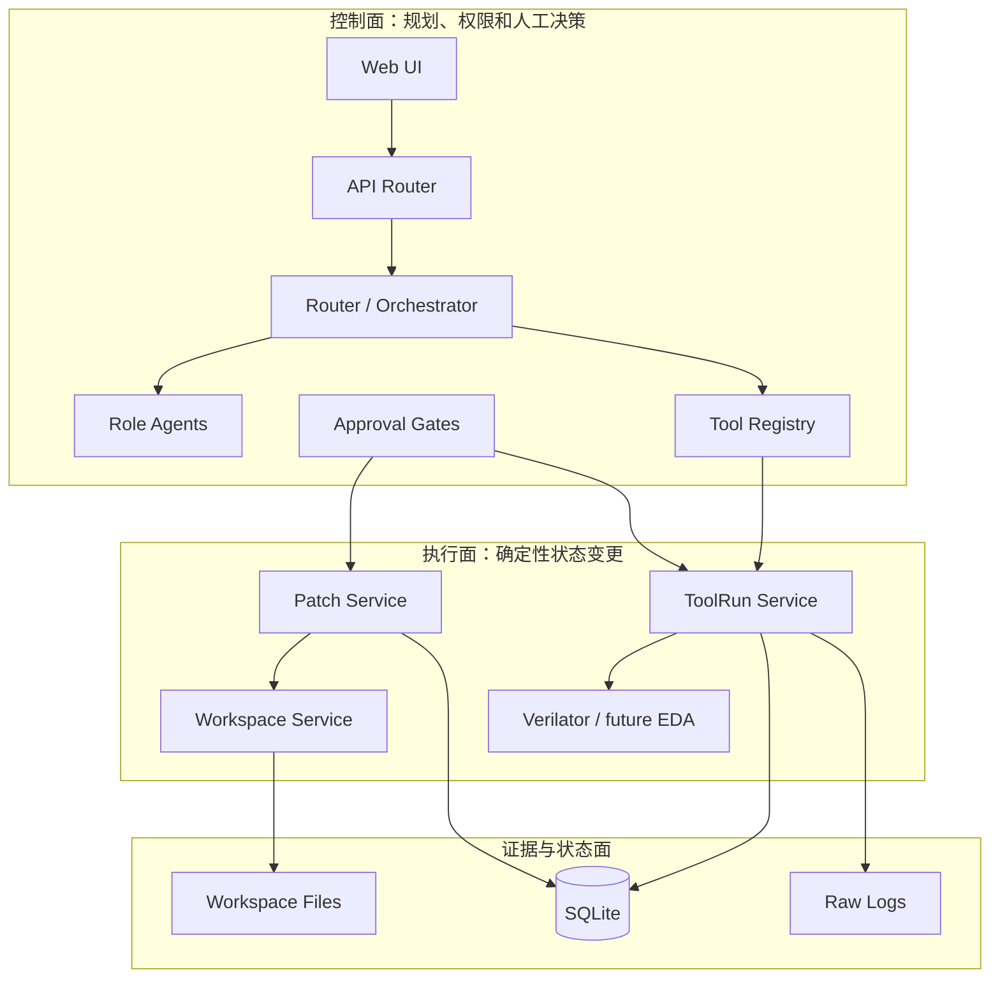
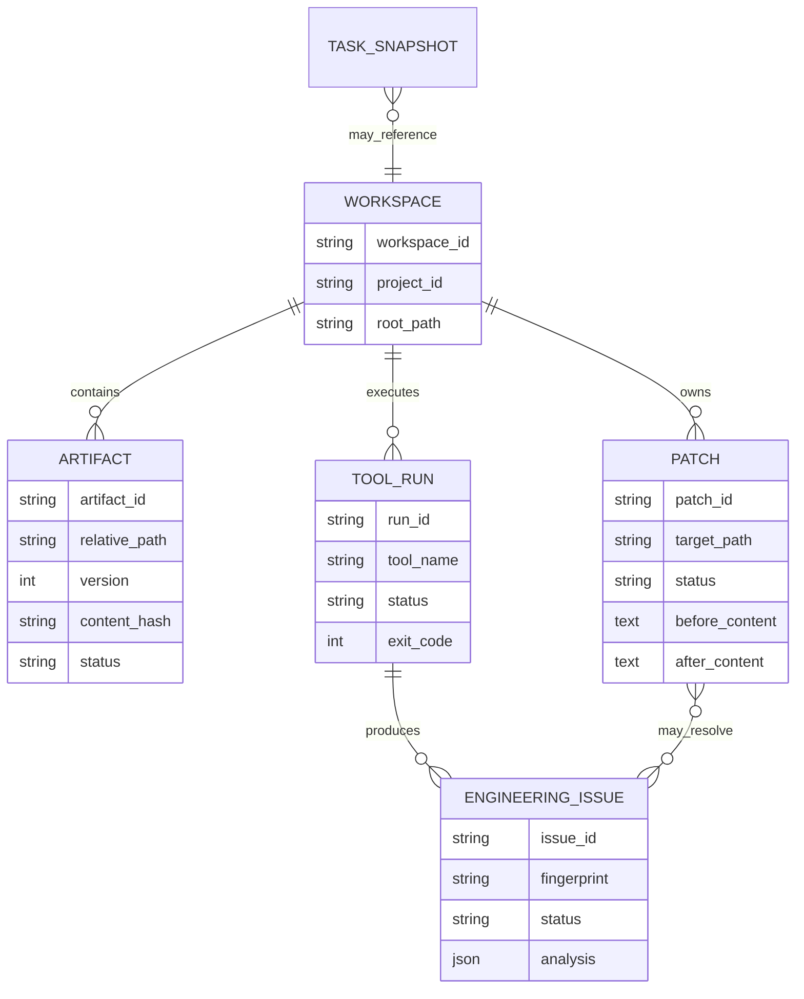
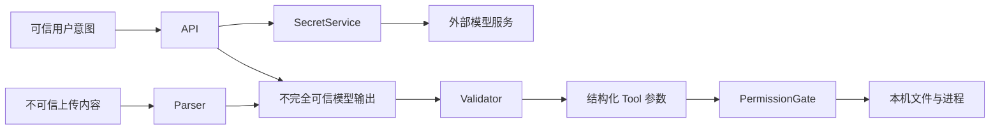

# 总体架构说明（v0.3 控制面）

## 1. 架构目标

系统围绕“用户决定任务、角色负责判断、Tool 负责确定性执行、所有修改先 Review”构建：

- FS、AS、ICD 是受控输入，虚拟 Agent 不得擅自修改；
- Orchestrator 只编排用户指定目标，不替用户推进研发阶段；
- Architecture、Design、Verification 和 Reviewer 按真实生产职责划分；
- DS、RTL 和修复先成为候选 Patch，用户批准后才写入；
- 工具运行受 Workspace、角色权限、参数校验和显式授权约束；
- 规格歧义及工程 Issue 都保留证据并把最终控制权交给用户。

## 2. 系统上下文



浏览器不直接访问模型或启动进程。API Key、文件访问和 Tool 执行全部由本机后端控制。

### 2.1 如何阅读这张图

这是一张系统上下文图，重点表达“请求从哪里进入、由谁判断、最终影响哪些资源”，而不是类之间的完整调用图。可以从左到右分成五个区域：

```text
用户与界面
→ API 边界
→ 对话/设计/工具三条业务路径
→ Agent Runtime 或确定性 Tool
→ SQLite、Workspace、外部模型和 EDA 工具
```

图中连线有三种含义：

1. **HTTP 调用**：Web 到 FastAPI；
2. **进程内函数调用**：API、Service、Workflow、Runtime、Registry 之间；
3. **外部或持久化 I/O**：模型 HTTPS、SQLite、Workspace 文件、Verilator 子进程。

当前系统是单机单后端进程，这些逻辑组件大部分不是独立服务。图把它们拆开，是为了说明职责边界和未来演进方向。

### 2.2 User → React Web 工作台

`User` 代表设计人员或验证人员，也是系统中唯一具有最终批准权的主体。用户可以进行四类操作：

- 普通聊天或文档问答；
- 上传 FS、AS、ICD，并明确要求生成 DS；
- 基于已交付 DS 生成 RTL Candidate、Review Diff；
- 明确授权执行 Lint，并逐条处理工具 Issue。

Web 工作台只负责展示和收集用户意图，不直接读写工程目录，不保存完整 API Key，也不直接调用 DeepSeek、OpenAI 或 Verilator。这样可以把密钥、路径和进程权限集中留在后端。

浏览器当前保存聊天历史、上传文档和当前 Run/Task 展示状态。刷新页面后这些 UI 状态会丢失；SQLite 中已经保存的 Run、RunEvent、Task、Workspace 和 ToolRun 不会丢失，但当前页面还不会自动重新绑定最近 Run。

### 2.3 React Web → FastAPI API

所有前端请求通过 `/api/v1` 进入 FastAPI。开发环境中，浏览器实际访问 Vite 的 `/api`，再由 Vite 代理到 `127.0.0.1:8000`。

FastAPI 是系统的统一信任边界，主要负责：

- 使用 Pydantic 校验请求；
- 分配或透传 `X-Request-ID`；
- 把请求转给对应 Service；
- 把权限、冲突和参数错误转换成 403、404、409、422 等状态码；
- 对未知异常返回结构化错误，而不是向前端泄露堆栈。

API 层本身不应包含模型 Prompt、文件原子写入或 EDA 命令拼装。这些职责分别属于 Runtime、Workspace/Patch Service 和 Tool Adapter。

图中的另外两个 API 分支是辅助入口：

- `Document Extractor` 接收 Multipart 文件，负责大小/格式检查和 PDF、DOCX、Markdown、TXT 文本抽取；结果返回浏览器，不自动启动 Agent；
- `Model Settings / DPAPI` 合并 TOML、网页覆盖和环境变量，在 Windows 下加密保存 Key；只有后端 Provider 可以取得有效明文 Key。

这两个组件都不会直接修改工程 Workspace。Document Extractor 当前也不是正式文档库，它只把抽取结果交还前端。

### 2.4 API → ConversationService

用户从主对话框发送消息时，请求进入 `ConversationService`。它是统一对话入口，负责准备以下上下文：

- 用户当前消息；
- 最近最多 20 条对话；
- project_id 和 module_name；
- 用户已上传的可选文档；
- Agent 禁用项、自定义 Reviewer 和讨论轮次。

ConversationService 不根据“是否上传文档”决定启动专业工作流，而是先调用 Conversation Router。这是为了避免上传动作被误解为执行授权。

### 2.5 ConversationService → Conversation Router

Router 只做意图分类，当前输出：

```json
{
  "route": "chat | ds_workflow | rtl_workflow | lint_workflow | simulation_workflow | cdc_workflow | synthesis_workflow | sta_workflow | test_execution_workflow",
  "reason": "本次路由原因"
}
```

它只在用户明确使用生成、实现、执行、运行等动作并指定任务对象时选择工作流。以下请求仍属于 `chat`：

- “DS 一般包含什么内容？”；
- “帮我解释这段 AS”；
- “这个 ready/valid 方案合理吗？”；
- 普通 RTL、验证和系统使用问题。

Router 后面由确定性的 `RunService` 落库和执行，不允许模型直接操作数据库或文件。当前已经实现单目标任务编排，但还不会把“完成 RTL 并跑综合”自动拆成多个依赖 Run；多目标请求应由用户确认或后续 Planner 拆解。

### 2.5.1 RunService：统一控制面

`RunService` 把 DS、RTL、仿真、Lint、CDC、综合、STA 和已有用例执行统一映射为 Run。Run 保存用户指令、路由理由、状态、等待项、结果快照和事件，并通过以下字段关联专业执行对象：

```text
legacy_task_id → DS Task / LangGraph State
tool_run_id    → 一次 Tool 进程执行
patch_id       → 候选 RTL 或其他文件修改
```

统一 Run 不吞并 TaskService、PatchService 或 ToolRunService，而是提供跨任务一致的查询、恢复、取消和审计边界。

### 2.6 Router → Chat Agent

route 为 `chat` 时，请求进入 Chat Agent。Chat Agent 可以使用对话、项目、模块和文档上下文回答问题，但不会：

- 自动创建 DS Task；
- 修改 FS、AS、ICD；
- 写入 RTL；
- 启动 EDA Tool；
- 代表真实架构师批准方案。

如果真实模型未启用，Deterministic Chat 只能回答预设的系统能力和简单问候，并明确提示其不具备开放式推理能力。

### 2.7 Router → RunService → TaskService → LangGraph DS Workflow

route 为 `ds_workflow` 时，ConversationService 先让 RunService 创建 `ds_design` Run。RunService 检查 AS：缺少时保留 `waiting_for_user` Run；满足时调用 TaskService 创建专业 Task，并把 `task_id` 回写到 Run。

TaskService 的职责是：

1. 生成 task_id；
2. 建立初始 Workflow State；
3. 使用 task_id 作为 LangGraph thread_id；
4. 调用 DS Workflow；
5. 保存内存热状态；
6. 把可序列化快照写入 SQLite；
7. 将内部 State 转换为稳定的 TaskView。

LangGraph DS Workflow 再组织 Architecture、Design、Verification 和 Reviewer 角色。它负责并行、条件分支、讨论循环和 Human-in-the-loop，不负责直接操作 RTL 或运行 Verilator。

### 2.8 DS Workflow → ConfigurableAgentRuntime

工作流节点不会直接依赖某个模型供应商，而是调用统一 Runtime 方法，例如：

```text
architecture_analysis
design_analysis
verification_analysis
detect_issues
generate_ds
review
```

`ConfigurableAgentRuntime` 每次调用时检查当前有效模型设置：

- 测试显式关闭模型：使用 Deterministic Runtime；
- enabled 且存在有效 Key：使用 LLM Runtime；
- 其他情况：使用 Deterministic Runtime。

因此保存模型设置后不需要重启服务。上层 Workflow 也不需要知道当前使用 DeepSeek、OpenAI 还是离线模板。

### 2.9 Conversation → RunService → RTLService → Design Runtime → PatchService

用户在聊天中明确要求生成 RTL 时，Router 创建 `rtl_implementation` Run；工程工作台也可以通过兼容接口 `/rtl/candidates` 直接调试该能力：

1. RTLService 获取或创建 Workspace；
2. 将 DS、规格文档、模块名和用户指令传给 Design Runtime；
3. Runtime 返回 SystemVerilog Candidate；
4. RTLService 不写目标文件，而是调用 PatchService；
5. PatchService 读取目标 before 内容并生成 unified diff；
6. Patch 进入 `patch_ready`；
7. 用户批准后才重新校验目标并原子写入。

图中 `RTL → Patch` 表示这一强制变更控制边界。即使 Design Runtime 被 Prompt Injection 影响，也没有直接文件写入口。

### 2.10 Conversation/兼容 API → RunService → ToolRunService → Tool Registry

聊天中明确要求执行 Lint 时，RunService 解析 Workspace 和参数并启动 ToolRun；工程工作台也可以通过兼容接口直接发起。进入 ToolRunService 后依次检查：

- Workspace 是否存在；
- Tool 是否在 Registry 注册；
- 请求角色是否有权限；
- Tool 是否要求用户批准；
- 本次请求是否带有真实用户批准。

通过后，Service 创建 queued Run 并交给线程池。Registry 保存 Tool 元数据和执行器，它不保存每次运行状态。

### 2.11 Tool Registry → Verilator / Discover Testcases

当前 Registry 有两个真实注册项：

| Tool | 行为 | 外部进程 | 是否需要批准 |
|---|---|---:|---:|
| `discover_testcases` | 扫描 Workspace 中已有验证文件 | 否 | 否 |
| `verilator_lint` | 执行受控 Verilator Lint | 是 | 是 |

Verilator Adapter 不接受任意 Shell 字符串。它校验文件路径、后缀和 top module，使用命令参数数组及 `shell=False` 启动进程。工具不存在时生成环境 Issue，而不是返回假成功。

### 2.12 Runtime → Deterministic Runtime / LLM Runtime

这两个 Runtime 实现相同的逻辑接口，但目的不同：

- Deterministic Runtime 用固定规则和模板保证开发、测试、演示可重复；
- LLM Runtime 用真实模型完成开放式理解、生成和评审。

Deterministic Runtime 生成的 RTL 只有安全骨架和 TODO，用于验证 Candidate/Patch 协议，不能当作实际设计结果。LLM Runtime 的输出能力更强，但仍必须经过 Schema 检查、评审、Diff 和 Tool 验证。

### 2.13 LLM Runtime → Model Provider → DeepSeek/OpenAI

LLM Runtime 负责角色 Prompt 和业务输出契约，Model Provider 负责供应商协议差异：

- Responses API 或 Chat Completions；
- OpenAI/DeepSeek Base URL；
- system role 和 Token 参数差异；
- 文本提取；
- JSON Fence 清理和一次格式修复；
- 网络、鉴权和格式异常统一包装。

只有后端 Provider 能读取解密后的 API Key。外部模型服务只接收当前 Agent 所需上下文，不应接收 Workspace 中无关文件。

### 2.14 Service → SQLite

图中的多个组件都连接 SQLite，但各自拥有不同表：

| 组件 | 主要表 | 保存内容 |
|---|---|---|
| RunService | `runs`、`run_events` | 用户任务、路由理由、状态、关联执行记录、等待项、结果快照和事件 |
| TaskService | `task_snapshots` | DS 请求、分析、Issue、Finding、事件、等待用户信息 |
| Workspace/ArtifactService | `workspaces`、`artifacts` | 目录、版本、Hash、来源 |
| PatchService | `patches` | before、after、Diff、审批和应用时间 |
| ToolRunService | `tool_runs`、`engineering_issues` | Run、命令、输出、Issue、分析和用户决策 |

SQLite 是当前单机事实存储，但不是模型长期记忆，也不是持久化 LangGraph Checkpointer。

### 2.15 Service → Workspace 文件系统

SQLite 保存元数据和部分文本，真实工程文件及日志位于 `data/workspaces/<workspace>/`：

```text
rtl/          RTL 文件
dv/           验证资产
constraints/  约束
candidates/   候选中间产物
artifacts/    其他制品
logs/         Tool stdout/stderr
```

所有路径必须通过 WorkspaceService 解析，拒绝绝对路径和逃逸根目录的 `..`。Patch 应用和 Artifact 写入都使用临时文件替换。

### 2.16 三条典型链路

#### 普通聊天

```text
User → Web → API → ConversationService → Router
→ Chat Agent → Configurable Runtime → Deterministic/LLM
→ API → Web → User
```

不会创建 Task、Workspace、Patch 或 ToolRun。

#### DS 生成

```text
User → Web → API → ConversationService → Router
→ RunService → TaskService → LangGraph DS Workflow
→ Architecture/Design/Verification/Review Agents
→ Task Snapshot + Unified Run → SQLite
→ RunView + TaskView → Web
```

可能在冲突处 Interrupt，等待用户带回真实架构结论。

#### RTL 与 Lint

```text
User → Chat → Router → RunService → RTLService → Design Runtime
→ PatchService → Diff → User Approval → Workspace RTL
User → Chat → Router → RunService → ToolRunService → Registry → Verilator
→ Raw Log + SQLite Run → EngineeringIssue
→ 单 Issue 用户决策
```

当前链路在 Issue 决策后结束，还没有自动生成修复 Patch并最小复验。

### 2.17 图中已经实现与尚未实现的部分

| 图中关系 | 当前状态 |
|---|---|
| Web → FastAPI | 已实现 |
| Conversation → Router → RunService | 已实现，支持单目标 DS/RTL/Lint/Test/EDA Run |
| DS Workflow → 多角色 Runtime | 已实现 |
| Runtime → DeepSeek/OpenAI | 已实现 |
| API → RTL → Patch | 已实现 |
| API → ToolRun → Registry → Verilator | 已实现，但当前机器可能未安装 Verilator |
| Service → SQLite/Workspace | 已实现 |
| 统一 Run 查询、恢复、取消和事件 | 已实现 |
| 多目标 Planner 和依赖 Run DAG | 尚未实现 |
| Sim/CDC/综合/STA Adapter | 尚未实现 |
| Issue → 自动修复 Patch → 最小复验 | 尚未实现 |
| SQLite → LangGraph 节点级精确恢复 | 尚未实现 |

因此，这张图既表示当前运行结构，也为后续扩展保留接口；判断某项能力是否已经可用时，应结合本表和“当前架构与目标架构差异”章节。

## 3. 分层架构

| 层 | 目录 | 职责 |
|---|---|---|
| 表现层 | `frontend/src` | 对话、文档、统一 Run、DS 结果、Diff、审批和工程兼容工作台 |
| API 层 | `app/api` | HTTP 契约、状态码和异常边界 |
| 应用服务层 | `app/services` | 对话、统一 Run 编排、DS Task、Workspace、Artifact、RTL、Patch、ToolRun、诊断 |
| 工作流层 | `app/workflows` | DS 节点、分支、讨论、Interrupt 和评审聚合 |
| Agent 层 | `app/agents` | 生产角色、评审角色、提示词和运行时选择 |
| Skill 层 | `skills`、`app/skills` | 版本化专业方法、检查清单和角色约束；不授予执行权限 |
| Tool 层 | `app/tools` | Tool 元数据、权限和确定性执行器 |
| 模型适配层 | `app/models` | Responses/Chat Completions、JSON 修复和异常包装 |
| 持久化层 | `app/storage` | SQLite Schema 和并发安全访问 |
| 配置安全层 | `app/config` | TOML、网页覆盖、环境变量和 Windows DPAPI |
| 领域层 | `app/domain` | Pydantic 请求/响应与枚举 |
| 文档层 | `app/documents` | PDF、DOCX、Markdown、TXT 抽取 |

## 4. 部署与本地数据



`data/chipflow.db*`、`data/workspaces/` 和 `data/model_settings.json` 均被 `.gitignore` 排除。

## 5. 核心决策

### 5.1 用户决定阶段

系统不会因为 DS 已完成就自动宣布进入 RTL，也不会把工具成功等同于 Sign-off。用户明确请求 DS、RTL 或工具任务后，系统才执行相应操作。

### 5.2 角色而非任务型 Agent

单项动作实现为 Tool，Design 或 Verification Agent 根据职责调用；Agent 不按每个命令无限拆分。评审角色保持独立，避免生产 Agent 自我批准。

### 5.3 原始资料只读

Architecture Agent 只能解释、质疑并提出建议。FS/AS/ICD 正式修改仍需真实架构结论、问题单或新版文档，本版本没有原始资料写接口。

### 5.4 候选修改协议

```text
读取目标内容 → 生成 after_content → 生成 unified diff
→ patch_ready → 用户 approve/reject/custom
→ approve 时再次校验目标未变化 → 原子写入
```

目标在 Review 期间变化会返回冲突，防止覆盖用户的新修改。

### 5.5 Tool 安全协议

- Workspace 内相对路径，拒绝绝对路径和路径穿越；
- 角色白名单和 `requires_user_approval`；
- Verilator 使用参数数组和 `shell=False`；
- 原始 stdout/stderr 写入 Workspace 日志；
- 工具缺失返回 `TOOL_ENVIRONMENT` Issue，不伪装为成功。

## 6. 状态与持久化

| 状态 | 存储 | 重启行为 |
|---|---|---|
| 浏览器消息、上传列表 | React State | 刷新后丢失 |
| LangGraph 活跃 Checkpoint | `MemorySaver` | 重启后丢失 |
| Task 应用快照 | SQLite `task_snapshots` | 可查询；等待任务可由服务恢复路径继续 |
| 统一 Run/事件 | SQLite `runs/run_events` | 可查询、恢复等待项或取消；运行中的外部进程仍不能跨重启接管 |
| Workspace/Artifact/Patch | SQLite + 文件系统 | 保留 |
| ToolRun/EngineeringIssue | SQLite + 日志文件 | 结果和决策保留；运行中的外部进程不会自动重连 |
| 模型设置 | JSON + DPAPI/环境变量 | 保留 |

这不是完整的分布式恢复：进程崩溃时正在运行的 Tool 不会被重新接管。

## 7. 安全边界

| 对象 | 当前保护 |
|---|---|
| API Key | Windows DPAPI 绑定用户；API 只返回掩码 |
| 原始文档 | 只读抽取，不自动回写 |
| Workspace | 根目录隔离和路径解析校验 |
| Patch | 用户批准、目标内容二次校验、原子替换 |
| Tool | 角色权限、显式批准、参数白名单、无 Shell 拼接 |
| 测试 | 强制关闭真实模型，避免产生 API 费用 |

系统仍无登录、项目 ACL、企业 Secret Manager 和 TLS 终止，只适用于受控本地环境。

## 8. 技术栈

- Python 3.11+、FastAPI、Pydantic、Uvicorn；
- LangGraph + MemorySaver；
- SQLite + 本地隔离 Workspace；
- OpenAI Python SDK，兼容 DeepSeek/OpenAI；
- React 19、TypeScript、Vite、React Markdown、Lucide；
- PyPDF、python-docx；
- pytest、FastAPI TestClient；
- Windows DPAPI、Verilator（可选本机依赖）。

## 9. 后续演进

1. 持久化 LangGraph Checkpointer 和 ToolRun 恢复/取消；
2. Sim、CDC、综合、STA 的项目化 Adapter；
3. 基于代码、DS 和规格的自动候选修复与最小复验；
4. SourceRef 精确到章节/行号，加入依赖和影响传播；
5. 问题单、Git 和评审审批集成；
6. 长期记忆和 Reflection 生命周期；
7. 多用户、项目 ACL、审计与企业密钥管理。

## 10. 逻辑子系统与数据所有权

系统可以划分为六个边界。边界的意义不是未来一定拆成六个微服务，而是明确谁负责修改哪类状态。

| 子系统 | 主要组件 | 拥有的数据 | 不应承担的职责 |
|---|---|---|---|
| Conversation | ConversationService、Router、Chat Runtime | 当前请求和会话上下文 | 不直接修改工程文件 |
| Design Workflow | TaskService、LangGraph、Agent Runtime | DS Task、规格 Issue、Finding、事件 | 不直接运行任意 Shell |
| Engineering Workspace | WorkspaceService、ArtifactService | 项目目录、Artifact 元数据和文件 | 不做架构语义判断 |
| Change Control | RTLService、PatchService | Candidate、before/after、Diff、审批状态 | 不自行代表用户批准 |
| Tool Execution | ToolRegistry、ToolRunService、Tool Adapter | Run、命令、日志、EngineeringIssue | 不隐藏设计决策 |
| Platform Configuration | ModelSettings、SecretProtection、Diagnostics | 模型设置、密钥密文、环境健康状态 | 不读取或修改项目业务结论 |

数据写入遵循单一入口：Workspace 文件只能经 WorkspaceService 写入；正式候选修改只能经 PatchService 批准后应用；ToolRun 状态只能由 ToolRunService 推进。这样可以减少模型或 API 路由绕过安全规则的可能。

## 11. 控制面与执行面



控制面中的模型可以提出计划和候选，但不能直接拥有操作系统写权限。执行面只接受经过校验的结构化输入。证据面保存结果，使用户可以追溯“谁基于什么证据提出什么修改、用户如何决策、工具如何反馈”。

当前完整 Orchestrator 尚未接入，所以部分控制由前端显式按钮承担：用户点击“生成 RTL 候选”或“执行 Lint”，等价于明确选择当前任务及批准点。

## 12. 组件依赖规则

推荐依赖方向如下：

```text
frontend
  → HTTP API
    → application services
      → domain contracts
      → agents / workflows / tools
      → storage and filesystem adapters
```

关键规则：

1. 前端不读取 SQLite、不直接启动模型或 EDA 进程；
2. API 路由不实现原子写入、路径校验或命令拼装；
3. Agent Runtime 不直接写 Workspace；
4. Tool Adapter 不自行决定是否获得用户批准；
5. Storage 不理解芯片设计语义；
6. Domain Model 不依赖 FastAPI、React 或具体数据库；
7. Reviewer 只产生 Finding，不调用正式写 Tool。

当前代码仍有一些 MVP 级耦合，例如内置 Tool 直接引用全局 WorkspaceService、部分 Service 直接写 SQL。后续拆 Worker 或迁移 PostgreSQL 时，应增加 ToolContext 和 Repository 抽象，而不是让更多全局对象扩散。

## 13. Agent、Tool 与权限模型

### 13.1 角色权限

| 能力 | Architecture | Design | Verification | Reviewer | Orchestrator |
|---|---:|---:|---:|---:|---:|
| 读取 FS/AS/ICD | 是 | 是 | 是 | 是 | 是 |
| 修改 FS/AS/ICD | 否 | 否 | 否 | 否 | 否 |
| 生成 DS Candidate | 建议 | 是 | 建议 | 否 | 编排 |
| 生成 RTL Candidate | 否 | 是 | 否 | 否 | 编排 |
| 执行 Lint | 否 | 是 | 是 | 否 | 仅发起计划 |
| 应用 Patch | 否 | 否 | 否 | 否 | 否 |
| 批准 Patch/高成本 Tool | 仅真实用户 | 仅真实用户 | 仅真实用户 | 仅真实用户 | 仅真实用户 |

表中的“否”由后端权限和服务边界保证，不能只依赖提示词。用户审批是一种独立 Authority，不属于任何虚拟 Agent。

### 13.2 Mutability

Tool 定义预留六级修改属性：

```text
read → analysis → candidate_write → execution → formal_write → external_write
```

当前内置 Tool 使用 `read` 和 `execution`。后续接入 Git、问题单、正式约束修改时，可按 Mutability 统一决定是否需要批准、是否允许自动重试、是否需要二次确认和审计级别。

## 14. 核心领域关系



目前 `EngineeringIssue` 的 `patch_id` 只出现在用户决策请求中，数据库尚未建立正式外键；Task 与 Workspace 也尚未形成强关联。上图中的虚线语义应视为目标关系，实际 Schema 以 `database.py` 为准。

## 15. 一致性与事务策略

系统同时修改数据库和文件系统，无法依靠单一 SQLite 事务覆盖全部操作，因此使用以下局部策略：

### 15.1 Patch 乐观并发

1. 创建 Patch 时读取并保存 before；
2. Review 期间不锁文件；
3. 批准时再次读取目标；
4. 目标与 before 不一致则返回 409；
5. 一致时使用同目录临时文件进行原子替换；
6. 成功后更新 Patch 为 applied。

极端情况下可能出现“文件已替换、进程在更新数据库前崩溃”。生产化需要恢复扫描、写前日志或把 Git Commit 作为最终一致性锚点。

### 15.2 ToolRun 状态

Run 先落库为 queued，再交给线程池。执行结束后先保存输出、写日志、解析 Issue，最后进入终态。因此读取者可能短暂看到 parsing。当前没有事务性 Outbox，进程在中间崩溃时可能留下 running/parsing 状态。

### 15.3 Artifact 版本

版本号通过查询同一路径最大版本再加一生成。单进程锁下足够，但多进程时存在竞争；迁移多 Worker 后应通过数据库唯一约束和事务生成版本。

## 16. 信任边界与威胁模型



主要威胁及控制：

| 威胁 | 当前控制 | 仍需补充 |
|---|---|---|
| 文档 Prompt Injection | 文档只作为上下文；权限不由 Prompt 决定 | 内容信任标签、检索隔离、策略扫描 |
| 路径穿越 | Resolve 后验证 Workspace 父子关系 | Reparse Point/符号链接防护 |
| 命令注入 | 参数数组、`shell=False`、标识符白名单 | 固定工具 Hash、进程沙箱 |
| LLM 越权写文件 | Runtime 无文件写入口；Patch 审批 | 统一 Capability Token |
| API Key 泄露 | DPAPI、响应掩码 | TLS、企业 Secret Manager |
| 未授权用户调用本机 API | 仅 Loopback/CORS | 登录、ACL、CSRF、防火墙策略 |
| EDA 工具漏洞或资源耗尽 | 超时、有限线程池 | CPU/内存/许可证隔离 |

## 17. 可用性、恢复与故障隔离

| 故障 | 影响范围 | 当前恢复 |
|---|---|---|
| 单次模型调用失败 | 当前 Chat/Task | 结构化错误；用户重试 |
| 模型 JSON 非法 | 当前 Agent 节点 | 一次格式修复，失败后中止 |
| 单个 Tool 失败 | 当前 Run | 保存日志和 Issue，不影响其他 Workspace |
| Patch 冲突 | 当前 Patch | 返回 409，重新生成 |
| 后端重启 | 活跃 MemorySaver/线程池 | Task 快照可查；等待 Task 兼容恢复；运行中 Tool 不续跑 |
| SQLite 损坏或不可写 | 持久化功能 | 自检报错；当前无自动备份恢复 |
| 模型服务不可达 | 真实模型功能 | 请求报错；不会自动把失败结果写入工程文件 |

Workspace 和 Run ID 提供基本故障隔离。当前 ThreadPool 中的 Tool 仍与 API 进程共享生命周期；生产环境应拆成独立 Worker，并以作业租约和心跳管理运行状态。

## 18. 可观测性设计

当前可观测信号包括：

- HTTP `X-Request-ID`；
- 后端异常日志；
- Task Event 列表；
- ToolRun 状态、命令、退出码和输出；
- Workspace 原始 stdout/stderr；
- 系统自检；
- SQLite 中的 Patch 和用户决策。

缺少的生产指标：

- 每个 Agent 节点耗时、模型、Token 和费用；
- Router 命中率和用户改路由率；
- Patch 接受率、冲突率和复验通过率；
- Tool 队列时长、执行时长、超时率；
- Issue 建议采纳率、跳过风险和 reopened 率；
- Artifact 数量、日志容量和磁盘水位；
- 统一 Trace 将 HTTP、模型调用、ToolRun 和 Patch 串联。

## 19. 当前架构与目标架构差异

| 主题 | 当前 v0.3 | 目标形态 |
|---|---|---|
| Orchestrator | 角色已定义；DS 固定图；工程操作由 UI 发起 | 结构化计划和动态 Function Call |
| 工作流恢复 | MemorySaver + SQLite 应用快照 | 持久化 Checkpointer、节点级幂等恢复 |
| Tool 执行 | API 进程内 ThreadPool | 可靠队列、独立 Worker、资源/许可证调度 |
| EDA | Verilator Lint | Sim、Lint、CDC、综合、STA Adapter |
| Issue 修复 | 归一化、建议、人工决策 | Candidate Patch、批准、最小复验、resolved/reopened |
| 记忆 | Task/Artifact 状态 | 来源化长期记忆、Reflection、失效传播 |
| 权限 | 本地单用户、角色白名单 | 用户/项目 ACL、企业审批和审计 |
| 存储 | SQLite + 本地文件 | PostgreSQL + Artifact/Object Storage |

这张差异表应作为面试和后续迭代的事实边界，避免把目标设计描述成当前能力。

## 20. 关键架构取舍与备选方案

### SQLite vs PostgreSQL

选择 SQLite 是为了 Windows 单机零部署；代价是多进程并发和迁移能力有限。达到多用户/Worker阶段后再迁移 PostgreSQL。

### ThreadPool vs 独立任务队列

ThreadPool 让首个 Tool 快速落地；代价是无法跨重启恢复和资源隔离。完成真实修复闭环后再引入队列，可以用已有 Run 状态作为迁移契约。

### 逻辑 Agent vs 多进程 Agent

逻辑角色更容易共享上下文、控制费用和测试；代价是模型配置共享、隔离较弱。只有出现明确吞吐或模型差异需求时才需要独立服务。

### 轮询 vs SSE/WebSocket

轮询实现简单、失败恢复容易；高并发下效率较低。Run 具有稳定 ID，因此后续可以增加 SSE，而不改变核心状态模型。

### 本地 Workspace vs 直接操作 Git 仓库

本地隔离 Workspace 更安全、可重复；代价是与真实代码仓库同步尚未解决。接入 Git 时仍应保留候选和审批协议。
