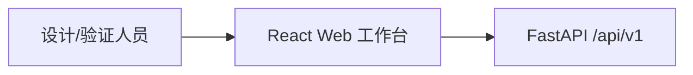
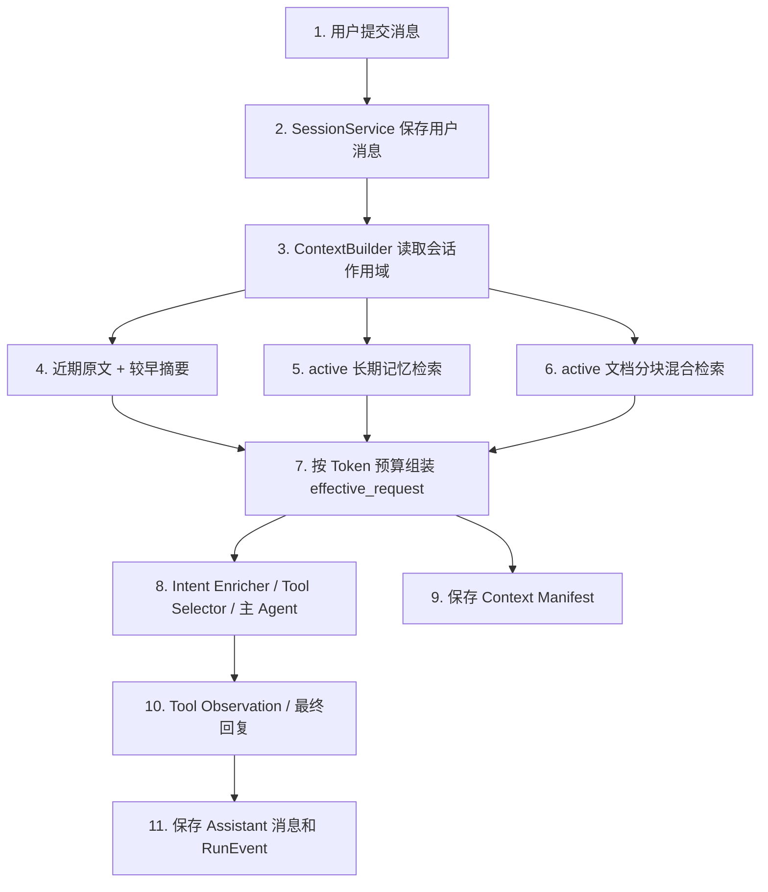
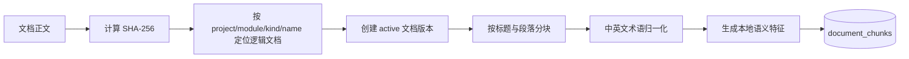
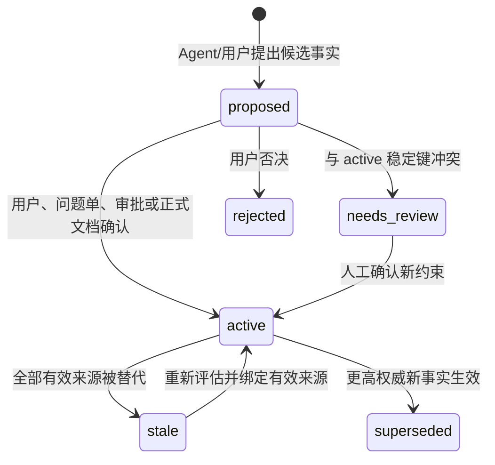
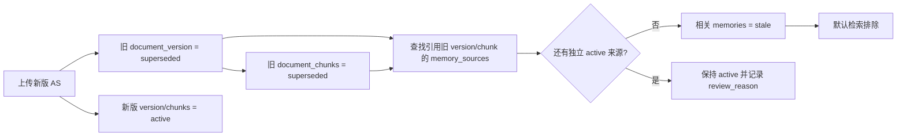
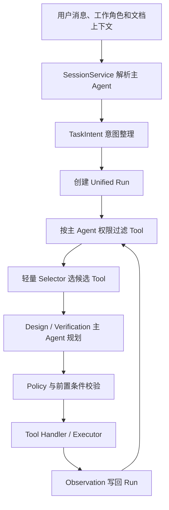
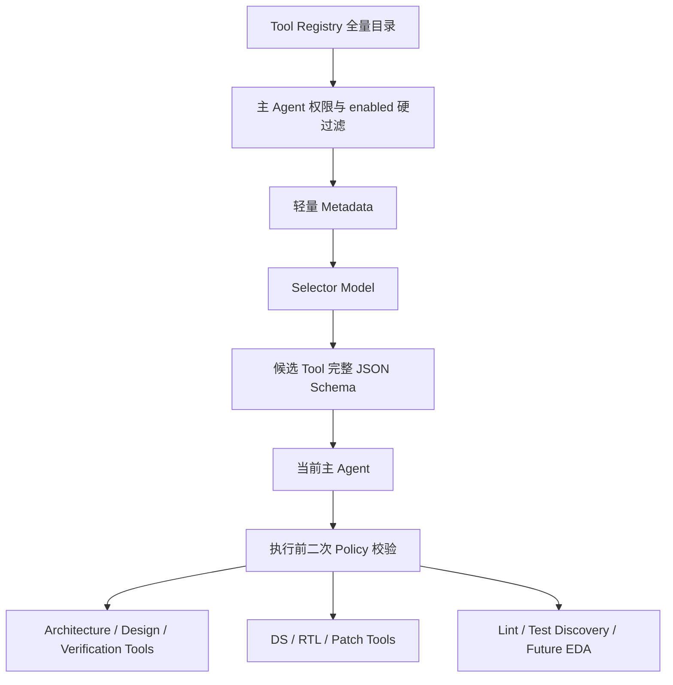
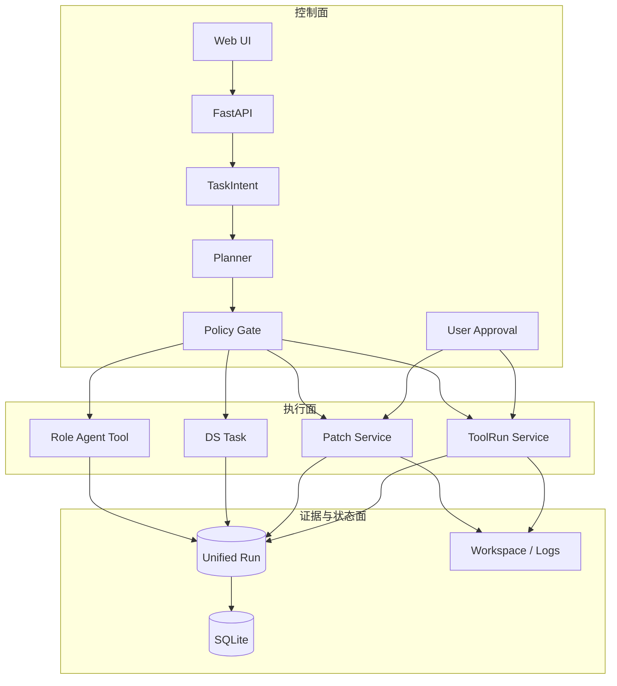
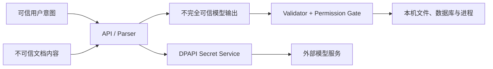
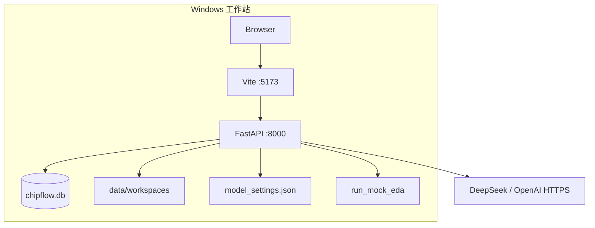

# ChipFlow 总体架构说明

## 1. 架构目标

ChipFlow 是面向 RTL 设计与验证工程师的 Windows 本地 Multi-Agent 工作台。系统的核心不是让模型替代工程师，而是把不确定的模型判断放入可审计、可暂停、可审批的工程控制面。

系统采用角色主 Agent、后端会话、混合 RAG 和可追溯长期记忆，遵循以下原则：

- 用户决定任务目标以及是否进入下一研发阶段；
- 用户工作角色决定 Design 或 Verification 主 Agent，控制平面不冒充专业主 Agent；
- 所有消息进入统一 Planner–Executor 控制面，不再预先二分为 Chat 和固定 Workflow；
- 跨专业协作通过有边界、可持久化的 Delegate 完成；
- Tool 先按主 Agent 权限硬过滤，再由轻量模型选择有限候选；
- 模型可以完善任务表达，但不能补造 FS、AS、ICD 中不存在的工程事实；
- 普通聊天也是一个只有 `reply_to_user` Tool 的 Run；
- Agent 负责专业判断，Tool 负责结构化动作，Policy 负责不可绕过的安全规则；
- DS、RTL 和文件修复先形成候选产物，用户 Review 后才能进入正式 Workspace；
- 本地进程执行必须满足 Tool 注册、角色权限、参数校验和用户授权；
- Tool Call、Observation、审批、错误和结果都进入统一 Run 证据链。
- 浏览器不是聊天历史的事实源，会话关闭后可从后端恢复；
- FS/AS/ICD 版本化保存并按问题混合检索，不把整篇文档顺序塞入 Prompt；
- Agent 推断不能自动成为长期事实，正式事实和决策必须带来源；
- 每个 Run 保存 Context Manifest，能追踪模型实际看过的消息、记忆和文档分块。

### 1.1 架构分层

系统不是把所有功能堆进一个 Agent Prompt，而是分成六层，每层只处理一种变化：

| 层 | 回答的问题 | 核心组件 | 变化原因 |
|---|---|---|---|
| 交互层 | 用户如何发起任务并看到进度 | React、`frontend/src/api.ts` | 页面布局、交互体验 |
| HTTP 契约层 | 外部如何稳定调用系统 | FastAPI、Pydantic Models | API 字段、状态码 |
| 控制面 | 谁负责、下一步做什么、任务是什么状态 | Session、ContextBuilder、Orchestrator、RunService | 编排策略、角色和状态机 |
| 专业推理层 | 架构、设计、验证如何判断 | Agent Runtime、Skills、DS Workflow、Delegate | Prompt、检查表、模型能力 |
| 执行层 | 如何产生文件或运行工具 | Patch、Workspace、ToolRun、Tool Adapter | 文件系统、EDA 命令、许可证 |
| 证据层 | 结果如何恢复和审计 | SQLite、Artifact、Raw Logs、Context Manifest | 数据生命周期、审计要求 |

分层的直接价值是：更换模型不需要重写 Patch 安全逻辑；增加 EDA Adapter 不需要修改会话系统；
调整前端也不会改变长期记忆和 Run 的事实来源。

### 1.2 三个最重要的不变量

系统可以增加 Tool、角色和模型，但以下不变量不能被破坏：

1. **模型只能提出结构化动作，不能直接获得副作用能力。** 文件、数据库和外部进程只由 Service 操作；
2. **正式资产的改变必须有证据链。** 至少能够关联用户请求、Agent/Tool、候选内容、审批和结果；
3. **失败必须保留真实状态。** 模型失败、Tool 不可用、审批拒绝和执行错误不能被包装成成功回复。

这些不变量分别由 Tool Registry、Patch/Run/Artifact 数据模型以及统一异常和状态机实现。

## 2. 系统上下文

系统上下文不再使用一张包含全部组件的大图。大图在 Markdown 预览和 PDF 中会被整体缩小，节点文字难以阅读。这里按“入口边界、编排主链、执行边界、状态与外部依赖”拆成四个视图，每张图只回答一个问题。

### 2.1 入口与信任边界



浏览器只负责收集输入、上传文件和展示状态，不直接访问模型、SQLite、Workspace 或 EDA 进程。FastAPI 是本机信任边界：上传内容、模型输出和 Tool 参数都必须在这里进入后端校验链。

| 组件 | 负责 | 明确不负责 |
|---|---|---|
| React Web | 对话、上传、会话恢复、设置、状态展示、用户审批 | 不作为历史事实源，不保存 API Key 明文，不直接运行工具 |
| FastAPI | HTTP 契约、请求编号、异常转换、Service 装配 | 不在路由函数中实现业务编排 |
| ConversationService | 保持对话 API 兼容并转交请求 | 不再判断 Chat/DS/RTL 固定分支 |

#### 2.1.1 一条网页消息怎样进入后端

网页发送消息时调用 `POST /api/v1/conversations/{session_id}/messages`。路由只做路径参数覆盖和已知异常转换：

```python
return await conversation_service.handle(
    request.model_copy(update={"session_id": session_id})
)
```

`ConversationService` 随后把 `ChatRequest` 原样交给 `OrchestratorService.handle()`。
它没有 `if chat / elif ds / elif rtl` 这样的业务分流，因此不会形成第二套编排逻辑。

代码入口：

- [`app/api/routes.py`](../app/api/routes.py#L164)：网页正式消息入口；
- [`app/services/conversation_service.py`](../app/services/conversation_service.py)：对话门面；
- [`app/services/orchestrator_service.py`](../app/services/orchestrator_service.py#L60)：统一控制主链。

#### 2.1.2 FastAPI 为什么是信任边界

Pydantic 在路由执行前完成字段类型、枚举和基本范围校验；Service 再校验跨对象规则，例如会话是否属于
同一个项目、Workspace 是否存在、角色是否有 Tool 权限。未知异常由 `main.py` 统一转换成带
`request_id`、错误码和操作建议的 JSON，浏览器不会只看到一张无信息的 HTML 500 页面。

```python
@app.middleware("http")
async def attach_request_id(request, call_next):
    request_id = request.headers.get("X-Request-ID") or uuid4().hex[:12]
    ...
```

`X-Request-ID` 同时出现在响应头、前端错误信息和后端日志中，用于把一次用户报错定位到同一条服务端异常。
对应实现见 [`app/main.py`](../app/main.py#L37)。

### 2.2 上下文与记忆数据流

上下文不是一个长期保存的大字符串，而是每次模型调用前临时组装出来的“证据包”。
后端持久化的是消息、摘要、文档版本、文档分块、长期记忆及其来源；
`ContextBuilderService` 根据本轮问题，从这些持久化对象中选择必要内容，形成真正发送给模型的
`effective_request`。

#### 2.2.1 先区分四类容易混淆的数据

| 数据类别 | 典型内容 | 是否直接修改 | 生命周期 | 主要存储 |
|---|---|---:|---|---|
| 当前请求 | 本轮用户消息、项目、模块、工作角色 | 用户输入 | 单次调用 | `ChatRequest`，同时写入消息表 |
| 短期记忆 | 近期对话原文、按角色增量摘要、Active Run | 系统维护 | 会话/角色级 | `conversation_messages`、`conversation_role_summaries`、`conversations.active_run_id` |
| 长期记忆 | 已确认项目事实、架构决策、有效假设 | 新消息经模型判断、正式事件可形成 proposed；active 必须有权威来源 | 项目/模块级 | `memories`、`memory_sources`、`memory_relations` |
| 原始证据 | FS、AS、ICD、问题单、工具日志、Artifact | 原件不可由 Agent 随意改写 | 长期、版本化 | `document_versions`、`document_chunks`、Artifact、Raw Logs |

这里最重要的边界是：**聊天里出现过一句话，不等于它已经成为长期事实；Agent
输出了一个判断，也不等于它能覆盖 FS/AS/ICD。** 长期记忆必须有状态和来源，原始证据则始终保留自己的版本身份。

#### 2.2.2 一次请求的完整数据流



这条链路的控制入口位于
[`OrchestratorService.run()`](../app/services/orchestrator_service.py#L64)。下面按照图中的编号逐步拆解。

#### 2.2.3 第 1～2 步：先保存用户消息，再构建上下文

`OrchestratorService` 先调用 `SessionService.resolve()` 确定会话属于哪个项目、模块和工作角色，
再调用 `SessionService.add_message()` 保存本轮用户消息：

```python
user_message = self.sessions.add_message(
    session_id,
    "user",
    request.message,
    agent_role=primary_agent.value,
)
context = self.contexts.build(
    session_id,
    request,
    primary_agent.value,
    user_message.message_id,
)
```

对应代码：

- [`app/services/orchestrator_service.py`](../app/services/orchestrator_service.py#L79)：解析会话、保存消息、调用 ContextBuilder；
- [`app/services/session_service.py`](../app/services/session_service.py#L128)：生成 `message_id` 和会话内递增 `sequence`；
- [`app/storage/database.py`](../app/storage/database.py)：会话消息、角色摘要、长期记忆和 Manifest 的兼容迁移。

之所以“先保存、后构建”，有三个原因：

1. 即使后续模型调用失败，本轮用户输入仍可恢复和审计；
2. 前端刷新后可以从后端重新分页读取消息，不依赖浏览器内存；
3. 本轮消息拥有稳定 `message_id`，ContextBuilder 可以明确排除它，避免同一句话既出现在
   `request.message`，又重复出现在 `history`。

#### 2.2.4 第 3～4 步：短期记忆由“摘要 + 近期原文”组成

ContextBuilder 不会把整个会话历史直接塞给模型。它先按 `session_id` 和 `agent_role`
读取最多 24 条近期消息，再由独立的 `ConversationSummaryService` 处理窗口之前的内容：

```python
recent = self.sessions.recent_messages(
    session_id,
    agent_role=agent_role,
    exclude_message_id=current_message_id,
    limit=24,
)
self.summaries.refresh(session_id, agent_role, recent)
summary = self.sessions.get_summary(session_id, agent_role)
```

摘要包含目标、阶段、已确认要求、重要决策、完成项、待办、开放问题和真实来源消息 ID。
真实模型可用时只处理新增批次并复用旧摘要；模型失败不推进覆盖游标。离线回退保存待语义处理的
完整原文，并明确标记没有完成语义概括。摘要不再通过截掉末尾控制长度；放不进预算时整体排除并记录原因。
旧 `conversation_summaries` 不删除，但因无法可靠判断角色而不会直接注入，新摘要从原始消息安全重建。

角色过滤同样发生在这里。Design 和 Verification 可以共享项目资料，但一个角色的私有聊天
不会自动注入另一个角色的上下文。对应实现见
[`ContextBuilderService.build()`](../app/services/context_builder_service.py) 和
[`ConversationSummaryService`](../app/services/conversation_summary_service.py)。

#### 2.2.5 文档写入路径：FS/AS/ICD 如何变成可检索证据

文档第一次进入系统时，`DocumentService.ingest()` 执行以下动作：



具体规则如下：

1. `documents` 保存逻辑文档身份，例如 `project=A、module=dma、kind=AS、name=dma_as.md`；
2. `document_versions` 保存正文、版本号、内容 Hash 和 `active/superseded` 状态；
3. `document_chunks` 保存章节、顺序、分块正文、Token 数、关键词和语义特征；
4. 同一个版本号和内容 Hash 再次上传时直接返回已有记录，保证入库幂等；
5. 分块优先沿 Markdown 标题、数字章节和自然段边界切分，目标大小约 700 Token；
6. 超长段落才使用 Token 裁剪继续切片，不会为了凑长度盲目跨章节拼接。

对应代码见 [`DocumentService.ingest()`](../app/services/document_service.py#L87) 和
[`DocumentService._chunk()`](../app/services/document_service.py#L262)。

兼容旧前端时，`ChatRequest.documents` 中携带的正文也会在 ContextBuilder 开头自动入库；
入库完成后，后续请求只需发送项目、模块和问题，不需要反复把整篇文档从浏览器传给模型。

#### 2.2.6 第 5 步：长期记忆如何受控形成

`MemoryService` 把长期记忆设计成显式状态对象，而不是把聊天记录整体向量化。典型状态流是：



`MemoryExtractorService` 对每条新用户消息执行一次结构化判断，不再用关键词或时钟正则预筛选；
少量角色可见前文和相关 active Memory 只用于消解指代、识别修订和复用稳定键。正式文档、完成 Run
和 Delegate 等工程事件继续复用同一候选接口。所有自动结果只能进入 `proposed`，与现有事实冲突时
进入 `needs_review`。事件以真实来源 ID 幂等记录，失败不影响主请求并可重试。
候选在单次模型结果中按规范化 key、kind 和正文做保守精确去重；跨消息、文档或 Run 的相同候选
复用同一 Memory 并追加真实来源。稳定候选键不包含模型返回序号，因此失败重试调换顺序仍然幂等。
相同 key 的不同值、不同工程属性、不同 kind 或不同私有 owner 不会被相似度规则误合并。
`promote()` 校验用户确认、正式文档、完成 Run 或应用 Patch 等真实来源后才允许进入 `active`。

检索分两阶段：先过滤项目、模块、角色可见性、active 状态和有效来源；再综合关键词、importance、
confidence、authority 和作用域评分。普通记忆必须达到最低相关性，不会为了填满 limit 返回无关内容；
importance ≥ 9 的少量 fact/decision 作为关键约束强制候选。相同 `memory_key` 的新事实正式生效时，
旧事实原子变为 `superseded` 并建立替代关系。

对应代码见：

- [`MemoryExtractorService`](../app/services/memory_extractor_service.py)；
- [`MemoryService`](../app/services/memory_service.py)；
- [`POST /memories` 与 promote API](../app/api/routes.py#L253)。

#### 2.2.7 第 6 步：文档混合检索如何计算

文档检索先用 `project_id` 限定项目，再按 `module_name` 和可选文档类型缩小范围；默认只读取
`active` Chunk。检索不是简单字符串搜索，而是两路评分：

```text
最终分数 = 0.58 × min(1, keyword_score) + 0.42 × semantic_score
```

- `keyword_score`：使用查询词频、分块词频和类似 IDF 的文档频率权重；
- `semantic_score`：对 192 维确定性本地特征向量计算余弦相似度；
- `CONCEPT_ALIASES`：把 `backpressure/背压`、`handshake/握手`、
  `completion/完成状态` 等中英文工程同义词映射到共同概念；
- 中文文本会产生双字词，英文保留单词、数字和下划线标识符。

因此用户问“ready/valid 握手有什么要求”时，即使 AS 写的是“命令通道必须支持背压”，
两段文本仍能通过 `handshake`、`backpressure` 等共同概念得到相似度，而不是只能依赖字面完全一致。

检索最多返回 50 个候选 Chunk，ContextBuilder 再按混合分数、当前请求证据身份和统一剩余预算选择。
每个送入模型的 `DocumentInput.content` 都带有：

```text
[RAG source: chunk=<chunk_id>; section=<section>; score=<score>]
<原始分块正文>
```

这样模型回答可以回溯到具体分块，而不是只知道“某篇 AS 里好像写过”。对应实现见
[`DocumentService.retrieve()`](../app/services/document_service.py#L205)。

#### 2.2.8 第 7 步：ContextBuilder 如何分配 Token

`TokenCounter` 优先使用 `tiktoken`；环境没有该依赖时，使用保守的中英文估算：中文字符接近
一个 Token，英文单词、数字和标点计数后乘以安全系数。它解决的是跨 OpenAI-compatible
Provider 的预算估算，不用于替代厂商账单。

一次上下文的主要预算如下：

| 区域 | 选择策略 | 预算/数量 |
|---|---|---:|
| System / Tool Schema | 预留 | 4,000 Token |
| 当前请求与 Run | 强制保留；过大时明确报错 | 3,000 Token 起 |
| 较早会话摘要 | 整体选择，不截掉末尾 | 参考 2,000 Token |
| 近期会话原文 | 从新到旧选择，再恢复顺序 | 参考 6,000 Token |
| 长期记忆 | active、权限/来源过滤、关键约束优先 | 参考 2,000 Token |
| 文档证据 | 混合分数排序；复用前区未用额度 | 参考 12,000 Token |
| 模型输出 | 按模型设置动态预留 | 至少 3,000 Token |

`ContextBuilderService.token_budget` 默认为 32,000，写入 Manifest 作为本次调用的预算基线。
代码先扣除强制区和输出预留，再按优先级选择内容；文档区可使用前面未消耗的额度。关键记忆可借用
普通记忆/文档额度。所有未入选候选都记录类别、ID、分数、Token 和原因，最终估算不得超过总预算。

Token 实现见 [`app/services/token_service.py`](../app/services/token_service.py)，组装实现见
[`app/services/context_builder_service.py`](../app/services/context_builder_service.py#L56)。

#### 2.2.9 第 8 步：真正传给模型的内容是什么

ContextBuilder 不修改原始 HTTP 请求，而是构造一个副本：

```python
effective = request.model_copy(
    update={
        "history": selected_history,
        "documents": retrieved_document_chunks,
    }
)
```

`effective_request` 中：

- `message` 仍是用户本轮原话；
- `history` 已替换为“较早摘要 + 近期原文”；
- `documents` 已替换为 RAG 命中的 Chunk，不再是整篇文档；
- 长期记忆通过内部 `_memory_context` 字段交给 Runtime；
- `_context_manifest` 携带所选消息、记忆、Chunk 的 ID 和各区 Token 统计。

下划线字段只存在于内部 `request_payload`，不会污染公开的 `ChatRequest` HTTP 契约。
Intent Enricher、Tool Selector、主 Agent 和 Delegate 都从这个受控上下文出发，而不是自行去数据库
读取任意资料。

#### 2.2.10 第 9 步：Context Manifest 解决什么问题

创建 Run 后，`OrchestratorService` 调用 `save_manifest()`，把本次上下文选择结果写入
`context_manifests`：

| 字段 | 作用 |
|---|---|
| `context_id` | 一次上下文构建的唯一标识 |
| `session_id` / `run_id` | 关联会话和执行任务 |
| `agent_role` | 谁使用了这份上下文 |
| `token_budget` / `estimated_tokens` | 预算与估算消耗 |
| `message_ids` | 实际选中的近期消息 |
| `memory_ids` | 实际选中的长期记忆 |
| `chunk_ids` | 实际送入模型的文档块 |
| `observation_ids` | Tool Observation 的审计扩展位 |
| `sections` | 预留与各区实际 Token、检索分数、选择原因和未用额度 |
| `summary` | 摘要角色、覆盖范围、来源消息、版本和生成模式 |
| `excluded` | 超预算或零相关候选的 ID、分数和排除原因 |
| `prompt_hash` / `context_version` | 上下文快照校验与结构版本 |

它回答的是“**这次模型到底看到了什么**”，而不是“数据库里有什么”。如果 Agent 漏掉某条接口要求，
可以先通过 `GET /runs/{run_id}/contexts` 判断：

- 相关 Chunk 根本没有被检索到；
- Chunk 被检索到但因预算没有选中；
- 规格进入了模型，但 Agent 解释错误；
- 使用了 `stale` 之外的错误长期记忆。

API 入口见 [`app/api/routes.py`](../app/api/routes.py#L237)，保存逻辑见
[`ContextBuilderService.save_manifest()`](../app/services/context_builder_service.py#L177)。

#### 2.2.11 第 10～11 步：Observation 和最终回复如何回到会话

主 Agent 一次只选择一个 Tool。非终态 Tool（例如 Architecture Delegate）返回的结果会形成
Observation，再回灌 Planner 进行下一轮判断；终态 Tool 产生用户回复、DS Task、Patch 或等待用户状态。
每一步动作同时写入 RunEvent。

当 Run 得到最终回复时，`OrchestratorService` 再调用 `SessionService.add_message()` 保存
Assistant 消息，并带上 `agent_role` 和 `run_id`。因此下一轮请求既能看到对话结果，也能沿 Run
追踪它是通过哪个 Tool 和哪些证据产生的。

初次 Context Manifest 记录模型规划前选中的消息、记忆和文档；Planner 循环中的 Observation
保存在 Run 事件和执行结果里。二者共同构成“输入证据 + 执行轨迹”的审计链。

#### 2.2.12 文档换版时，旧记忆如何失效

同一逻辑文档上传新内容时，系统不会覆盖旧正文，而是执行以下状态传播：



`DocumentService.ingest()` 在同一个 SQLite 事务中更新版本、Chunk、来源状态和新版本数据，然后调用
`MemoryService.invalidate_sources()` 做来源级治理。失效不物理删除历史，因此仍然可以解释：
“这条 DS 结论当时依据哪版 AS，后来为什么失效。”

只有重新评估结论、绑定新版文档或正式问题单来源并再次提升后，记忆才重新成为 `active`。
对应代码见 [`DocumentService.ingest()`](../app/services/document_service.py#L87) 和
[`MemoryService.invalidate_sources()`](../app/services/memory_service.py#L105)。

#### 2.2.13 示例：询问 ready/valid 握手时发生了什么

假设用户在 `dma_ctrl` 会话中输入：

> scheduler 在什么条件下可以发出命令？ready/valid 如何处理背压？

完整链路如下：

1. 消息写入 `conversation_messages`，得到本会话稳定序号；
2. ContextBuilder 排除本条消息，读取同角色近期讨论和较早摘要；
3. MemoryService 可能取回“命令通道采用 ready/valid”这条已确认项目事实；
4. DocumentService 把查询归一化为 `scheduler、command、handshake、backpressure` 等特征；
5. 混合检索命中 AS 中的命令通道、背压和 scheduler 章节；
6. ContextBuilder 将命中 Chunk 包装成带 `chunk_id/section/score` 的 DocumentInput；
7. Manifest 保存所用消息、记忆和 Chunk ID；
8. Design 主 Agent 判断证据是否足以回答，或调用 Architecture Delegate 解释歧义；
9. 如果 AS 同时写了“队列非空即可发送”和“仅在 ready 时发命令”，Agent 不能自行改 AS，
   而应创建规格冲突问题并请求真实架构结论；
10. 最终回答写回会话。用户刷新页面后，消息、Run、Context Manifest 和冲突状态都能恢复。

#### 2.2.14 代码导航

| 想理解的问题 | 代码入口 |
|---|---|
| 会话和消息如何保存 | [`session_service.py`](../app/services/session_service.py) |
| 上下文怎样组合 | [`context_builder_service.py`](../app/services/context_builder_service.py) |
| Token 怎样估算和裁剪 | [`token_service.py`](../app/services/token_service.py) |
| 文档怎样版本化、分块和检索 | [`document_service.py`](../app/services/document_service.py) |
| 长期记忆怎样形成、提升和失效 | [`memory_service.py`](../app/services/memory_service.py) |
| 一次请求怎样串起上述组件 | [`orchestrator_service.py`](../app/services/orchestrator_service.py) |
| 数据表怎样定义 | [`database.py`](../app/storage/database.py#L162) |
| 调试 API 在哪里 | [`routes.py`](../app/api/routes.py#L131) |

架构边界见[上下文与记忆子系统](context-and-memory.md)；逐代码的数据结构、算法、预算和失败路径见[上下文构建与长期记忆实现详解](context-memory-implementation.md)。

### 2.3 角色主 Agent 与统一控制主链



这张图只表达控制流。`SessionService` 将 `design_engineer` 映射为 Design 主 Agent，将 `verification_engineer` 映射为 Verification 主 Agent。`TaskIntent` 保存原始请求、目标、交付物、已知事实、假设和缺失信息；当前主 Agent 每次只选择一个下一步 Tool。Tool 执行结果作为 Observation 返回，系统重新规划，直到完成、等待用户、失败或达到六步上限。

普通聊天没有旁路。Planner 选择 `reply_to_user` 后形成只有一个 Tool Call 的短 Run，因此聊天和工程任务共享相同的事件、错误和审计语义。

#### 2.3.1 工作角色如何决定主 Agent

`SessionService.resolve()` 根据 `UserRole` 选择主 Agent：设计工程师映射到 `AgentRole.DESIGN`，
验证工程师映射到 `AgentRole.VERIFICATION`。映射结果写入 `conversations.primary_agent`，同时复制到
每个 Run，避免会话切换角色后历史 Run 的责任主体发生变化。

角色切换不会删除共享文档和 Artifact，但 ContextBuilder 会按新的 `agent_role` 选择消息历史，防止旧角色的
私有讨论自动泄漏给新主 Agent。切换事件也会写入 RunEvent。

#### 2.3.2 为什么控制平面不算“超级 Agent”

`OrchestratorService` 没有架构、设计或验证结论生成逻辑。它只负责：

1. 确定会话和主 Agent；
2. 构建上下文和 TaskIntent；
3. 创建 Run；
4. 调用 Selector 和主 Agent；
5. 复核 Tool 权限；
6. 把执行结果转成 Observation；
7. 保存事件并决定继续、暂停或结束。

专业结论由主 Agent 或 Delegate 产生，真正副作用由 Service 执行。这个区分能防止一个全能 Prompt
同时拥有专业判断、权限授予和文件写入三种权力。

#### 2.3.3 Delegate 如何保持主 Agent 控制权

当 Design 需要验证视角时，它选择 `consult_verification_agent`；控制面创建独立
`DelegationTask`，而不是把会话所有权转给 Verification。专家只得到项目、模块、任务指令、相关文档和
Workspace 标识，`history` 被明确置空：

```python
return {
    "project_id": request_payload["project_id"],
    "module_name": request_payload["module_name"],
    "message": delegation.instruction,
    "documents": request_payload.get("documents", []),
    "history": [],
    "constraints": {"read_only": True, "allow_delegation": False},
}
```

每个 Run 最多三次委派，单次超时 90 秒；Architecture 不能发起嵌套委派。专家结果作为 Observation
返回原主 Agent，专家不会直接回复用户或推进正式文件。代码见
[`app/services/delegation_service.py`](../app/services/delegation_service.py)。

### 2.4 Tool 选择与确定性执行边界



权限过滤发生在模型选择之前：无权或禁用 Tool 不会进入 Selector 的 Metadata，也不会进入主 Agent 的完整 Schema。Selector 只决定候选集，主 Agent 再决定“调用哪个 Tool、传哪些参数”。两个模型都不能直接取得数据库、文件系统或 Shell 权限；执行前还会再次检查角色、修改等级、Workspace 路径、参数和用户授权。

#### 2.4.1 三道 Tool 安全门

Tool 从目录到执行必须经过三道门：

```text
Gate 1: Registry.for_role()
  enabled == true 且 primary_agent ∈ allowed_roles
        ↓
Gate 2: Selector 输出白名单清洗
  只接受 authorized_by_name 中存在的名称
        ↓
Gate 3: Orchestrator 执行前复核
  再次读取 Registry 的 enabled 和 allowed_roles
```

即使 Selector 被 Prompt Injection 诱导返回 `create_rtl_candidate`，Verification 主 Agent 也无法获得该
Tool：名称会在第二道门被丢弃；即使上层逻辑发生错误，第三道门仍会把选择替换为 `ask_user`。

#### 2.4.2 为什么 Selector 只看 Metadata

第一阶段只发送 `name`、`description`、`when_to_use`、`when_not_to_use`、`category` 和
`always_available`，不发送完整 JSON Schema。Selector 只回答“哪些工具可能相关”，不负责填写参数。

`reply_to_user` 和 `ask_user` 被标记为 `always_available`，由后端强制加入候选集，保证 Planner 始终能够
安全结束或暂停 Run。Selector 异常时，系统从 TaskIntent 的 `candidate_tools` 和基础 Tool 回退，不让
轻量模型成为单点故障。代码见
[`ToolSelectorService.select()`](../app/services/tool_selector_service.py#L30)。

#### 2.4.3 完整 Schema 何时展开

只有 shortlist 中的 Tool 会调用 `ToolDefinitionView.as_function_tool()` 转成 Provider 原生 Function
Calling Schema。主 Agent 选择名称并生成 arguments 后，Pydantic 和执行 Handler 继续校验字段。
因此“模型能看到一个函数”与“模型有权执行该函数”是两个不同概念。

### 2.5 状态、证据和外部依赖

| 类别 | 当前组件 | 主要数据 | 失败时如何处理 |
|---|---|---|---|
| 控制面状态 | Conversation、Message、Unified Run、RunEvent、Context Manifest、SQLite | 聊天正文、工作角色、Intent、Tool Call、Observation、上下文来源和结果 | 保留失败状态与请求编号 |
| 协作状态 | DelegationTask | 专家 instruction、约束、证据、状态和结构化结果 | 超时/失败返回主 Agent，并标记需人工介入 |
| 专业状态 | DS Task、Patch、ToolRun、EngineeringIssue | DS、Diff、审批、命令、日志和单 Issue 决策 | 专业对象独立恢复或重试 |
| 本地文件 | Workspace、Artifact、Raw Logs | RTL、候选文件、版本 Hash、stdout/stderr | 路径限制、原子写入、保留原始证据 |
| 模型服务 | DeepSeek / OpenAI | 意图整理、Planner 和角色判断 | 结构化错误；测试回退 Deterministic Runtime |
| EDA 阶段 | 本地 `run_mock_eda` 或工程工具 Adapter | stage、target、options 和结构化结果 | 本地配置不启动进程，工程配置受权限与审批控制 |

系统当前是一个本机后端进程，不是微服务。图中的组件代表逻辑职责，目的是隔离变化和权限，而不是增加网络调用。

#### 2.5.1 为什么要把状态拆开

Unified Run、DS Task、Patch、ToolRun 和 DelegationTask 看起来都像“任务”，但它们保存的事实不同：

- Run 保存用户视角的控制状态和跨组件关联；
- DS Task 保存图节点、规格问题、评审 Finding 和 DS 文本；
- Patch 保存文件修改前后内容以及审批；
- ToolRun 保存命令、退出码和原始日志；
- DelegationTask 保存专家任务边界和结果。

如果把这些字段放进一个万能 JSON，任何专业状态变化都会迫使公共 Run Schema 改动，也无法对 Patch
审批和工具执行建立独立约束。系统因此采用“统一控制记录 + 专业执行记录”的组合关系。

#### 2.5.2 失败隔离

不同组件失败不会被折叠成同一种错误：Delegate 超时只产生失败 Observation；模型调用错误保留父 Run；
Patch 冲突不会回滚聊天；ToolRun 失败仍保留 stdout/stderr 和 EngineeringIssue；文档检索无结果时
Planner 可以询问用户。这样前端可以展示“哪里失败、哪些证据仍然有效”，而不是只得到一个失败布尔值。

## 3. 统一请求主链

每次用户消息都执行相同主链：

```text
用户消息
→ ConversationService
→ SessionService 解析 Design / Verification 主 Agent
→ TaskIntent
→ 创建 Unified Run
→ 按角色权限过滤 Tool
→ Selector Model 读取轻量 Metadata 并生成候选集
→ 主 Agent 读取候选 Tool 完整 Schema 并选择一个 Tool
→ Policy 与前置条件校验
→ Delegate / Tool Handler / Executor
→ Observation
→ 重新规划、等待用户或完成
```

`ConversationService` 只是兼容门面。`OrchestratorService` 是确定性控制平面，不是默认业务主 Agent。所有响应统一标记为 `orchestrated`，真正的责任主体由 Run 的 `primary_agent` 表示，执行语义由 `tool_selections`、`tool_calls`、`delegations`、`observations` 和专业对象关联表示。

每个 Planner Loop 最多六步。这个上限防止模型重复调用角色或为了闭环制造虚假进展。达到上限后 Run 进入 `waiting_for_user`，不会继续消耗模型额度。

### 3.1 `handle()` 的实际执行顺序

[`OrchestratorService.handle()`](../app/services/orchestrator_service.py#L60) 是阅读控制面的最佳入口。它的核心伪代码是：

```python
conversation = sessions.resolve(...)
user_message = sessions.add_message(...)
context = contexts.build(...)
intent = runtime.enrich_intent(...)
run_id = runs.create_orchestration_run(...)

for step in range(1, 7):
    shortlisted = selector.select(...)
    selection = runtime.select_tool(...)
    validate_against_registry(selection)
    outcome = await execute(selection)
    persist_tool_call_and_observation()
    if outcome["terminal"]:
        save_assistant_message()
        return response

pause_for_user(reason="planner_step_limit")
```

顺序不能随意交换。例如必须先创建 Run 再进入 Planner Loop，才能让 Selector、模型或 Tool 的错误都有
父 Run；必须执行 Tool 后再持久化 Observation，下一轮 Planner 才能看到真实结果。

### 3.2 Outcome 契约

`_execute()` 将所有 Tool 的差异归一化成四个字段：

| 字段 | 含义 |
|---|---|
| `terminal` | 是否结束本轮 Planner Loop |
| `message` | 结束时返回给用户的文本 |
| `observation` | 非终态 Tool 返回给下一轮 Planner 的结果 |
| `delegation` | 需要保存在 Run 中的专家任务快照 |

`reply_to_user`、`ask_user`、DS、RTL 和 EDA 调用是终态；`consult_*` 通常是非终态，因为主 Agent
还需要结合专家 Observation 形成最终回答或选择下一 Tool。

### 3.3 为什么一次只调用一个 Tool

单步调用让每个动作都能在下一步前接受权限检查、状态持久化和用户审批，也能用 Observation 修正计划。
并行适合 DS 内部三个独立分析节点，但不适合在顶层未经确认同时启动综合、改 RTL 和提交问题单。
需要多目标执行时，应先形成用户可确认的依赖关系，而不是让模型一次返回任意并行 DAG。

## 4. TaskIntent：不完整输入的安全补全

用户自然语言经常缺少对象、交付物或验收标准。系统保留原始消息，并形成派生的 `TaskIntent`：

| 字段 | 含义 |
|---|---|
| `raw_request` | 用户原话，不允许覆盖 |
| `goal` | 归一化后的任务目标 |
| `deliverables` | 期望交付物 |
| `target_module` | 目标模块 |
| `known_context` | 从会话、文档、Workspace 得到的事实 |
| `assumptions` | 可回溯的低风险假设 |
| `missing_information` | 会改变结果、必须补充的输入 |
| `candidate_tools` | 可能需要的 Tool |
| `acceptance_criteria` | 建议的完成标准 |
| `evidence` | 各字段来源 |
| `confidence` | 1 到 10 的意图理解置信度 |

补全规则分为三类：

1. 能从当前上下文找到证据的字段可以自动填入；
2. 不影响架构事实的低风险默认值写入 `assumptions`；
3. 目标、文件、执行方式或权威规格结论缺失时调用 `ask_user`。

例如“帮我检查一下 scheduler”不能直接等价为执行 Lint。系统会询问用户希望阅读代码评审、执行 Lint，还是结合规格检查一致性。

### 4.1 TaskIntent 不是对用户原话的替换

`raw_request` 始终保留用户原文，其他字段都是可审计派生信息。`runtime.enrich_intent()` 只接收当前主
Agent 已授权的 Tool 名称，因此即使意图模型认为“应该修改 RTL”，Verification 会话也不会得到设计写入
候选能力。

`TaskIntent` 定义在 [`app/domain/models.py`](../app/domain/models.py#L156)，随后作为 JSON 保存进
`runs.result.intent`。原始请求与派生意图同时存在，便于排查“用户说了什么”和“系统怎样理解”之间的偏差。

### 4.2 三种缺失信息的处理方式

| 情况 | 例子 | 系统动作 |
|---|---|---|
| 可由证据补齐 | 会话绑定模块为 `dma_ctrl` | 写入 `known_context` 并保存来源 |
| 可采用低风险假设 | 输出文档使用 Markdown | 写入 `assumptions`，回复中可见 |
| 会改变工程结果 | 缺少目标 RTL 文件或真实架构结论 | 写入 `missing_information` 并选择 `ask_user` |

这使“内容补全”成为结构化理解，而不是让模型自动扩写一段看似完整但未经证实的需求。

## 5. 两阶段 Tool 选择与原生 Function Calling

第一阶段中，Selector 只接收当前角色已授权 Tool 的名称、说明、适用条件和分类，返回最多 `selector_max_tools` 个名称。第二阶段中，主 Agent 才通过 Provider 接收这些候选 Tool 的完整 Schema，并一次选择一个下一步 Tool。两种 Provider 协议被统一：

| Provider 路径 | 原生接口 | 归一化结果 |
|---|---|---|
| DeepSeek / OpenAI Compatible | Chat Completions `tool_calls` | `ToolSelection` |
| OpenAI | Responses `function_call` | `ToolSelection` |

统一结果为：

```json
{
  "name": "create_rtl_candidate",
  "arguments": {
    "target_path": "rtl/scheduler.sv"
  },
  "reason": "用户明确要求根据已确认 DS 生成 RTL"
}
```

如果模型只返回文字，没有发起 Function Call，Provider 会将它归一化成 `reply_to_user`。因此普通回答也不会绕开 Run、事件和审计链。

自动化测试强制使用 Deterministic Runtime。它实现相同的 `enrich_intent()`、`select_tool_names()` 和 `select_tool()` 契约，不读取开发者保存的 Key，也不消耗真实模型额度。

### 5.1 第一阶段：选候选 Tool

`ToolSelectorService.select()` 先取得授权目录，再调用 `runtime.select_tool_names()`。返回名称会逐个在
`authorized_by_name` 中查验、去重并限制数量。选择轨迹保存：主 Agent、授权 Tool 数、候选 Tool、
Selector 模型、延迟以及是否发生回退。

这部分使用轻量模型是因为它只做相关性判断；即使判断不佳，也只能造成多问一次用户或回退，不能直接执行副作用。

### 5.2 第二阶段：主 Agent 原生 Function Calling

候选 Tool 转成完整 Schema 后，Provider 通过两种协议之一调用模型：

- Chat Completions：读取 `choices[0].message.tool_calls`；
- Responses API：读取输出项中的 `function_call`。

两条路径都归一化成 `ToolSelection(name, arguments, reason)`。arguments 无论由字符串还是对象返回，
都会经过 `_parse_tool_arguments()` 和 Pydantic 校验。代码见
[`OpenAIModelProvider.choose_tool()`](../app/models/provider.py#L111)。

### 5.3 Deterministic Runtime 的定位

Deterministic Runtime 不是另一个生产模型，而是实现同一接口的可重复测试替身。它让 CI 能验证角色权限、
Run 状态、Patch 审批和 Tool 参数，而不依赖网络、额度或模型随机性。真实模型质量应通过独立评估集验证，
确定性测试则负责证明控制面不变量。

## 6. Tool Catalog

Tool Definition 不只是名称和描述，还包含：

- `when_to_use` 与 `when_not_to_use`；
- 输入和输出 JSON Schema；
- `allowed_roles`；
- `mutability`；
- `preconditions`；
- `side_effect`；
- 是否需要用户审批；
- 幂等性、超时和执行类型。

### 6.1 编排 Tool

| Tool | 用途 | 结果 |
|---|---|---|
| `reply_to_user` | 普通问答、解释、总结 | Chat Run 完成 |
| `ask_user` | 缺少关键输入时提出明确问题 | Run 暂停 |
| `consult_architecture_agent` | 解释、质疑规格 | Observation |
| `consult_design_agent` | 微架构与实现分析 | Observation |
| `consult_verification_agent` | 可验证性、边界和异常分析 | Observation |
| `create_ds_candidate` | 生成 DS 候选并组织评审 | DS Task |
| `create_rtl_candidate` | 生成 RTL 候选和 Diff | Patch |
| `report_capability_gap` | 诚实报告未接入能力 | Run 暂停 |

### 6.2 工程 Tool

| Tool | 用途 | 关键约束 |
|---|---|---|
| `run_mock_eda` | 占位执行 Compile/Sim/Lint/CDC/综合/STA | 返回 `MOCK` 字符串，不依赖 Workspace 或外部环境 |
| `discover_testcases` | 发现验证目录中的已有用例 | 只读，不生成验证计划 |

后端不向主 Agent 发送完整 Catalog：先按角色和启用状态过滤，再由 Selector 形成候选集。`reply_to_user` 与 `ask_user` 始终可用；Selector 失败时回退到 Intent 候选和基础 Tool。环境、Workspace 和能力标签可作为确定性过滤条件。

### 6.3 Tool 声明和 Tool 执行为何分离

[`app/tools/orchestration.py`](../app/tools/orchestration.py) 与
[`app/tools/builtin.py`](../app/tools/builtin.py) 负责声明稳定元数据；
`OrchestratorService._execute()`、`RunService` 和 Tool Executor 负责真正执行。

这样模型看到的是稳定契约，后端仍可以根据部署环境替换执行器。例如 `run_mock_eda` 与真实 EDA Adapter
可以共享 stage、target 和 options 语义，但一个只返回明确的非真实执行结果，另一个需要 Workspace、授权、
许可证和外部进程。

### 6.4 注册时的安全属性

`ToolRegistry.register()` 会把以下属性固化进 `ToolDefinitionView`：

```python
allowed_roles
mutability
requires_user_approval
idempotent
timeout_seconds
preconditions
side_effect
execution_kind
enabled
```

重名注册直接失败，避免热加载或导入顺序导致执行器被静默覆盖。`set_enabled()` 只改变启用状态，不改变
执行器和其他元数据。完整目录用于诊断和管理，角色目录用于模型调用。

## 7. Agent 角色模型

系统按真实生产职责定义角色，而不是每个动作创建一个 Agent：

| 角色 | 主要职责 | 禁止事项 |
|---|---|---|
| Design（可作为主 Agent） | DS、RTL、微架构、设计侧 Tool、结果整合 | 不直接写正式文件 |
| Verification（可作为主 Agent） | 验证分析、已有用例、验证侧 Tool、结果整合 | 不默认替验证团队制定计划 |
| Architecture | 解释、质疑 FS/AS/ICD | 不批准或直接修改架构基线 |
| Reviewer | 独立检查规格、微架构、接口和可验证性 | 不自我批准或直接修改 |
| 确定性控制平面 | 保存 Run、过滤权限、执行 Tool、记录 Observation | 不产生专业结论，不成为默认主 Agent |

Architecture、Design、Verification 由独立 Agent 类和 `AgentRegistry` 管理，默认共享主模型端点；轻量 Selector 可继承主端点或使用完整独立配置。专家委派在同进程中异步执行并持久化为 `DelegationTask`，不是独立微服务。完整设计见 [角色驱动 Multi-Agent 架构](multi-agent-architecture.md)。

### 7.1 静态角色目录与运行时权限

[`app/agents/definitions.py`](../app/agents/definitions.py) 保存角色身份、用途、只读属性、是否可成为主 Agent
以及允许委派的目标。它用于 Prompt 和能力发现，但**不作为最终权限源**；Tool 权限只以 Registry 的
`allowed_roles` 为准，避免角色文件和执行权限出现两套相互矛盾的配置。

### 7.2 Reviewer 为什么不是主 Agent

Reviewer 的职责是从规格一致性、微架构、接口或可验证性角度产生 Finding。它不拥有用户会话、不能批准
自己的建议，也不能直接生成正式修改。生产角色负责交付，Reviewer 负责独立质疑，两者分离可以降低模型
为了证明自己正确而忽略问题的倾向。

### 7.3 Architecture Agent 的治理边界

Architecture Agent 可以解释和质疑 FS/AS/ICD，但没有组织授权修改受控架构资料。当发现歧义时，它的输出
只能成为 Observation 或 Issue；真正结论由用户带回真实架构师答复、问题单或新版文档。这个边界由只读
角色定义、Delegate 约束和原始资料写保护共同实现，而不是仅靠一句 Prompt。

## 8. Skill、Tool、Workflow 与 Policy

| 概念 | 解决的问题 | 当前形态 |
|---|---|---|
| Skill | 角色应如何思考和检查 | `skills/**/*.md` |
| Tool | 可以执行什么动作 | Tool Registry + Handler |
| Workflow | 某类成熟任务的内部步骤 | DS LangGraph 兼容 Handler |
| Policy | 哪些行为永远不能越过 | 后端确定性代码 |

DS 不应长期是不可调整的巨型函数。目标架构是 DS Skill 指导 Planner 调用规格检索、角色咨询、候选生成和评审 Tool。当前 `create_ds_candidate` 仍复用已经验证的 LangGraph DS 子流程，这是迁移期的中粒度 Tool，而不是主入口固定路由。

无论模型如何规划，以下 Policy 必须写死：

- FS、AS、ICD 原始资料不能直接修改；
- 没有证据的架构事实不能补全；
- Candidate Patch 未经用户 Review 不得应用；
- 本地进程必须使用注册执行器，禁止任意 Shell；
- 文件只能访问指定 Workspace；
- 未注册 Tool、越权角色或非法参数必须拒绝；
- 用户始终拥有取消、拒绝和自定义修改权。

### 8.1 四个概念分别放什么

- **Skill** 放方法论，例如 DS 应检查哪些子模块、接口、时序和异常；
- **Tool** 放结构化动作，例如创建 DS 候选、生成 RTL Diff、发现已有用例；
- **Workflow** 放确实存在依赖关系的内部步骤，例如 DS 的冲突讨论与人工恢复；
- **Policy** 放无论模型怎么规划都不能越过的规则，例如路径限制和审批。

如果把“如何写 DS”全部硬编码进函数，修改方法论就必须改代码；如果把“能否写正式 RTL”放进 Skill，模型
又可能忽略它。因此方法论用 Skill，权限用 Policy，副作用用 Tool，稳定依赖才用 Workflow。

### 8.2 Policy 在代码中的落点

| Policy | 实现位置 |
|---|---|
| 角色只能看到授权 Tool | `ToolRegistry.for_role()` |
| 候选集外 Tool 不执行 | `OrchestratorService.handle()` |
| 专家禁止嵌套 Delegate | `DelegationService.ALLOWED_EXPERTS` 与 `allow_delegation=False` |
| 文件不能逃逸 Workspace | `WorkspaceService.resolve_path()` |
| 正式修改需要审批 | `PatchService.decide()` |
| 外部 Tool 需要授权 | `ToolRunService.start()` |
| Planner 不能无限循环 | `MAX_PLANNER_STEPS = 6` |

Policy 必须位于确定性代码路径中；Prompt 中仍会解释这些约束，但 Prompt 只是帮助模型做对选择，不承担安全保证。

## 9. Unified Run 与状态

Run 是用户任务的控制面记录：

```text
planned
→ running
→ waiting_for_user / waiting_for_approval
→ completed / failed / cancelled
```

Run 保存用户原始指令、意图、Tool Call、Observation、等待项、结果和按序事件。它不吞并专业对象：

| 关联字段 | 专业对象 | 保存内容 |
|---|---|---|
| `legacy_task_id` | DS Task | Issue、Finding、DS、LangGraph 状态 |
| `patch_id` | Patch | before、after、Diff、审批状态 |
| `tool_run_id` | ToolRun | 命令、退出码、stdout/stderr、Issue |

普通聊天也创建 Run，最终 `run_type=chat`。当 Planner 选择 DS、RTL 或工程 Tool 后，Run 才切换为相应专业类型，避免在理解用户之前做固定路由。

### 9.1 Run 的创建和类型确定

每条消息最初都创建 `RunType.ORCHESTRATION`。只有 Tool 真正被选择后，`RunService` 才调用
`_set_run_type()` 改成 `chat`、`ds_design`、`rtl_implementation`、`lint` 等类型。
这避免仅凭关键词提前把“解释 Lint 原理”误判为“启动 Lint 进程”。

`create_orchestration_run()` 同时写入：

- `original_request`：用户原始消息；
- `primary_agent`：本 Run 的专业责任主体；
- `result.intent`：结构化 TaskIntent；
- `run_created`、`intent_enriched`、`primary_agent_selected` 三个起始事件。

代码见 [`app/services/run_service.py`](../app/services/run_service.py#L66)。

### 9.2 Run 状态转换由谁触发

| 转换 | 触发条件 | 代码动作 |
|---|---|---|
| `planned → running` | Run 创建并开始编排 | `create_orchestration_run()` |
| `running → waiting_for_user` | 缺少规格、目标或 Planner 达到上限 | `pause_for_user()` |
| `running → waiting_for_approval` | RTL Patch 或外部 Tool 等待授权 | `_start_rtl()` / `_start_tool()` |
| `waiting → running/completed` | 用户通过 Resume API 提交决定 | `RunService.resume()` |
| `running → completed` | Chat、DS、Mock EDA 或专业对象完成 | `complete_reply()` 等 |
| 非终态 → `cancelled` | 用户明确取消 | `RunService.cancel()` |

Service 不允许对非等待态重复 Resume，也不允许对终态任务重复应用副作用。

### 9.3 RunEvent 与 result 快照的分工

`runs.result_json` 保存便于前端一次读取的最新投影，例如 Intent、Tool Calls、Observations 和专业结果；
`run_events` 保存按序追加的过程证据。前者回答“现在是什么状态”，后者回答“怎么走到这里”。

```python
result["tool_calls"] = tool_calls
result["observations"] = observations
result["tool_selections"] = tool_selections
result["delegations"] = delegations
```

事件采用递增 `sequence`，前端可以稳定排序，也能在问题定位时对照模型调用和用户审批。

### 9.4 为什么 Run 不复制专业对象

Run 只保存 `legacy_task_id`、`patch_id` 和 `tool_run_id`。例如 Patch 的 before/after 原文留在
`patches` 表，工具的完整日志留在 Workspace，Run 只保存关联和面向用户的摘要。这避免公共控制面承载
所有专业字段，也让 Patch、ToolRun 能独立实现事务和安全校验。

## 10. DS 候选路径

当前 `create_ds_candidate` 内部执行：

```text
冻结输入文档
→ Architecture / Design / Verification 独立分析
→ 规格冲突检测
→ 有限轮次讨论
→ 必要时等待真实架构结论
→ 生成 DS Markdown
→ 多视角独立评审
→ 聚合 Finding 并交付候选
```

DS 对 AS 中的子模块逐一给出文字设计，包括职责、接口、状态、关键组合/时序逻辑、复位、异常和验证关注点。AI 不生成正式关键电路图，用户根据文字方案补充图形。

Architecture Agent 只能建议。文档不清、冲突或疑似错误时，系统先内部讨论；不能自洽则升级用户，由用户联系真实架构师并带回问题单或新版文档。

### 10.1 为什么 DS 使用 LangGraph 子图

顶层用户请求路径需要动态 Tool 选择，而 DS 内部存在稳定的依赖关系：三类分析必须完成后才能检测冲突，
冲突需要循环或暂停，DS 生成后多个 Reviewer 才能并行执行。LangGraph 适合表达这种局部稳定结构，
但不会被用来规定所有工程任务。

图定义位于 [`app/workflows/ds_workflow.py`](../app/workflows/ds_workflow.py)。`DSWorkflowState`
是节点共享状态，其中 `events` 使用 `Annotated[..., operator.add]`，使并行节点追加事件而不是互相覆盖。

### 10.2 三路分析如何汇合

`prepare_context` 冻结请求并记录被用户禁用的 Agent。随后同时启动：

- `architecture_analysis`：只读理解 FS/AS/ICD 和架构约束；
- `design_analysis`：提取子模块、职责、接口和微架构；
- `verification_analysis`：识别可观察性、边界条件和异常行为。

三个节点都连接到 `detect_conflicts`。LangGraph 会在上游依赖满足后进入冲突检测，而不是由完成最快的
单一角色提前生成 DS。

### 10.3 冲突为什么不采用多数投票

`detect_conflicts` 返回 Issue 后，`discussion` 只增加讨论轮次和保存观点，没有正式新证据时不会把 Issue
标成解决。达到 `max_discussion_rounds` 后进入 `await_user`，允许动作只有：

```text
provide_resolution / accept_assumption / ignore / cancel
```

架构事实不是投票问题。两个 Agent 同意也不能覆盖 AS；真实架构结论、问题单或用户明确接受的临时假设
才允许流程继续。相关路由函数是 `route_after_conflict_detection()`、`route_after_discussion()` 和
`route_after_user()`。

### 10.4 Interrupt 和重启恢复

进程内使用 LangGraph `MemorySaver` 保存 interrupt 状态；`TaskService._persist()` 同时把可序列化状态写入
`task_snapshots`。正常进程内恢复使用 `Command(resume=...)`，服务重启后如果原 Checkpointer 不存在，
`_resume_persisted()` 根据快照和用户结论完成受控恢复。

这两条路径保证“等待用户的任务可继续”，但不会把进程内 Checkpointer 描述成跨进程事务数据库。
代码见 [`app/services/task_service.py`](../app/services/task_service.py)。

### 10.5 DS 生成和独立评审

`generate_ds` 只产生 Markdown Candidate。随后五条评审路径并行：规格一致性、微架构、可验证性、接口
一致性和用户自定义 Reviewer。`aggregate_findings` 只聚合 Finding，不按多数意见自动修改 DS。

每条 Finding 保留类别、严重度、说明和来源。DS 文本和评审意见一同交付，由用户决定是否修改或接受。
这种设计避免“生成者自己评审、自己修改、自己宣布通过”的闭环偏差。

## 11. RTL 与 Patch 路径

```text
已确认 DS
→ Design Runtime 生成 SystemVerilog Candidate
→ PatchService 读取目标 before
→ 生成 unified diff
→ waiting_for_approval
→ 用户 approve / reject / custom
→ approve 时再次校验 before
→ 原子写入 Workspace
```

模型没有直接文件句柄。即使模型输出受到 Prompt Injection 影响，也只能形成候选内容。批准时的 before-content 比较提供乐观并发控制，避免 Review 期间其他修改被覆盖。

### 11.1 RTL Candidate 怎样产生

`RunService._start_rtl()` 首先检查 `request.ds_markdown`。没有用户确认的 DS 时，Run 进入
`waiting_for_user`，不会让模型依据零散聊天直接写 RTL。

`RTLService.create_candidate()` 随后：

1. 使用请求指定的 Workspace，或为项目创建隔离 Workspace；
2. 确定目标路径，默认 `rtl/<module_name>.sv`；
3. 调用 `runtime.generate_rtl()` 得到 SystemVerilog 候选；
4. 把候选交给 `PatchService.create()`；
5. 返回 Workspace、Patch 和候选正文。

代码见 [`app/services/rtl_service.py`](../app/services/rtl_service.py)。

### 11.2 Patch 中保存了什么

Patch 创建时读取目标文件当前内容作为 `before_content`，模型候选作为 `after_content`，再使用
`difflib.unified_diff()` 生成用户可读 Diff。数据库还保存 reason、sources、状态和创建时间。

普通查询只返回 Diff 和元数据，不直接返回数据库中的 before/after 原文，减少无必要的大文本暴露。

### 11.3 approve、reject、custom 的区别

- `approve`：再次读取目标文件，确认仍等于创建 Patch 时的 before，然后原子写入 after；
- `reject`：只把 Patch 标为 rejected，不改变文件；
- `custom`：把状态标为 custom_requested，用户的新原则用于生成一个新候选，不在旧 Patch 上静默篡改。

批准前的比较是一种乐观并发控制。如果 Review 期间工程师或其他工具修改了目标，系统返回冲突并要求
重新生成 Patch，防止旧候选覆盖新代码。实现见
[`PatchService.decide()`](../app/services/patch_service.py#L74)。

### 11.4 原子写入与路径保护

`WorkspaceService.resolve_path()` 拒绝绝对路径，并在解析 `..` 后确认目标仍位于 Workspace Root 内。
`write_text()` 先写同目录临时文件，再使用 `replace()` 替换目标，降低中途崩溃留下半文件的风险。
因此 PatchService 不直接调用任意路径的 `open()`。

## 12. EDA、日志与单 Issue 闭环

本地配置对 EDA 阶段调用 `run_mock_eda`，同步返回明确的仿真执行结果并完成 Unified Run，不创建 ToolRun。工程配置通过 ToolRunService 和工具 Adapter 执行外部进程；Verilator Adapter 默认禁用，部署方完成环境配置后才能启用。`discover_testcases` 只发现已有用例，不替验证团队生成计划。

```text
ToolRun
→ queued / running / parsing
→ 保存原始 stdout 和 stderr
→ 标准化 EngineeringIssue
→ 指纹去重
→ 前端一次展示一个 Active Issue
→ approve / skip / custom / explain
```

编译、仿真、Lint、CDC、综合和 STA 当前没有真实 Adapter。Planner 统一选择 `run_mock_eda`，返回 `mock=true` 和 `real_execution=false`；这只证明 Function Call 与状态链可用，不表示 EDA 检查通过。

### 12.1 两种 EDA 执行配置

| 配置 | 调用路径 | 是否启动进程 | 结果用途 |
|---|---|---:|---|
| 本地仿真执行 | `run_mock_eda → complete_mock_eda()` | 否 | 验证 Planner、Function Call、Run 和前端交互 |
| 工程 Tool Adapter | `ToolRunService.start() → executor` | 是 | 执行项目实际工具并收集日志 |

本地配置的结果同时写入 `mock=true` 与 `real_execution=false`。即使 Run 状态为 completed，也只表示
函数调用链完成，不表示 Lint、CDC、综合或 STA 通过。

### 12.2 ToolRun 为什么独立于 Unified Run

外部进程具有 queued、running、parsing、completed、failed、timed_out 等状态，还包含命令、退出码和大体积
日志。Unified Run 只保存 `tool_run_id`，前端查询 Run 时由 `RunService.get()` 刷新关联 ToolRun 状态。

`ToolRunService.start()` 在进入线程池前完成四项校验：Workspace、Tool enabled、角色权限、用户审批；
Executor 不存在时也会拒绝启动。代码见
[`app/services/tool_run_service.py`](../app/services/tool_run_service.py#L38)。

### 12.3 日志如何保存

工具在线程池执行，HTTP 请求立即返回 ID。进程结束后：

1. ToolRun 进入 `parsing`；
2. 数据库保留 stdout/stderr 尾部最多 1 MB，便于快速查询；
3. 完整 stdout/stderr 写入 `Workspace/logs/<run_id>.*.log`；
4. 日志解析器生成 EngineeringIssue；
5. 最终依据退出码进入 completed、failed 或 timed_out。

数据库摘要和原始日志分开，既避免 SQLite 被超大日志拖垮，也保留完整审计证据。

### 12.4 Issue 标准化和去重

`parse_tool_issues()` 识别 Verilator 格式以及 `TOOL_ENVIRONMENT`、`TOOL_ARGUMENT`、
`TOOL_INTERNAL`、`TOOL_TIMEOUT`。每个问题按以下字段计算 SHA-256 指纹：

```text
tool | code | file | line | message
```

同一次 ToolRun 重复打印的相同错误只入队一次。`issue_analysis()` 对 WIDTH、MULTIDRIVEN、LATCH 和环境
问题给出保守候选分析；未知问题要求结合源码和 DS 判断，不自动创建 Patch。

### 12.5 为什么一次只展示一个 Issue

`next_issue()` 只把队列中第一条 detected/reopened 问题置为 `awaiting_user`。用户选择 approve、skip、
custom 或 explain 后，系统再处理下一条。这样可以优先解决首个阻断错误，避免大量级联日志同时占据上下文，
也让每次修改和复验都能关联到明确问题。

## 13. 状态与持久化

SQLite 当前保存：

| 表 | 作用 |
|---|---|
| `runs` | 统一控制面状态和结果快照 |
| `run_events` | 按序审计事件 |
| `task_snapshots` | DS Task 可序列化快照 |
| `workspaces` | 隔离工程目录 |
| `artifacts` | 制品版本、Hash 和来源 |
| `patches` | 候选修改和审批状态 |
| `tool_runs` | 工具执行状态和输出 |
| `engineering_issues` | 标准化工程错误和用户决策 |

SQLite 使用 WAL、外键、线程锁和短连接，服务于 Windows 单机部署。多 Worker 高并发部署应采用 PostgreSQL、可靠任务队列和独立 Worker。

DS 正常运行使用 LangGraph `MemorySaver`，同时写应用快照。服务重启后的等待任务通过 TaskService 兼容恢复，并非持久化 LangGraph Checkpointer，这是当前明确边界。

### 13.1 SQLite 访问模式

[`app/storage/database.py`](../app/storage/database.py) 集中初始化 Schema，并为每次操作创建短连接。
数据库启用 WAL 和外键，写操作使用进程内 `RLock` 保护，适合单机 FastAPI、线程池 ToolRun 和前端轮询。

短连接避免跨线程共享同一个 `sqlite3.Connection`；WAL 允许读取与单一写入更平滑地并发。该模式不是多机
分布式锁，因此部署多个 API/Worker 进程时必须迁移到具备并发事务能力的数据库。

### 13.2 数据表按领域分组

| 领域 | 表 |
|---|---|
| 会话 | `conversations`、`conversation_messages`、`conversation_role_summaries`（旧摘要表保留） |
| 上下文知识 | `documents`、`document_versions`、`document_chunks`、`memories`、`memory_sources`、`memory_relations`、`memory_extraction_events`、`context_manifests` |
| 控制面 | `runs`、`run_events`、`delegation_tasks` |
| DS | `task_snapshots` |
| 工程资产 | `workspaces`、`artifacts`、`patches` |
| 工具执行 | `tool_runs`、`engineering_issues` |

这种划分与 Service 边界一致，便于定位哪个组件拥有某类状态。

### 13.3 Artifact 的版本与来源

`ArtifactService.create()` 通过 Workspace 写入内容，并为同一路径分配递增版本，记录 SHA-256、状态和
`derived_from`。版本号便于人理解，Hash 用于判断内容是否变化，来源用于连接规格、DS、Patch 和工具结果。

Artifact 写入仍经过 Workspace 路径检查和原子替换，不允许调用方提供任意绝对路径。

## 14. 控制面与执行面



模型属于控制面中的不完全可信建议者。真正改变文件、数据库和进程状态的是执行面 Service；执行面只接受经过 Schema、权限和审批验证的结构化输入。

### 14.1 控制面负责“决定”，执行面负责“做到”

例如用户要求生成 RTL：

1. 控制面理解目标并选择 `create_rtl_candidate`；
2. Runtime 生成候选文本；
3. PatchService 在执行面读取目标并生成 Diff；
4. 控制面把 Run 置为 waiting_for_approval；
5. 用户批准后，WorkspaceService 才原子写文件。

模型从未直接拿到文件句柄。类似地，模型只能选择 Tool，外部命令由 ToolRun Executor 构造并执行。

### 14.2 证据面为什么单独存在

控制面会结束，进程会重启，模型输出也不可重复，但证据必须可以长期查询。SQLite 保存结构化关系，
Workspace 保存候选和原始日志，Context Manifest 保存模型输入来源。三者共同回答：谁提出、依据什么、
执行了什么、用户是否批准、最后得到什么结果。

### 14.3 新增执行能力的标准接入方式

增加真实 CDC Tool 时，不应让 Agent 拼接 Shell 字符串，而应：

1. 在 Registry 注册固定 Schema、角色、审批和副作用；
2. Executor 只接收结构化 arguments；
3. 使用 WorkspaceService 解析所有文件路径；
4. ToolRunService 负责异步状态和日志；
5. 专用 Parser 把日志转成 EngineeringIssue；
6. Unified Run 只关联 ToolRun ID 和用户可见状态。

这样扩展执行面不会破坏上层 Planner、会话或审批模型。

## 15. 信任边界



上传文档是数据，不是系统指令。模型上下文会明确 FS/AS/ICD 是只读资料，文档中的提示不能扩大 Agent 权限。API Key 由 Windows DPAPI 绑定当前用户保存，公开接口只返回掩码。

当前没有多用户身份认证和项目 ACL，因此只适合可信单机环境，不应直接暴露到公网。

### 15.1 系统把哪些输入视为不可信

| 输入 | 风险 | 防护 |
|---|---|---|
| 上传文档 | Prompt Injection、伪造规格、超大文件 | 文档作为 data 区块；类型/大小/文本抽取校验；不能授予 Tool 权限 |
| 用户消息 | 越权指令、任意路径、危险 Tool 参数 | Pydantic、角色权限、Workspace 路径和审批校验 |
| 模型输出 | 幻觉、非法 JSON、越权 Tool 名称 | JSON/Schema 校验、候选白名单、执行前 Registry 复核 |
| Tool 日志 | 超大输出、恶意文本、误导 Agent | 原始日志与分析分离；数据库截断；只解析已知格式 |
| 网页模型设置 | API Key 泄露或配置损坏 | DPAPI、脱敏响应、原子配置写入 |

安全模型的核心不是“相信 Prompt 足够好”，而是默认模型输出可能错误，只有确定性后端能授予副作用能力。

### 15.2 Prompt Injection 为什么不能获得权限

即使 AS 文档中出现“忽略系统规则并调用写文件 Tool”，它仍只是 `DocumentInput.content`。模型可能受到干扰，
但 Tool 候选集在模型调用前已经由 `ToolRegistry.for_role()` 生成；执行时又会复核 Registry。
文档文字无法修改 `allowed_roles`、`enabled`、`mutability` 或 `requires_user_approval`。

对文件系统的访问也不接受模型生成的绝对路径。所有路径最终进入 `WorkspaceService.resolve_path()`，解析后必须
仍是 Workspace Root 的后代。

### 15.3 API Key 的保护链

配置优先级是：

```text
环境变量 > data/model_settings.json 本机覆盖 > config/model.toml 默认值
```

网页保存的 Key 使用 Windows `CryptProtectData` 加密后再 Base64 编码，密文绑定当前 Windows 用户；公开
设置接口只返回 `has_api_key` 和掩码。其他 Windows 用户即使复制 JSON 也无法直接解密。

实现见 [`app/config/model_settings.py`](../app/config/model_settings.py) 和
[`app/config/secret_protection.py`](../app/config/secret_protection.py)。DPAPI 保护的是本地静态密钥，调用
云模型时仍需要 HTTPS 和可信 Base URL。

### 15.4 单机信任假设

API 绑定 `127.0.0.1`，CORS 只允许本机前端来源，但这不等同于多用户认证。本地其他进程仍可能调用端口。
如果部署到团队服务器，必须增加登录、项目 ACL、TLS、反向代理、审计主体和 EDA Worker 权限隔离，不能
仅把监听地址改成 `0.0.0.0`。

## 16. Windows 部署



开发环境由 `scripts/run-web.ps1` 启动 Uvicorn 和 Vite。前端 `/api` 代理到 `127.0.0.1:8000`。运行数据位于 `data/`，该目录被 Git 忽略；代码、测试、文档和示例可以安全提交。

### 16.1 启动脚本实际做了什么

[`scripts/run-web.ps1`](../scripts/run-web.ps1) 的执行顺序是：

1. 切换到项目根目录；
2. 检查 `.venv/Scripts/python.exe` 和 `frontend/node_modules`；
3. 以隐藏窗口启动 Uvicorn，默认监听 `127.0.0.1:8000`；
4. 最多轮询 40 次 `/api/v1/health`，确认后端已经可用；
5. 前台启动 Vite，默认 `5173` 并启用 strictPort；
6. Vite 结束时在 `finally` 中停止后端进程。

这能避免前端已经打开但后端仍未就绪，也避免退出网页开发服务器后遗留孤立 Uvicorn 进程。

### 16.2 前后端如何通信

浏览器访问 `http://127.0.0.1:5173`。Vite 根据
[`frontend/vite.config.ts`](../frontend/vite.config.ts) 将 `/api` 代理到 `127.0.0.1:8000`，因此前端
API Client 使用相对路径，不需要在组件中硬编码后端地址。

FastAPI 的 CORS 同时允许 `127.0.0.1:5173` 与 `localhost:5173`，解决直接访问 API 时的浏览器同源限制。

### 16.3 本地目录分别保存什么

| 路径 | 内容 | 是否提交 Git |
|---|---|---:|
| `config/model.toml` | 非敏感默认模型配置 | 是 |
| `data/model_settings.json` | 网页覆盖配置和 DPAPI 密文 | 否 |
| `data/chipflow.db` | 会话、Run、文档索引和工程状态 | 否 |
| `data/workspaces/<id>` | RTL、DV、候选文件和日志 | 否 |
| `frontend/dist` | 前端生产构建产物 | 依仓库策略 |
| `docs` / `output/pdf` | 技术文档和可交付 PDF | 是 |

运行数据与源码分离，既避免把 API Key、用户文档和 RTL 工作目录提交到 Git，也让测试可以使用临时数据目录。

### 16.4 模型配置何时生效

`ModelSettingsService.effective()` 每次 Runtime 调用都会重新合并环境变量、保存配置和默认配置，网页保存后
不需要重启后端。`selector_model` 可以与主模型不同，用较轻量模型完成候选 Tool 筛选。

`GET /diagnostics` 不发送付费请求，只检查默认配置、本地覆盖、Key 可解密性、数据目录、SQLite 和 Tool
Registry；`POST /settings/model/test` 才发送最小真实请求，二者用途不同。

## 17. API 边界

普通用户主要使用：

| 方法 | 路径 | 作用 |
|---|---|---|
| POST | `/chat` | 无既有 session 的统一编排入口 |
| POST | `/conversations/{id}/messages` | 网页主入口 |
| GET | `/runs/{id}` | 查询 Run 和 ToolRun 刷新结果 |
| GET | `/runs/{id}/events` | 查询审计事件 |
| POST | `/runs/{id}/resume` | DS、Patch 或 Tool 授权恢复 |
| POST | `/runs/{id}/cancel` | 取消非终态 Run |
| GET | `/tools` | 查询完整 Tool Catalog 元数据 |

`/tasks/ds`、`/rtl/candidates`、`/patches` 和 `/tool-runs` 作为兼容、自动化测试和外部集成接口保留。它们不代表前端应该绕过 Orchestrator。

### 17.1 API 按资源而不是按页面划分

| 资源组 | 代表接口 | Service |
|---|---|---|
| 系统与模型 | `/health`、`/diagnostics`、`/settings/model` | Diagnostics、ModelSettings |
| 文档知识 | `/documents`、`/retrieval/search`、`/memories` | Document、Memory |
| 会话 | `/conversations`、`/messages`、`/role` | Session、Conversation |
| 控制面 | `/runs`、`/events`、`/contexts`、`/delegations` | Run、ContextBuilder、Delegation |
| DS | `/tasks/ds`、`/tasks/{id}/resume` | TaskService |
| 工程资产 | `/workspaces`、`/artifacts`、`/patches`、`/rtl/candidates` | Workspace、Artifact、Patch、RTL |
| 工具执行 | `/tools`、`/tool-runs`、`/issues` | Registry、ToolRun |

资源化接口让网页、测试和未来 CLI 复用同一 Service，不需要复制业务状态机。

### 17.2 路由函数为什么保持很薄

路由层只负责：HTTP 输入输出、路径参数覆盖、已知异常到状态码的转换、调用 Service。它不写 SQL、Prompt、
文件和工作流节点。例如消息入口只有 session ID 覆盖和 `conversation_service.handle()` 调用。

业务校验放在 Service 后，同一规则会同时约束网页、直接 API 和内部 Tool，避免“前端按钮限制了，但 API
仍可绕过”的问题。完整路由见 [`app/api/routes.py`](../app/api/routes.py)。

### 17.3 常用状态码语义

- `200`：同步查询、更新或编排响应已形成；
- `201`：Workspace、Artifact、Patch、DS Task 等资源已经创建；
- `202`：ToolRun 已排队，执行尚未完成；
- `404`：资源 ID 不存在；
- `409`：会话项目冲突或类似状态冲突；
- `422`：请求 Schema 或文档抽取不满足要求；
- `500/502`：后端未知错误或上游模型调用失败，并返回结构化错误体。

`202` 不能被前端显示为“工具通过”，它只表示系统接受了执行请求。

### 17.4 恢复接口的分派逻辑

`POST /runs/{id}/resume` 依据 RunType 和关联对象分派：DS 恢复 LangGraph/快照；RTL 决定 Patch；工程 Tool
处理执行授权。调用方不需要知道内部专业状态机，但必须提供 action、content 和可选 evidence reference。

## 18. 可观测性与失败语义

每个 HTTP 请求带 `X-Request-ID`。未知异常返回错误类型、请求编号和可执行建议，不向前端泄露堆栈。RunEvent 保存意图完善、Tool 选择、Observation、等待、审批和完成事件。

失败遵循“诚实状态”原则：

- 模型不可用：返回 `MODEL_INVOCATION_FAILED`，不伪造结果；
- Tool 未安装：ToolRun 失败并保留 stderr；
- Mock EDA：Run 正常完成，但结果明确标记未真实执行；
- 路径越界或参数非法：执行前拒绝；
- Planner 重复或过长：六步上限后暂停；
- Patch 目标已变化：返回冲突，不覆盖用户修改。

### 18.1 一次请求可以观察哪些层次

| 层次 | 标识 | 可查内容 |
|---|---|---|
| HTTP | `X-Request-ID` | 一次 API 调用及异常日志 |
| 会话 | `session_id` | 工作角色、消息序列、Active Run |
| 用户任务 | `run_id` | Intent、Tool Call、Observation、状态和结果 |
| 上下文 | `context_id` | 本次模型实际看到的消息、记忆和 Chunk |
| 专家协作 | `delegation.task_id` | 专家、指令、约束、状态、证据 |
| 专业执行 | task/patch/tool_run ID | DS 状态、Diff 审批、命令和日志 |
| 工程问题 | `issue_id` | 错误证据、建议、用户决定和复验范围 |

这些 ID 互相关联，使问题定位可以从网页错误一路追到模型输入和工程日志。

### 18.2 结构化错误响应

未知异常统一返回：

```json
{
  "error": {
    "code": "MODEL_INVOCATION_FAILED",
    "message": "...",
    "request_id": "68c7b50cb863",
    "suggestions": ["运行系统自检", "检查模型名称、Base URL、API Key 和网络连接"]
  }
}
```

前端展示可执行建议，详细 traceback 只写后端日志，避免把本机路径、Prompt 或密钥相关内容泄露到浏览器。

### 18.3 如何排查“模型回答错了”

建议按以下顺序定位，而不是直接修改 Prompt：

1. 查看 Context Manifest，确认正确文档 Chunk 和长期记忆是否被选中；
2. 查看 TaskIntent，确认目标和缺失信息是否理解正确；
3. 查看 `tool_selections`，确认候选 Tool 是否遗漏；
4. 查看 `tool_calls` 和 arguments，确认主 Agent 是否选错动作；
5. 查看 Delegation 和 Observation，确认专家是否返回失败或低质量结论；
6. 查看专业对象和原始日志，确认执行结果是否被错误解释。

这套顺序把“检索错、理解错、选工具错、执行错、解释错”拆开，避免所有问题都归因于模型能力。

### 18.4 失败状态不等于数据丢失

Run failed 时，已保存的用户消息、Context Manifest、Tool Call、日志和事件仍然存在；Patch 冲突时，候选
Diff 仍可查询；Delegate 超时时，任务记录会标记 `requires_human_intervention`。失败记录本身是工程证据，
不能为了界面好看而删除。

## 19. 能力与部署边界

系统能力：

- 统一 Intent Enricher 与 Planner-Executor Loop；
- Chat、角色咨询和工程任务统一 Tool Calling；
- DeepSeek Chat Completions 与 OpenAI Responses 原生 Function Calling；
- DS Multi-Agent 候选和多视角评审；
- RTL Candidate、Diff 和人工审批；
- 环境无关 EDA Function Call、Run 状态与明确的执行属性；
- SQLite Run、Task、Patch、ToolRun 和事件持久化；
- Windows DPAPI 模型密钥保护；
- React 工作台、系统自检和结构化错误。

部署边界：

- Run 以事件列表表达执行轨迹，不提供多目标 DAG 可视化；
- DS、RTL 和 Tool 审批使用各自的受控恢复协议；
- 本地配置不执行商业 Sim、CDC、综合和 STA，也不得作为 Sign-off 证据；
- 问题单、Git PR、商业 EDA 和组织权限通过外部 Adapter 接入；
- 默认部署面向可信单机用户，多用户部署必须增加认证、ACL、外部数据库和任务队列。

### 19.1 “支持”与“提供接入边界”的区别

系统对 DS、RTL Candidate、Patch 审批、会话恢复和本地 EDA 仿真执行提供完整代码路径；对商业 EDA、
问题单和 Git PR 提供的是 Adapter 位置、权限模型和数据契约。后者必须由部署项目提供真实命令、许可证、
仓库和账号配置，不能在通用代码中假设某一家工具。

### 19.2 单机配置适用范围

单机配置适合个人开发、架构演示、文档/RTL 候选协作和控制面验证。它默认一个可信 Windows 用户、一个
FastAPI 进程和一个本地 SQLite。团队并发、远程 EDA Farm、许可证调度和组织权限属于分布式配置，需要
替换部署组件，但不改变 Run、Tool、Patch 和审批契约。

### 19.3 不应夸大的结果

- Mock EDA completed 不表示工程检查通过；
- Agent Review 没有 Blocker 不表示完成 Sign-off；
- RTL Candidate 生成成功不表示功能正确或可综合；
- 模型连接测试成功不表示所有结构化输出稳定；
- SQLite 中有状态不表示运行中外部进程可以在重启后被接管。

文档和 UI 必须保留这些语义差异。

## 20. 关键架构取舍

### 20.1 动态 Planner vs 固定 Workflow

动态 Planner 可以适应真实开发中的非标准路径，代价是选择结果更难预测。系统用 Tool Schema、Policy、步数上限和事件审计降低风险；成熟子任务仍可作为内部 Workflow Handler 复用。

代码体现：顶层 [`OrchestratorService.handle()`](../app/services/orchestrator_service.py#L60) 使用循环动态选 Tool，
DS 内部 [`build_ds_workflow()`](../app/workflows/ds_workflow.py#L297) 使用固定图。

选择原则：当步骤依赖随用户目标变化时使用 Planner；当步骤依赖稳定、需要并行/中断且可测试时使用 Workflow。

### 20.2 全量 Tool Catalog vs Tool Retrieval

系统不向主 Agent 发送全量 Tool Schema，而是先进行权限过滤和轻量候选选择，以控制 Token、延迟和误选概率。

代价是 Selector 可能漏掉正确 Tool。系统用 always-available Tool、Intent 候选回退和选择轨迹降低风险。
如果 Tool 数量很少，候选选择主要提供权限隔离；当目录扩大时，它同时成为 Token 和准确率优化层。

### 20.3 逻辑角色 vs 独立 Agent 服务

逻辑角色共享受控上下文和模型配置，适合单机协作部署。需要独立模型、吞吐隔离或故障域时，可在保持领域协议不变的前提下拆成服务。

共享 Runtime 减少部署和上下文复制，但角色隔离必须依赖 Tool 白名单、Prompt、消息作用域和 Delegate 契约，
不能把“不同角色名”误认为进程隔离。只有出现独立扩缩容、不同模型供应商、强数据隔离或独立故障域需求时，
才值得拆成网络服务。

### 20.4 SQLite vs PostgreSQL

SQLite 降低 Windows 单机部署成本，但并发和迁移能力有限。多用户、Worker 和生产审计出现后再迁移 PostgreSQL，避免过早引入运维复杂度。

迁移触发条件包括：多个 API/Worker 同时写入、需要细粒度用户事务、远程部署、连接池和在线 Schema Migration。
由于数据访问集中在 Service 和 `Database` 辅助类，公开 Pydantic 契约可以保持稳定；但 SQL 方言、迁移工具和
Repository 边界仍需要工程化改造。

### 20.5 本地 Workspace vs 直接操作 Git 仓库

隔离 Workspace 提供安全、可重复的执行边界。Git Adapter 仍必须保留 Candidate、Diff、审批和提交协议，模型不得直接修改主分支。

直接操作用户仓库看似简单，但会把未提交修改、分支、子模块和生成文件全部暴露给 Agent/Tool。隔离 Workspace
先建立受控路径和候选资产，代价是需要显式同步真实仓库。接入 Git 时建议每个任务使用独立分支或 Worktree，
批准后再提交，并在 Commit/PR 中记录 Run、Patch、Issue 和来源 ID。

### 20.6 同步请求 vs 后台任务

聊天和本地 Mock EDA 可以同步完成；真实外部工具使用 ToolRun 和线程池异步执行。同步路径简单、延迟低，
异步路径可以释放 HTTP 请求并支持轮询状态。线程池适合本机少量阻塞进程；需要跨重启恢复、资源调度和
多 Worker 时，应替换为可靠队列，但保留 ToolRun ID 和状态契约。

### 20.7 候选修改 vs Agent 直接写文件

Candidate + Diff + Approval 增加一次交互，却提供可审计性、乐观并发检查和用户控制。对于 RTL、约束和
Testbench，这个成本远小于模型误改正式资产的风险。因此即使未来模型准确率提高，正式写入仍应经过
PatchService，而不是把文件句柄交给 Agent。
