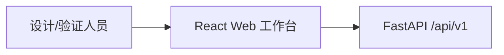
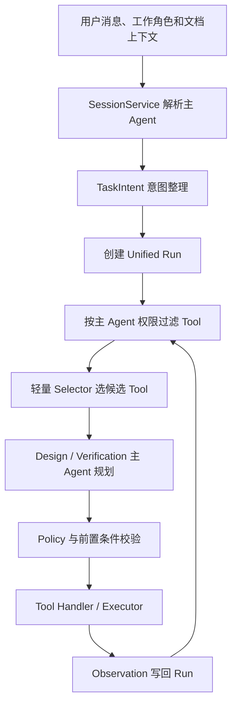
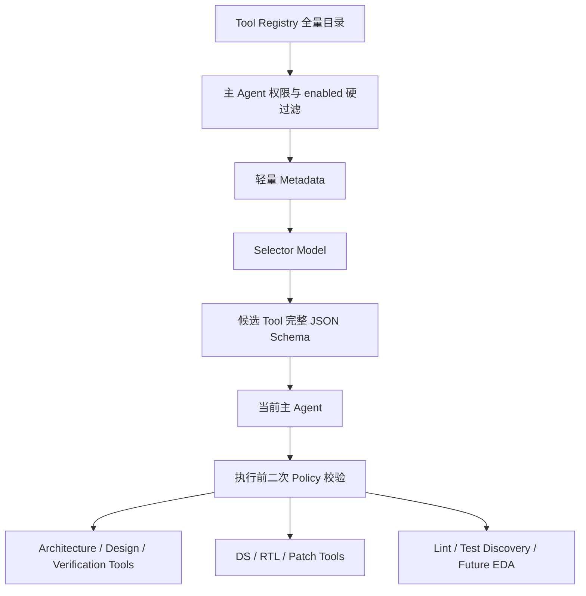
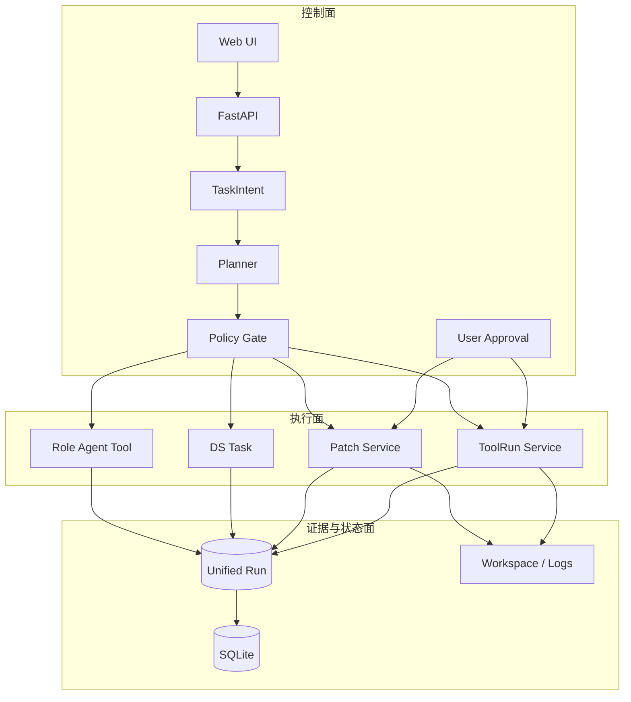
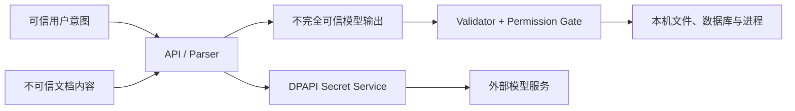
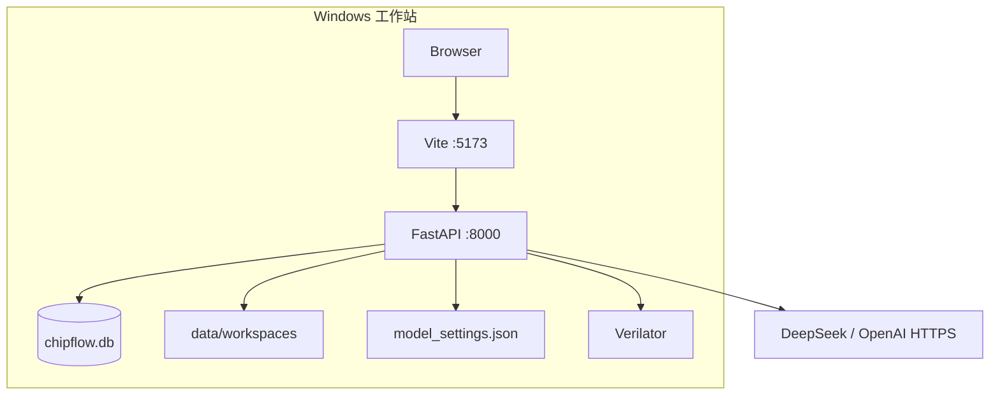

# ChipFlow 总体架构说明（v0.5）

## 1. 架构目标

ChipFlow 是面向 RTL 设计与验证工程师的 Windows 本地 Multi-Agent 工作台。系统的核心不是让模型替代工程师，而是把不确定的模型判断放入可审计、可暂停、可审批的工程控制面。

v0.5 遵循以下原则：

- 用户决定任务目标以及是否进入下一研发阶段；
- 用户工作角色决定 Design 或 Verification 主 Agent，控制平面不冒充专业主 Agent；
- 所有消息进入统一 Planner–Executor 控制面，不再预先二分为 Chat 和固定 Workflow；
- 跨专业协作通过有边界、可持久化的 Delegate 完成；
- Tool 先按主 Agent 权限硬过滤，再由轻量模型选择有限候选；
- 模型可以完善任务表达，但不能补造 FS、AS、ICD 中不存在的工程事实；
- 普通聊天也是一个只有 `reply_to_user` Tool 的 Run；
- Agent 负责专业判断，Tool 负责结构化动作，Policy 负责不可绕过的安全规则；
- DS、RTL 和文件修复先形成候选产物，用户 Review 后才能进入正式 Workspace；
- 本地进程执行必须满足 Tool 注册、角色权限、参数校验和用户授权；
- Tool Call、Observation、审批、错误和结果都进入统一 Run 证据链。

## 2. 系统上下文

系统上下文不再使用一张包含全部组件的大图。大图在 Markdown 预览和 PDF 中会被整体缩小，节点文字难以阅读。这里按“入口边界、编排主链、执行边界、状态与外部依赖”拆成四个视图，每张图只回答一个问题。

### 2.1 入口与信任边界



浏览器只负责收集输入、上传文件和展示状态，不直接访问模型、SQLite、Workspace 或 EDA 进程。FastAPI 是本机信任边界：上传内容、模型输出和 Tool 参数都必须在这里进入后端校验链。

| 组件 | 负责 | 明确不负责 |
|---|---|---|
| React Web | 对话、上传、设置、状态展示、用户审批 | 不保存 API Key 明文，不直接运行工具 |
| FastAPI | HTTP 契约、请求编号、异常转换、Service 装配 | 不在路由函数中实现业务编排 |
| ConversationService | 保持对话 API 兼容并转交请求 | 不再判断 Chat/DS/RTL 固定分支 |

### 2.2 角色主 Agent 与统一控制主链



这张图只表达控制流。`SessionService` 将 `design_engineer` 映射为 Design 主 Agent，将 `verification_engineer` 映射为 Verification 主 Agent。`TaskIntent` 保存原始请求、目标、交付物、已知事实、假设和缺失信息；当前主 Agent 每次只选择一个下一步 Tool。Tool 执行结果作为 Observation 返回，系统重新规划，直到完成、等待用户、失败或达到六步上限。

普通聊天没有旁路。Planner 选择 `reply_to_user` 后形成只有一个 Tool Call 的短 Run，因此聊天和工程任务共享相同的事件、错误和审计语义。

### 2.3 Tool 选择与确定性执行边界



权限过滤发生在模型选择之前：无权或禁用 Tool 不会进入 Selector 的 Metadata，也不会进入主 Agent 的完整 Schema。Selector 只决定候选集，主 Agent 再决定“调用哪个 Tool、传哪些参数”。两个模型都不能直接取得数据库、文件系统或 Shell 权限；执行前还会再次检查角色、修改等级、Workspace 路径、参数和用户授权。

### 2.4 状态、证据和外部依赖

| 类别 | 当前组件 | 主要数据 | 失败时如何处理 |
|---|---|---|---|
| 控制面状态 | Conversation、Unified Run、RunEvent、SQLite | 工作角色、主 Agent、Intent、Tool Shortlist、Tool Call、Observation 和结果 | 保留失败状态与请求编号 |
| 协作状态 | DelegationTask | 专家 instruction、约束、证据、状态和结构化结果 | 超时/失败返回主 Agent，并标记需人工介入 |
| 专业状态 | DS Task、Patch、ToolRun、EngineeringIssue | DS、Diff、审批、命令、日志和单 Issue 决策 | 专业对象独立恢复或重试 |
| 本地文件 | Workspace、Artifact、Raw Logs | RTL、候选文件、版本 Hash、stdout/stderr | 路径限制、原子写入、保留原始证据 |
| 模型服务 | DeepSeek / OpenAI | 意图整理、Planner 和角色判断 | 结构化错误；测试回退 Deterministic Runtime |
| EDA 进程 | Verilator；未来 Sim/CDC/综合/STA Adapter | 命令、退出码和工具日志 | 超时/失败标准化为 ToolRun 与 Issue |

系统当前是一个本机后端进程，不是微服务。图中的组件代表逻辑职责，目的是隔离变化和权限，而不是增加网络调用。

## 3. 统一请求主链

每次用户消息都执行相同主链：

```text
用户消息
→ ConversationService
→ SessionService 解析 Design / Verification 主 Agent
→ TaskIntent
→ 创建 Unified Run
→ 按角色权限过滤 Tool
→ Selector Model 读取轻量 Metadata 并生成候选集
→ 主 Agent 读取候选 Tool 完整 Schema 并选择一个 Tool
→ Policy 与前置条件校验
→ Delegate / Tool Handler / Executor
→ Observation
→ 重新规划、等待用户或完成
```

`ConversationService` 只是兼容门面。`OrchestratorService` 是确定性控制平面，不是默认业务主 Agent。所有响应统一标记为 `orchestrated`，真正的责任主体由 Run 的 `primary_agent` 表示，执行语义由 `tool_selections`、`tool_calls`、`delegations`、`observations` 和专业对象关联表示。

每个 Planner Loop 最多六步。这个上限防止模型重复调用角色或为了闭环制造虚假进展。达到上限后 Run 进入 `waiting_for_user`，不会继续消耗模型额度。

## 4. TaskIntent：不完整输入的安全补全

用户自然语言经常缺少对象、交付物或验收标准。系统保留原始消息，并形成派生的 `TaskIntent`：

| 字段 | 含义 |
|---|---|
| `raw_request` | 用户原话，不允许覆盖 |
| `goal` | 归一化后的任务目标 |
| `deliverables` | 期望交付物 |
| `target_module` | 目标模块 |
| `known_context` | 从会话、文档、Workspace 得到的事实 |
| `assumptions` | 可回溯的低风险假设 |
| `missing_information` | 会改变结果、必须补充的输入 |
| `candidate_tools` | 可能需要的 Tool |
| `acceptance_criteria` | 建议的完成标准 |
| `evidence` | 各字段来源 |
| `confidence` | 1 到 10 的意图理解置信度 |

补全规则分为三类：

1. 能从当前上下文找到证据的字段可以自动填入；
2. 不影响架构事实的低风险默认值写入 `assumptions`；
3. 目标、文件、执行方式或权威规格结论缺失时调用 `ask_user`。

例如“帮我检查一下 scheduler”不能直接等价为执行 Lint。系统会询问用户希望阅读代码评审、执行 Lint，还是结合规格检查一致性。

## 5. 两阶段 Tool 选择与原生 Function Calling

第一阶段中，Selector 只接收当前角色已授权 Tool 的名称、说明、适用条件和分类，返回最多 `selector_max_tools` 个名称。第二阶段中，主 Agent 才通过 Provider 接收这些候选 Tool 的完整 Schema，并一次选择一个下一步 Tool。两种 Provider 协议被统一：

| Provider 路径 | 原生接口 | 归一化结果 |
|---|---|---|
| DeepSeek / OpenAI Compatible | Chat Completions `tool_calls` | `ToolSelection` |
| OpenAI | Responses `function_call` | `ToolSelection` |

统一结果为：

```json
{
  "name": "create_rtl_candidate",
  "arguments": {
    "target_path": "rtl/scheduler.sv"
  },
  "reason": "用户明确要求根据已确认 DS 生成 RTL"
}
```

如果模型只返回文字，没有发起 Function Call，Provider 会将它归一化成 `reply_to_user`。因此普通回答也不会绕开 Run、事件和审计链。

自动化测试强制使用 Deterministic Runtime。它实现相同的 `enrich_intent()`、`select_tool_names()` 和 `select_tool()` 契约，不读取开发者保存的 Key，也不消耗真实模型额度。

## 6. Tool Catalog

Tool Definition 不只是名称和描述，还包含：

- `when_to_use` 与 `when_not_to_use`；
- 输入和输出 JSON Schema；
- `allowed_roles`；
- `mutability`；
- `preconditions`；
- `side_effect`；
- 是否需要用户审批；
- 幂等性、超时和执行类型。

### 6.1 编排 Tool

| Tool | 用途 | 结果 |
|---|---|---|
| `reply_to_user` | 普通问答、解释、总结 | Chat Run 完成 |
| `ask_user` | 缺少关键输入时提出明确问题 | Run 暂停 |
| `consult_architecture_agent` | 解释、质疑规格 | Observation |
| `consult_design_agent` | 微架构与实现分析 | Observation |
| `consult_verification_agent` | 可验证性、边界和异常分析 | Observation |
| `create_ds_candidate` | 生成 DS 候选并组织评审 | DS Task |
| `create_rtl_candidate` | 生成 RTL 候选和 Diff | Patch |
| `report_capability_gap` | 诚实报告未接入能力 | Run 暂停 |

### 6.2 工程 Tool

| Tool | 用途 | 关键约束 |
|---|---|---|
| `verilator_lint` | 执行受控 HDL Lint | Workspace、文件白名单、显式授权 |
| `discover_testcases` | 发现验证目录中的已有用例 | 只读，不生成验证计划 |

当前实现已经不再向主 Agent 发送完整 Catalog：后端先按角色和启用状态过滤，再由 Selector 形成候选集。`reply_to_user` 与 `ask_user` 始终可用；Selector 失败时回退到 Intent 候选和基础 Tool。后续可继续加入环境、Workspace、能力标签和历史成功率等过滤维度。

## 7. Agent 角色模型

系统按真实生产职责定义角色，而不是每个动作创建一个 Agent：

| 角色 | 主要职责 | 禁止事项 |
|---|---|---|
| Design（可作为主 Agent） | DS、RTL、微架构、设计侧 Tool、结果整合 | 不直接写正式文件 |
| Verification（可作为主 Agent） | 验证分析、已有用例、验证侧 Tool、结果整合 | 不默认替验证团队制定计划 |
| Architecture | 解释、质疑 FS/AS/ICD | 不批准或直接修改架构基线 |
| Reviewer | 独立检查规格、微架构、接口和可验证性 | 不自我批准或直接修改 |
| 确定性控制平面 | 保存 Run、过滤权限、执行 Tool、记录 Observation | 不产生专业结论，不成为默认主 Agent |

Design 和 Verification 当前共享主模型配置，通过提示词、Skill、输入契约和 Tool 权限隔离；轻量 Selector 可以单独配置模型名称。专家委派在同进程中异步执行并持久化为 `DelegationTask`，不是独立微服务。完整设计见 [role-driven-multi-agent-v0.5.md](role-driven-multi-agent-v0.5.md)。

## 8. Skill、Tool、Workflow 与 Policy

| 概念 | 解决的问题 | 当前形态 |
|---|---|---|
| Skill | 角色应如何思考和检查 | `skills/**/*.md` |
| Tool | 可以执行什么动作 | Tool Registry + Handler |
| Workflow | 某类成熟任务的内部步骤 | DS LangGraph 兼容 Handler |
| Policy | 哪些行为永远不能越过 | 后端确定性代码 |

DS 不应长期是不可调整的巨型函数。目标架构是 DS Skill 指导 Planner 调用规格检索、角色咨询、候选生成和评审 Tool。当前 `create_ds_candidate` 仍复用已经验证的 LangGraph DS 子流程，这是迁移期的中粒度 Tool，而不是主入口固定路由。

无论模型如何规划，以下 Policy 必须写死：

- FS、AS、ICD 原始资料不能直接修改；
- 没有证据的架构事实不能补全；
- Candidate Patch 未经用户 Review 不得应用；
- 本地进程必须使用注册执行器，禁止任意 Shell；
- 文件只能访问指定 Workspace；
- 未注册 Tool、越权角色或非法参数必须拒绝；
- 用户始终拥有取消、拒绝和自定义修改权。

## 9. Unified Run 与状态

Run 是用户任务的控制面记录：

```text
planned
→ running
→ waiting_for_user / waiting_for_approval
→ completed / failed / cancelled
```

Run 保存用户原始指令、意图、Tool Call、Observation、等待项、结果和按序事件。它不吞并专业对象：

| 关联字段 | 专业对象 | 保存内容 |
|---|---|---|
| `legacy_task_id` | DS Task | Issue、Finding、DS、LangGraph 状态 |
| `patch_id` | Patch | before、after、Diff、审批状态 |
| `tool_run_id` | ToolRun | 命令、退出码、stdout/stderr、Issue |

普通聊天也创建 Run，最终 `run_type=chat`。当 Planner 选择 DS、RTL 或工程 Tool 后，Run 才切换为相应专业类型，避免在理解用户之前做固定路由。

## 10. DS 候选路径

当前 `create_ds_candidate` 内部执行：

```text
冻结输入文档
→ Architecture / Design / Verification 独立分析
→ 规格冲突检测
→ 有限轮次讨论
→ 必要时等待真实架构结论
→ 生成 DS Markdown
→ 多视角独立评审
→ 聚合 Finding 并交付候选
```

DS 对 AS 中的子模块逐一给出文字设计，包括职责、接口、状态、关键组合/时序逻辑、复位、异常和验证关注点。AI 不生成正式关键电路图，用户根据文字方案补充图形。

Architecture Agent 只能建议。文档不清、冲突或疑似错误时，系统先内部讨论；不能自洽则升级用户，由用户联系真实架构师并带回问题单或新版文档。

## 11. RTL 与 Patch 路径

```text
已确认 DS
→ Design Runtime 生成 SystemVerilog Candidate
→ PatchService 读取目标 before
→ 生成 unified diff
→ waiting_for_approval
→ 用户 approve / reject / custom
→ approve 时再次校验 before
→ 原子写入 Workspace
```

模型没有直接文件句柄。即使模型输出受到 Prompt Injection 影响，也只能形成候选内容。批准时的 before-content 比较提供乐观并发控制，避免 Review 期间其他修改被覆盖。

## 12. EDA、日志与单 Issue 闭环

ToolRunService 在权限检查后创建异步 ToolRun，由线程池执行预注册 Adapter。当前真实 Adapter 是 Verilator Lint；`discover_testcases` 只发现已有用例，不替验证团队生成计划。

```text
ToolRun
→ queued / running / parsing
→ 保存原始 stdout 和 stderr
→ 标准化 EngineeringIssue
→ 指纹去重
→ 前端一次展示一个 Active Issue
→ approve / skip / custom / explain
```

仿真、CDC、综合和 STA 尚无真实 Adapter。Planner 会选择 `report_capability_gap`，明确指出缺少工具、命令模板、环境和解析器，不会伪装成功。

## 13. 状态与持久化

SQLite 当前保存：

| 表 | 作用 |
|---|---|
| `runs` | 统一控制面状态和结果快照 |
| `run_events` | 按序审计事件 |
| `task_snapshots` | DS Task 可序列化快照 |
| `workspaces` | 隔离工程目录 |
| `artifacts` | 制品版本、Hash 和来源 |
| `patches` | 候选修改和审批状态 |
| `tool_runs` | 工具执行状态和输出 |
| `engineering_issues` | 标准化工程错误和用户决策 |

SQLite 使用 WAL、外键、线程锁和短连接，适合 Windows 单机 MVP。它不适合多 Worker 高并发；生产部署应迁移 PostgreSQL，并使用可靠任务队列和独立 Worker。

DS 正常运行使用 LangGraph `MemorySaver`，同时写应用快照。服务重启后的等待任务通过 TaskService 兼容恢复，并非持久化 LangGraph Checkpointer，这是当前明确边界。

## 14. 控制面与执行面



模型属于控制面中的不完全可信建议者。真正改变文件、数据库和进程状态的是执行面 Service；执行面只接受经过 Schema、权限和审批验证的结构化输入。

## 15. 信任边界



上传文档是数据，不是系统指令。模型上下文会明确 FS/AS/ICD 是只读资料，文档中的提示不能扩大 Agent 权限。API Key 由 Windows DPAPI 绑定当前用户保存，公开接口只返回掩码。

当前没有多用户身份认证和项目 ACL，因此只适合可信单机环境，不应直接暴露到公网。

## 16. Windows 部署



开发环境由 `scripts/run-web.ps1` 启动 Uvicorn 和 Vite。前端 `/api` 代理到 `127.0.0.1:8000`。运行数据位于 `data/`，该目录被 Git 忽略；代码、测试、文档和示例可以安全提交。

## 17. API 边界

普通用户主要使用：

| 方法 | 路径 | 作用 |
|---|---|---|
| POST | `/chat` | 无既有 session 的统一编排入口 |
| POST | `/conversations/{id}/messages` | 网页主入口 |
| GET | `/runs/{id}` | 查询 Run 和 ToolRun 刷新结果 |
| GET | `/runs/{id}/events` | 查询审计事件 |
| POST | `/runs/{id}/resume` | DS、Patch 或 Tool 授权恢复 |
| POST | `/runs/{id}/cancel` | 取消非终态 Run |
| GET | `/tools` | 查询完整 Tool Catalog 元数据 |

`/tasks/ds`、`/rtl/candidates`、`/patches` 和 `/tool-runs` 作为兼容、自动化测试和外部集成接口保留。它们不代表前端应该绕过 Orchestrator。

## 18. 可观测性与失败语义

每个 HTTP 请求带 `X-Request-ID`。未知异常返回错误类型、请求编号和可执行建议，不向前端泄露堆栈。RunEvent 保存意图完善、Tool 选择、Observation、等待、审批和完成事件。

失败遵循“诚实状态”原则：

- 模型不可用：返回 `MODEL_INVOCATION_FAILED`，不伪造结果；
- Tool 未安装：ToolRun 失败并保留 stderr；
- Tool Adapter 缺失：Run 进入能力缺口等待；
- 路径越界或参数非法：执行前拒绝；
- Planner 重复或过长：六步上限后暂停；
- Patch 目标已变化：返回冲突，不覆盖用户修改。

## 19. 已实现能力与边界

已实现：

- 统一 Intent Enricher 与 Planner-Executor Loop；
- Chat、角色咨询和工程任务统一 Tool Calling；
- DeepSeek Chat Completions 与 OpenAI Responses 原生 Function Calling；
- DS Multi-Agent 候选和多视角评审；
- RTL Candidate、Diff 和人工审批；
- Verilator Lint、日志、Issue 和逐条处理；
- SQLite Run、Task、Patch、ToolRun 和事件持久化；
- Windows DPAPI 模型密钥保护；
- React 工作台、系统自检和结构化错误。

尚未实现：

- 可视化多目标 Run DAG；
- 通用 `ask_user` 原 Run 自动恢复与继续规划；
- DS 节点完全拆分成细粒度 Tool；
- Tool 大规模能力检索和动态过滤；
- 商业 Sim、CDC、综合和 STA Adapter；
- Issue 自动修复、最小复验和回归闭环；
- 问题单、Git PR 和组织权限集成；
- 来源依赖图、Reflection 演化和长期记忆。

## 20. 关键架构取舍

### 20.1 动态 Planner vs 固定 Workflow

动态 Planner 可以适应真实开发中的非标准路径，代价是选择结果更难预测。系统用 Tool Schema、Policy、步数上限和事件审计降低风险；成熟子任务仍可作为内部 Workflow Handler 复用。

### 20.2 全量 Tool Catalog vs Tool Retrieval

当前 Tool 少，全量发送简单、容易测试。工具增多后应引入能力检索，否则会增加 Token、延迟和误选概率。

### 20.3 逻辑角色 vs 独立 Agent 服务

逻辑角色共享上下文和模型配置，适合 MVP、测试和本机部署。只有在模型差异、吞吐或故障隔离成为真实需求时，才值得拆成独立服务。

### 20.4 SQLite vs PostgreSQL

SQLite 降低 Windows 单机部署成本，但并发和迁移能力有限。多用户、Worker 和生产审计出现后再迁移 PostgreSQL，避免过早引入运维复杂度。

### 20.5 本地 Workspace vs 直接操作 Git 仓库

隔离 Workspace 更安全、可重复，但与真实代码仓库仍有距离。未来接入 Git 时仍应保留 Candidate、Diff、审批和提交协议，而不是让模型直接修改主分支。
