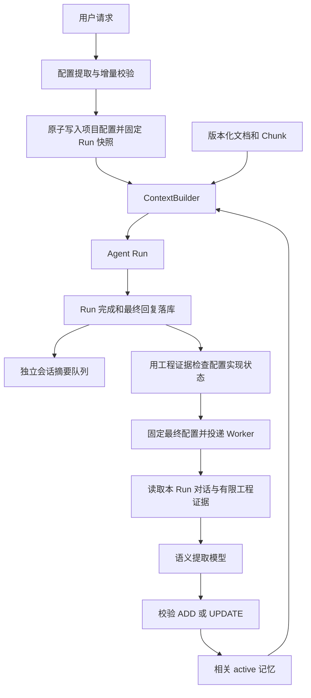

# 上下文与长期记忆子系统

> 本文用于快速理解架构边界。需要结合当前代码查看数据表、算法、预算、失败路径、API、示例和测试时，请阅读[《上下文构建与长期记忆实现详解》](context-memory-implementation.md)。

## 1. 目标与边界

系统把上下文分成四层，避免把聊天、模型推断和正式工程事实混为一谈：

| 层 | 内容 | 生命周期 | 主要存储 |
|---|---|---|---|
| L0 当前执行状态 | 当前请求、Run、Observation、审批与执行进度 | 单次 Run | `runs`、`run_events` |
| L1 短期记忆 | 最近 5 轮完整原文、较早 30 轮独立摘要 | Session | `conversation_messages`、`conversation_turn_summaries` |
| L2 长期记忆 | 稳定偏好、长期约定、设计理由和经过验证的经验 | Project / Module | `memories`、`memory_sources`、`memory_relations` |
| L3 原始证据 | 规格、RTL、Artifact、Tool 日志及版本 | 长期版本化保存 | `document_versions`、`document_chunks`、Workspace |

LLM 生成的摘要、推断和专家建议不是正式事实。原始消息和历史证据不因摘要、文档换版或记忆替代而删除。

## 2. 总体流程



## 3. 会话摘要

一轮由一条 User Request 和对应的最终 Assistant Response 组成。新消息通过同一个 `turn_id` 关联；旧数据库中没有 `turn_id` 的消息按稳定 sequence 使用“User + 后续第一条 Assistant”兼容配对。工具调用和工具结果不作为独立消息轮次。

`ContextBuilderService` 只读已持久化结果：最近 5 个完整轮次以最多 10 条原文注入，更早部分只考察最近 30 个完整轮次。每个较早轮次若有 `completed` 摘要则注入独立 JSON；若摘要仍为 pending、processing、failed 或尚未创建，则整轮回退为 User/Assistant 原文。摘要和原文不会重复注入，预算筛选也不会拆散半轮。

摘要生成发生在最终 Assistant 消息持久化之后。普通聊天和 Run Resume 都调用 `ConversationSummaryService.enqueue_turn()`，由最多 2 个 Worker、最多 32 个待处理槽位的有界线程池执行。任务以 `turn_id` 唯一 Upsert，状态为 pending、processing、completed 或 failed，并保留尝试次数和错误；`retry_failed_summaries()` 可重新投递失败或排队任务。生成失败不会改变已经成功的用户响应。

每轮摘要只把该轮的两条消息发送给模型，不读取旧摘要，也不做增量合并。结构化字段包括 topic、module、user_intent、key_information、decisions、constraints、assumptions、inferences、open_questions 和 keywords。目标长度 150–250 Token，超过 500 Token 时重新压缩；压缩后仍超限则标记 failed，不保存超长 completed 摘要。用户确认与 Assistant 建议通过来源消息 ID 和 confirmation_status 区分。

旧 `conversation_summaries` 和 `conversation_role_summaries` 均保留用于兼容和审计，但 ContextBuilder 不再读取或刷新它们。

### 项目配置

`ConfigExtractorService` 在 Legacy 和 Hierarchical Chat 构建上下文之前读取当前请求、同角色最近 3 轮完整对话、当前模块配置。模型只提出增量更新，后端校验项目、模块、用户原文证据和配置项 revision。项目配置存于已登记 Workspace 的 `.chipflow/design-config.json`。相同值保留原版本和实现状态。

Run 固定自己读到的配置版本。完成检查只使用该 Run 关联的已应用 Patch、当前有效 RTL 快照或通过验收的工程与仿真证据。Lint 和未绑定要求的仿真最多支持 `implemented`。匹配配置目标的用例通过后可标为 `verified`。配置版本有变化时，旧 Run 的结果保留原有快照。

## 4. Run 级长期记忆提取

Legacy 聊天、Legacy Resume 和分层执行的完成路径在最终回复提交后调用 `enqueue_run()`。文档版本通过 RAG 管理，委派结论作为父 Run 的执行证据。

每个 Run 对应一条 `run:<run_id>` 事件。线程池默认有 2 个 Worker 和 32 个槽位，队满时事件保留为 `pending`。启动恢复和周期扫描会重新投递待处理、到期失败和租约过期的事件。空结果也会标记为 `completed`。事件与记忆写入同一事务。

Worker 读取同一 Run 的原始请求、恢复对话、最终答复、精选工程证据、最终配置快照和最多五条相关记忆。配置中可识别的精确重复项在入库前跳过。生产提取使用已启用的 DeepSeek 主模型，固定地址为 `https://api.deepseek.com`。端到端回归使用本地模型替身。

## 5. 语义记忆和来源

ADD 在项目、模块和角色范围内比较规范化正文。重复项复用 Memory ID 并关联当前 Run。新记录直接保存为 `active`、`semantic`，使用来源 Run 的主角色作为私有记忆的 owner。

UPDATE 只允许操作传给模型、且正文版本未变化的同范围 active 语义记忆。如果正文变更，旧来源标为失效并保留历史，再追加当前 Run 来源。非法目标跳过。

历史数据和 `POST /memories`、查询与 `promote` 接口继续可用。显式治理中的同键冲突和替代仍沿用旧流程，历史候选保留原状态。

## 6. 文档换版与来源级失效

文档身份、版本、Chunk 和关联记忆更新位于一个 SQLite 事务中：

```text
读取当前 active 版本
→ 标记旧 version/chunk 为 superseded
→ 将对应 memory_source 标记为 invalidated
→ 检查每条 Memory 的其他 active 来源
→ 写入新 version 和 chunks
→ 一次提交
```

没有其他有效来源的 active 记忆变为 `stale`；仍有独立来源的记忆保持 active，但记录
`review_reason`。历史版本、来源和记忆都不会删除。重新上传完全相同的历史版本是幂等查询，不会意外恢复为 active；显式“恢复旧版本”仍需要后续单独的治理接口。

## 7. 两阶段长期记忆检索

第一阶段进行确定性过滤：

- `project_id`、`module_name`；
- 默认只允许 `active`；
- `project_shared` 或当前 Agent 自己的 `role_private`；
- active semantic、fact 和 decision 必须仍有 active 来源；
- Delegate 使用 `shared_only=True`，不会取得主 Agent 私有记忆。

第二阶段计算关键词交集、importance、confidence、authority 和作用域匹配度。默认取最多 5 条。普通记忆须满足最低关键词相关性，旧版高重要性 fact/decision 可作为关键约束参与排序。运行时只接收 ID、类型和正文，Manifest 记录分数和选择原因。

## 8. 统一 Token 预算

默认总预算为 32,000 Token，并根据主模型 `max_output_tokens` 调整输出预留。默认参考额度：

| 区段 | Token |
|---|---:|
| System / Tool Schema | 4,000 |
| 当前请求与 Run | 3,000 |
| 最近 5 轮完整原文 | 6,000 |
| 较早 30 轮摘要/原文回退 | 6,000 |
| 项目配置 | 2,500 |
| 长期记忆 | 2,000 |
| RAG 文档 | 12,000 |
| 输出安全预留 | 3,000（至少） |

当前请求和安全预留先占用预算；最近完整轮次优先，较早摘要或回退原文随后按整轮选择；长期记忆优先关键约束；文档最后使用剩余额度。本轮刚提交的文档即使查询相关性为零，也作为当前请求证据保留候选，避免破坏 DS/RTL 工作流。

如果强制保留区本身超过总预算，Builder 明确报错。其他未入选项记录类别、ID、Token、分数和原因，不静默丢弃。Runtime 仍保留最后一道输入安全阀。

## 9. Context Manifest

Manifest 描述实际发送给模型的上下文，包括：

- 实际消息、原始 `turn_id`、独立 `turn_summary_id`、Memory 和 Document Chunk ID；
- 摘要轮次、原文回退轮次及各自实际 Token；
- Memory 与 Chunk 的检索分数和选择原因；
- 所有超预算或零相关候选的排除原因；
- System/Run/Output 预留、各区实际 Token、未用额度和最终估算；
- `prompt_hash` 与 `context_version`。

`GET /api/v1/runs/{run_id}/contexts` 可用于复现一次 Run 当时看到的证据范围。

## 10. Multi-Agent 隔离

- Design / Verification 的消息原文和摘要按角色隔离；
- 已批准项目事实和正式文档通过 `project_shared` 跨角色共享；
- 私有 Memory 必须带 `owner_agent_role`；
- Delegate 始终保留 `history: []`，只注入与 instruction 相关的共享 active Memory；
- Expert 建议由父 Run 提取器结合实际执行证据判断；
- 主 Agent 始终保留控制权，不发生 Handoff。

## 11. 当前边界

- 关键词/本地语义检索仍基于 SQLite 与确定性特征，没有引入外部向量数据库；
- 文档历史版本可审计，但显式恢复某个 superseded 版本尚无独立 API；
- 多用户部署仍需在当前角色模型之前增加真实身份认证与项目 ACL；
- 独立摘要在完整轮次落库后生成，较早轮次进入上下文时才读取。
