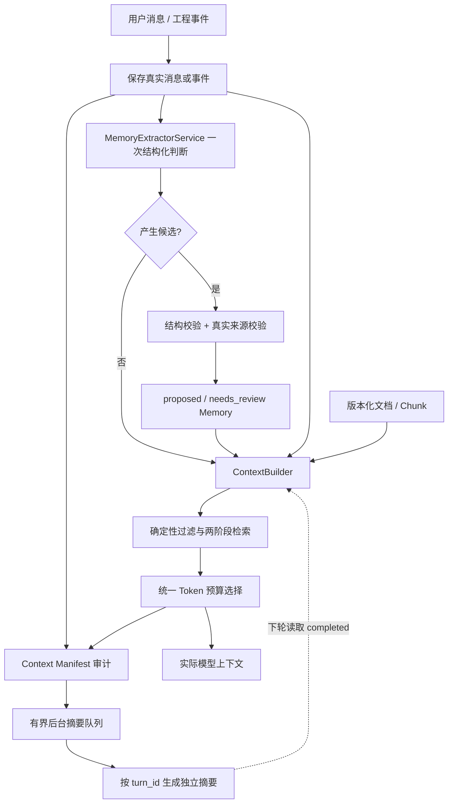
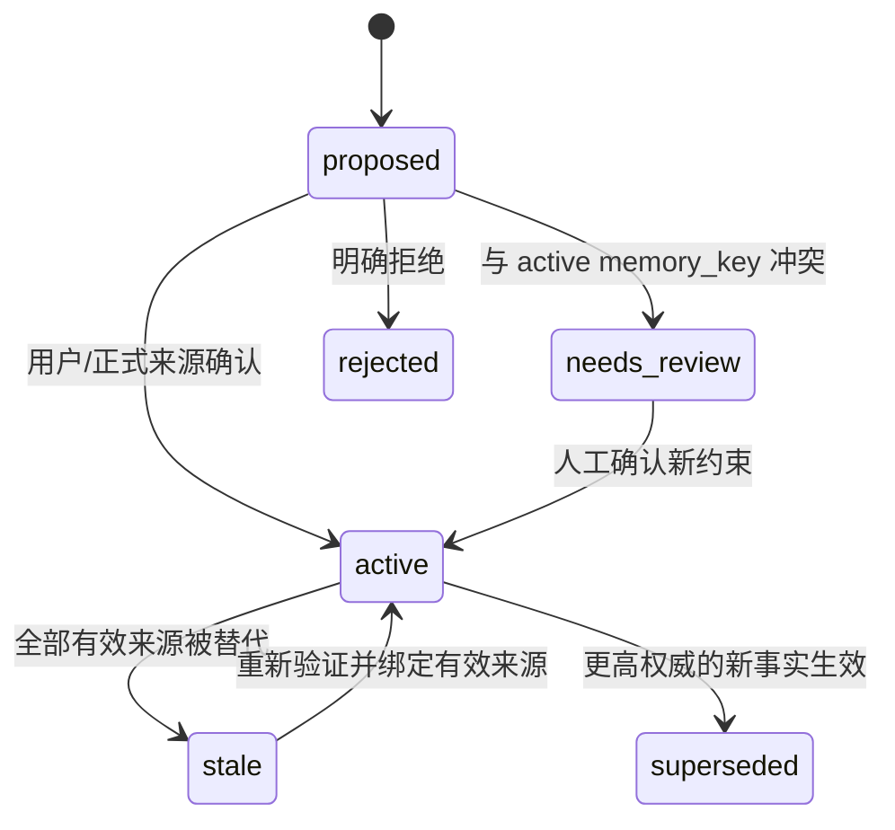

# 上下文与长期记忆子系统

> 本文用于快速理解架构边界。需要结合当前代码查看数据表、算法、预算、失败路径、API、示例和测试时，请阅读[《上下文构建与长期记忆实现详解》](context-memory-implementation.md)。

## 1. 目标与边界

系统把上下文分成四层，避免把聊天、模型推断和正式工程事实混为一谈：

| 层 | 内容 | 生命周期 | 主要存储 |
|---|---|---|---|
| L0 当前执行状态 | 当前请求、Run、Observation、审批与执行进度 | 单次 Run | `runs`、`run_events` |
| L1 短期记忆 | 最近 5 轮完整原文、较早 30 轮独立摘要 | Session | `conversation_messages`、`conversation_turn_summaries` |
| L2 长期记忆 | 项目事实、设计约束、正式决策、工程经验 | Project / Module | `memories`、`memory_sources`、`memory_relations` |
| L3 原始证据 | 规格、RTL、Artifact、Tool 日志及版本 | 长期版本化保存 | `document_versions`、`document_chunks`、Workspace |

LLM 生成的摘要、推断和专家建议不是正式事实。原始消息和历史证据不因摘要、文档换版或记忆替代而删除。

## 2. 总体流程



## 3. 会话摘要

一轮由一条 User Request 和对应的最终 Assistant Response 组成。新消息通过同一个 `turn_id` 关联；旧数据库中没有 `turn_id` 的消息按稳定 sequence 使用“User + 后续第一条 Assistant”兼容配对。工具调用和工具结果不作为独立消息轮次。

`ContextBuilderService` 只读已持久化结果：最近 5 个完整轮次以最多 10 条原文注入，更早部分只考察最近 30 个完整轮次。每个较早轮次若有 `completed` 摘要则注入独立 JSON；若摘要仍为 pending、processing、failed 或尚未创建，则整轮回退为 User/Assistant 原文。摘要和原文不会重复注入，预算筛选也不会拆散半轮。

摘要生成发生在最终 Assistant 消息持久化之后。普通聊天和 Run Resume 都调用 `ConversationSummaryService.enqueue_turn()`，由最多 2 个 Worker、最多 32 个待处理槽位的有界线程池执行。任务以 `turn_id` 唯一 Upsert，状态为 pending、processing、completed 或 failed，并保留尝试次数和错误；`retry_failed_summaries()` 可重新投递失败或排队任务。生成失败不会改变已经成功的用户响应。

每轮摘要只把该轮的两条消息发送给模型，不读取旧摘要，也不做增量合并。结构化字段包括 topic、module、user_intent、key_information、decisions、constraints、assumptions、inferences、open_questions 和 keywords。目标长度 150–250 Token，超过 500 Token 时重新压缩；压缩后仍超限则标记 failed，不保存超长 completed 摘要。用户确认与 Assistant 建议通过来源消息 ID 和 confirmation_status 区分。

旧 `conversation_summaries` 和 `conversation_role_summaries` 均保留用于兼容和审计，但 ContextBuilder 不再读取或刷新它们。

## 4. 自动长期记忆提取

`MemoryExtractorService` 对每条新用户消息执行一次结构化模型判断，不再用关键词或时钟正则预筛选。模型判断当前消息是否明确新增、确认或修订了对后续工作有价值的事实、约束、决策、偏好或经验；纯提问、闲聊和未确认设想返回空候选。一条消息可以生成多个独立候选，因此自然语言描述的时钟、复位、接口、位宽、FIFO 深度和验证结论都走同一条路径。

消息提取会携带最多 6 条当前角色可见的近期消息以及最多 6 条相关 active Memory，并设置独立 Token 上限。前文和旧记忆只能用于消解“第二种”“改成 32”等指代、识别修订和复用已有 `memory_key`，候选必须在当前消息中有依据。Run 的“按临时假设继续”会由后端强制降级为 `assumption`，不能形成 fact/decision。

正式文档版本、完成 Run 和 Delegate 结论继续复用同一个 `_model_candidates()`，但不携带会话前文。每个事件写入 `memory_extraction_events`，以 `source_type:source_id` 幂等；完成消息在准备上下文和调用模型之前直接复用已有结果，失败保存原因和尝试次数，可安全重试。

去重分为模型提示、单批候选和跨事件存储三层。Prompt 要求模型对同一工程属性只输出一个稳定的小写点分键；后端仍会对 `memory_key` 做 NFKC、大小写和 `-`/`_`/`.` 统一，对正文去除空白、标点及少量不改变事实的表述词。单批完全相同的候选只保留一条并吸收更高的置信度和重要性。不同消息、Run 或文档再次提取到同一候选时，`MemoryService` 复用原 Memory 并追加来源，不覆盖原正文、状态、authority 或评分。

这是一种保守的确定性精确去重，不使用模糊相似度或额外模型调用。相同规范化键但内容不同的候选不会合并，而是进入 `needs_review`；不同工程属性、不同知识类型以及不同 `role_private` owner 也不会误合并。候选 `extraction_key` 由事件、类型、规范化键和规范化正文生成，不依赖模型返回顺序，因此失败重试时调换候选顺序也不会重复入库。

模型只返回候选字段，不能直接更新数据库。Service 会检查：

- `memory_key` 格式、类型、置信度和重要性；
- 来源 ID 在消息、文档、Run、Delegate 或 Patch 表中真实存在；
- Run、Delegate、Patch 等权威来源已经处于对应完成/应用状态；
- `extraction_key` 未被处理过，或规范化后的逻辑候选可安全合并来源。

自动提取结果始终是 `proposed`，与现有 active 事实冲突时进入 `needs_review`。

## 5. 生命周期、冲突与权威性



`fact` 和 `decision` 成为 active 时必须有可追溯来源。自动提取、模型摘要、Agent 建议和 Delegate 结论不能自动成为 active。当前系统允许以下方式激活：

- `POST /memories/{id}/promote`，并提供真实用户确认、正式文档、已完成 Run 或已应用 Patch 等来源；
- 兼容旧 API 的显式 active 创建，但同样必须通过来源校验。

同一 `memory_key` 的新事实正式生效时，旧 active 事实原子地变为 `superseded`，并在 `memory_relations` 中建立 `supersedes` 关系。默认检索不会同时返回冲突的新旧事实。

## 6. 文档换版与来源级失效

文档身份、版本、Chunk 和关联记忆更新位于一个 SQLite 事务中：

```text
读取当前 active 版本
→ 标记旧 version/chunk 为 superseded
→ 将对应 memory_source 标记为 invalidated
→ 检查每条 Memory 的其他 active 来源
→ 写入新 version 和 chunks
→ 一次提交
```

没有其他有效来源的 active 记忆变为 `stale`；仍有独立来源的记忆保持 active，但记录
`review_reason`。历史版本、来源和记忆都不会删除。重新上传完全相同的历史版本是幂等查询，不会意外恢复为 active；显式“恢复旧版本”仍需要后续单独的治理接口。

## 7. 两阶段长期记忆检索

第一阶段进行确定性过滤：

- `project_id`、`module_name`；
- 默认只允许 `active`；
- `project_shared` 或当前 Agent 自己的 `role_private`；
- active fact/decision 必须仍有 active 来源；
- Delegate 使用 `shared_only=True`，不会取得主 Agent 私有记忆。

第二阶段计算关键词交集、importance、confidence、authority 和作用域匹配度。普通记忆必须达到最低关键词相关性，不会因为 `limit=8` 就填满八条无关内容；importance ≥ 9 的 active fact/decision 作为少量关键约束可强制候选。每条入选记忆在 Manifest 中记录分数和选择原因。

## 8. 统一 Token 预算

默认总预算为 32,000 Token，并根据主模型 `max_output_tokens` 调整输出预留。默认参考额度：

| 区段 | Token |
|---|---:|
| System / Tool Schema | 4,000 |
| 当前请求与 Run | 3,000 |
| 最近 5 轮完整原文 | 6,000 |
| 较早 30 轮摘要/原文回退 | 6,000 |
| 长期记忆 | 2,000 |
| RAG 文档 | 12,000 |
| 输出安全预留 | 3,000（至少） |

当前请求和安全预留先占用预算；最近完整轮次优先，较早摘要或回退原文随后按整轮选择；长期记忆优先关键约束；文档最后使用剩余额度。本轮刚提交的文档即使查询相关性为零，也作为当前请求证据保留候选，避免破坏 DS/RTL 工作流。

如果强制保留区本身超过总预算，Builder 明确报错。其他未入选项记录类别、ID、Token、分数和原因，不静默丢弃。Runtime 仍保留最后一道输入安全阀。

## 9. Context Manifest

Manifest 描述实际发送给模型的上下文，包括：

- 实际消息、原始 `turn_id`、独立 `turn_summary_id`、Memory 和 Document Chunk ID；
- 摘要轮次、原文回退轮次及各自实际 Token；
- Memory 与 Chunk 的检索分数和选择原因；
- 所有超预算或零相关候选的排除原因；
- System/Run/Output 预留、各区实际 Token、未用额度和最终估算；
- `prompt_hash` 与 `context_version`。

`GET /api/v1/runs/{run_id}/contexts` 可用于复现一次 Run 当时看到的证据范围。

## 10. Multi-Agent 隔离

- Design / Verification 的消息原文和摘要按角色隔离；
- 已批准项目事实和正式文档通过 `project_shared` 跨角色共享；
- 私有 Memory 必须带 `owner_agent_role`；
- Delegate 始终保留 `history: []`，只注入与 instruction 相关的共享 active Memory；
- Expert 建议只作为 Observation 或 proposed Memory，不能直接覆盖正式事实；
- 主 Agent 始终保留控制权，不发生 Handoff。

## 11. 当前边界

- 关键词/本地语义检索仍基于 SQLite 与确定性特征，没有引入外部向量数据库；
- 文档历史版本可审计，但显式恢复某个 superseded 版本尚无独立 API；
- 多用户部署仍需在当前角色模型之前增加真实身份认证与项目 ACL；
- 摘要模型可进一步独立配置或异步批处理，但当前复用主 Provider，只有消息移出窗口时才调用。
