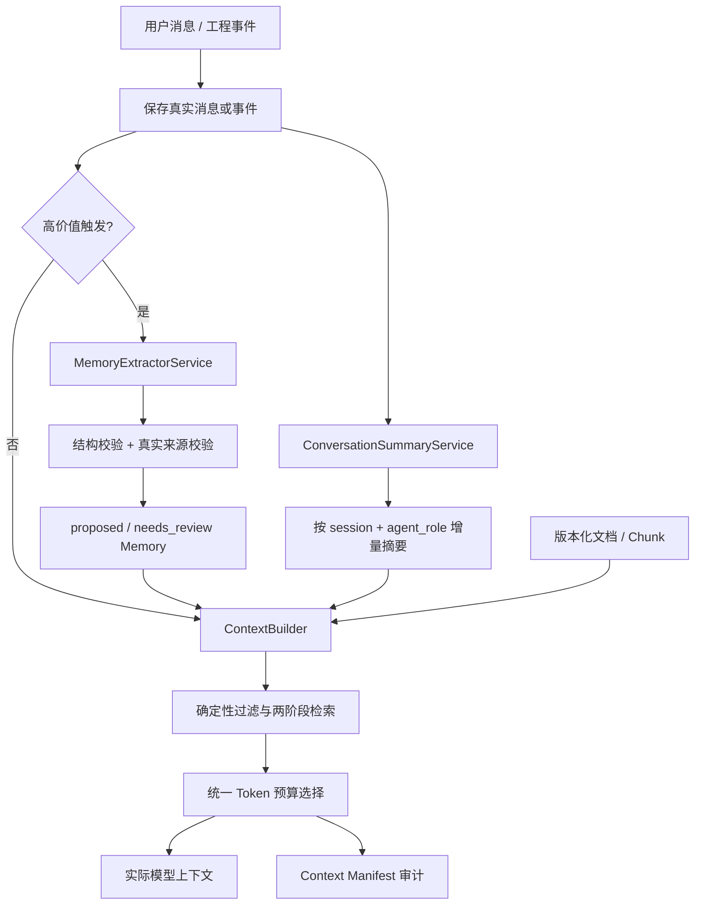
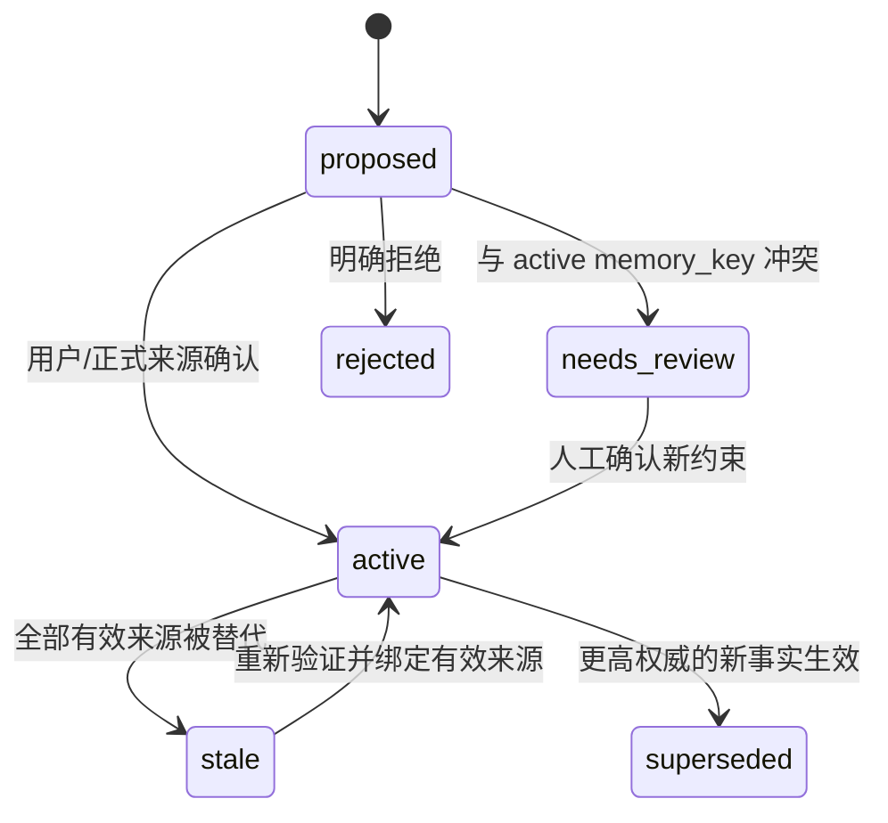

# 上下文与长期记忆子系统

> 本文用于快速理解架构边界。需要结合当前代码查看数据表、算法、预算、失败路径、API、示例和测试时，请阅读[《上下文构建与长期记忆实现详解》](context-memory-implementation.md)。

## 1. 目标与边界

系统把上下文分成四层，避免把聊天、模型推断和正式工程事实混为一谈：

| 层 | 内容 | 生命周期 | 主要存储 |
|---|---|---|---|
| L0 当前执行状态 | 当前请求、Run、Observation、审批与执行进度 | 单次 Run | `runs`、`run_events` |
| L1 短期记忆 | 近期原文、按角色摘要、目标与待办 | Session | `conversation_messages`、`conversation_role_summaries` |
| L2 长期记忆 | 项目事实、设计约束、正式决策、工程经验 | Project / Module | `memories`、`memory_sources`、`memory_relations` |
| L3 原始证据 | 规格、RTL、Artifact、Tool 日志及版本 | 长期版本化保存 | `document_versions`、`document_chunks`、Workspace |

LLM 生成的摘要、推断和专家建议不是正式事实。原始消息和历史证据不因摘要、文档换版或记忆替代而删除。

## 2. 总体流程



## 3. 会话摘要

`ConversationSummaryService` 从 `ContextBuilderService` 中独立出来。摘要键是
`session_id + agent_role`，Design 和 Verification 使用各自可见的历史。可见性规则与
`SessionService.recent_messages()` 完全一致：只读取 `agent_role IS NULL` 或当前角色的消息。

更新过程：

1. 永久保留最近 24 条可见消息原文；
2. 计算即将移出窗口且尚未覆盖的消息范围；
3. 当近期原文超过约 4,000 Token 时也提前移动最旧部分；窗口、批量和阈值由 `SummaryPolicy` 配置；
4. 每批最多处理 10 条，复用已有结构化摘要；
5. 真实模型可用时，通过 Provider 的结构化 JSON 输出合并目标、阶段、要求、决策、完成项、待办和问题；
6. 对 `confirmed_requirements` 和 `important_decisions` 校验真实消息 ID。没有用户消息来源时，模型不能将条目标为 `user_confirmed`；
7. 保存覆盖起止序号、全部来源消息 ID、内容 Hash、版本、生成模式和失败原因；
8. 只有一批成功持久化后才推进 `covered_until_sequence`。

模型不可用时使用 `deterministic_extract`：它保存待处理消息的完整原文和来源，并明确写入“尚未完成语义摘要”。它不会用字符截断冒充语义总结。摘要整体放不进上下文时会被排除并写入 Manifest，不会裁掉摘要末尾后继续声称覆盖成功。

旧 `conversation_summaries` 表保留，不删除。由于历史记录无法可靠判断角色，新代码不会直接注入旧混合摘要，而是从永久保存的原始消息按角色重建 `conversation_role_summaries`。

## 4. 自动长期记忆提取

`MemoryExtractorService` 不是每轮聊天都运行。只有以下事件进入提取流程：

- 命中“确定、确认、必须、约束、后续按照”等高价值表达的用户消息；
- 明确的时钟频率等可确定性识别的工程约束；
- 正式文档版本入库；
- Run 完成或审批恢复完成；
- Delegate 完成并返回专家结论。

明确的时钟约束可由确定性规则形成候选；其他复杂事件仅在真实模型可用时调用结构化提取。无模型时记录事件已检查或失败，不伪造候选。每个事件写入 `memory_extraction_events`，以 `source_type:source_id` 幂等；失败保存原因和尝试次数，可安全重试。

模型只返回候选字段，不能直接更新数据库。Service 会检查：

- `memory_key` 格式、类型、置信度和重要性；
- 来源 ID 在消息、文档、Run、Delegate 或 Patch 表中真实存在；
- Run、Delegate、Patch 等权威来源已经处于对应完成/应用状态；
- `extraction_key` 未被处理过。

自动提取结果始终是 `proposed`，与现有 active 事实冲突时进入 `needs_review`。

## 5. 生命周期、冲突与权威性



`fact` 和 `decision` 成为 active 时必须有可追溯来源。自动提取、模型摘要、Agent 建议和 Delegate 结论不能自动成为 active。当前系统允许以下方式激活：

- `POST /memories/{id}/promote`，并提供真实用户确认、正式文档、已完成 Run 或已应用 Patch 等来源；
- 兼容旧 API 的显式 active 创建，但同样必须通过来源校验。

同一 `memory_key` 的新事实正式生效时，旧 active 事实原子地变为 `superseded`，并在 `memory_relations` 中建立 `supersedes` 关系。默认检索不会同时返回冲突的新旧事实。

## 6. 文档换版与来源级失效

文档身份、版本、Chunk 和关联记忆更新位于一个 SQLite 事务中：

```text
读取当前 active 版本
→ 标记旧 version/chunk 为 superseded
→ 将对应 memory_source 标记为 invalidated
→ 检查每条 Memory 的其他 active 来源
→ 写入新 version 和 chunks
→ 一次提交
```

没有其他有效来源的 active 记忆变为 `stale`；仍有独立来源的记忆保持 active，但记录
`review_reason`。历史版本、来源和记忆都不会删除。重新上传完全相同的历史版本是幂等查询，不会意外恢复为 active；显式“恢复旧版本”仍需要后续单独的治理接口。

## 7. 两阶段长期记忆检索

第一阶段进行确定性过滤：

- `project_id`、`module_name`；
- 默认只允许 `active`；
- `project_shared` 或当前 Agent 自己的 `role_private`；
- active fact/decision 必须仍有 active 来源；
- Delegate 使用 `shared_only=True`，不会取得主 Agent 私有记忆。

第二阶段计算关键词交集、importance、confidence、authority 和作用域匹配度。普通记忆必须达到最低关键词相关性，不会因为 `limit=8` 就填满八条无关内容；importance ≥ 9 的 active fact/decision 作为少量关键约束可强制候选。每条入选记忆在 Manifest 中记录分数和选择原因。

## 8. 统一 Token 预算

默认总预算为 32,000 Token，并根据主模型 `max_output_tokens` 调整输出预留。默认参考额度：

| 区段 | Token |
|---|---:|
| System / Tool Schema | 4,000 |
| 当前请求与 Run | 3,000 |
| 近期消息 | 6,000 |
| 历史摘要 | 2,000 |
| 长期记忆 | 2,000 |
| RAG 文档 | 12,000 |
| 输出安全预留 | 3,000（至少） |

当前请求和安全预留先占用预算；摘要整体选择；近期消息从新到旧；长期记忆优先关键约束；文档最后使用本区额度以及前面未用额度。本轮刚提交的文档即使查询相关性为零，也作为当前请求证据保留候选，避免破坏 DS/RTL 工作流。

如果强制保留区本身超过总预算，Builder 明确报错。其他未入选项记录类别、ID、Token、分数和原因，不静默丢弃。Runtime 仍保留最后一道输入安全阀。

## 9. Context Manifest

Manifest 描述实际发送给模型的上下文，包括：

- 实际消息、Memory、Document Chunk ID；
- 摘要角色、覆盖范围、来源消息 ID、版本和生成模式；
- Memory 与 Chunk 的检索分数和选择原因；
- 所有超预算或零相关候选的排除原因；
- System/Run/Output 预留、各区实际 Token、未用额度和最终估算；
- `prompt_hash` 与 `context_version`。

`GET /api/v1/runs/{run_id}/contexts` 可用于复现一次 Run 当时看到的证据范围。

## 10. Multi-Agent 隔离

- Design / Verification 的消息原文和摘要按角色隔离；
- 已批准项目事实和正式文档通过 `project_shared` 跨角色共享；
- 私有 Memory 必须带 `owner_agent_role`；
- Delegate 始终保留 `history: []`，只注入与 instruction 相关的共享 active Memory；
- Expert 建议只作为 Observation 或 proposed Memory，不能直接覆盖正式事实；
- 主 Agent 始终保留控制权，不发生 Handoff。

## 11. 当前边界

- 关键词/本地语义检索仍基于 SQLite 与确定性特征，没有引入外部向量数据库；
- 文档历史版本可审计，但显式恢复某个 superseded 版本尚无独立 API；
- 多用户部署仍需在当前角色模型之前增加真实身份认证与项目 ACL；
- 摘要模型可进一步独立配置或异步批处理，但当前复用主 Provider，只有消息移出窗口时才调用。
