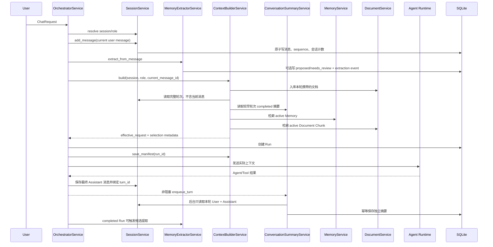
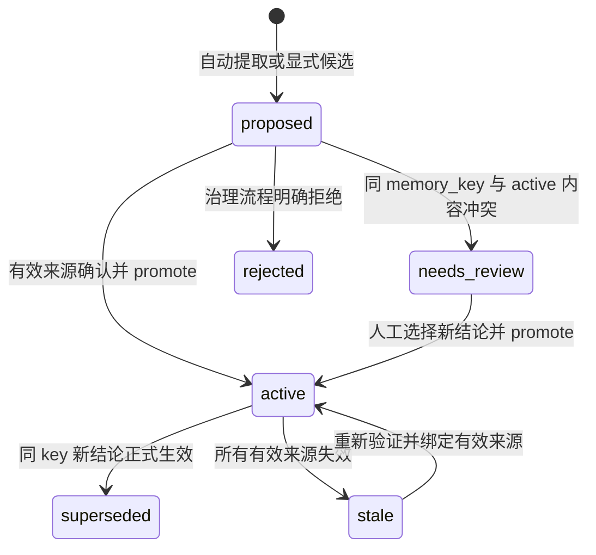

# 上下文构建与长期记忆实现详解

本文面向需要维护、调试或扩展 ChipFlow 上下文系统的开发者。它不只描述概念，还逐项对应当前代码中的 Service、数据表、状态转换、选择算法、失败路径和测试。

如果只想快速了解系统边界，可以先阅读[上下文与长期记忆子系统概览](context-and-memory.md)。本文以当前仓库代码为事实来源；后续修改算法时，应同步更新本文和专项测试。

## 1. 要解决的问题

一次芯片设计对话可能同时包含：当前问题、几十轮历史消息、规格文档、已确认工程约束、尚未确认的专家建议、Run 状态和 Tool 输出。如果把这些内容直接拼进 Prompt，会产生四类问题：

1. 历史持续增长，最终超过模型上下文窗口；
2. Design 与 Verification 的私有讨论可能互相泄漏；
3. 模型建议、用户确认和正式规格容易被误当成同等权威的事实；
4. 文档换版后，旧结论可能继续被检索并影响新设计。

当前实现用四层数据模型处理这些问题：

| 层级 | 内容 | 主要存储 | 是否直接视为正式事实 |
|---|---|---|---|
| L0 当前执行状态 | 当前请求、Run、Observation、审批状态 | `runs`、`run_events` | 否，属于执行现场 |
| L1 短期上下文 | 最近 5 轮完整原文、较早 30 轮独立摘要 | `conversation_messages`、`conversation_turn_summaries` | 否，摘要是派生数据 |
| L2 长期记忆 | 项目事实、决策、假设、经验 | `memories`、`memory_sources`、`memory_relations` | 只有满足生命周期与来源规则的 active 项才可作为事实使用 |
| L3 原始证据 | FS/AS/ICD、RTL、Artifact、日志 | `document_versions`、`document_chunks`、Workspace | 是证据，但仍需考虑版本和状态 |

这里最重要的约束是：**持久化不等于可信，进入 Prompt 也不等于成为正式事实。**

## 2. 代码导航

| 职责 | 代码入口 | 关键方法 |
|---|---|---|
| 请求编排 | [`orchestrator_service.py`](../app/services/orchestrator_service.py) | `OrchestratorService._handle()` |
| 上下文选择和预算 | [`context_builder_service.py`](../app/services/context_builder_service.py) | `ContextBuilderService.build()`、`save_manifest()` |
| 会话消息、轮次与角色可见性 | [`session_service.py`](../app/services/session_service.py) | `add_message()`、`completed_turns()`、`get_turn()` |
| 独立轮次摘要 | [`conversation_summary_service.py`](../app/services/conversation_summary_service.py) | `enqueue_turn()`、`summarize_turn()`、`get_recent_turn_summaries()`、`retry_failed_summaries()` |
| 长期记忆治理 | [`memory_service.py`](../app/services/memory_service.py) | `create()`、`promote()`、`retrieve()`、`invalidate_sources()` |
| 自动候选提取 | [`memory_extractor_service.py`](../app/services/memory_extractor_service.py) | `extract_from_message()`、`extract_from_event()` |
| 文档版本与检索 | [`document_service.py`](../app/services/document_service.py) | `ingest()`、`retrieve()` |
| Delegate 上下文隔离 | [`delegation_service.py`](../app/services/delegation_service.py) | `_scoped_context()` |
| 数据模型 | [`models.py`](../app/domain/models.py) | `ConversationTurnSummaryView`、`MemoryView`、`ContextManifestView` |
| SQLite Schema 和迁移 | [`database.py`](../app/storage/database.py) | `Database._initialize()`、`transaction()` |
| HTTP 查询和治理接口 | [`routes.py`](../app/api/routes.py) | `/memories`、`/contexts`、`/runs/{id}/contexts` |
| 专项回归测试 | [`test_context_memory_v2.py`](../tests/test_context_memory_v2.py) | 长对话、角色隔离、冲突、换版、失败和迁移场景 |

## 3. 一次请求的完整数据流



当前用户消息先被持久化，但 `ContextBuilderService.build()` 通过 `exclude_message_id` 将它从历史中排除，因为它会继续以 `request.message` 发送给模型。这样数据库保留完整审计记录，Prompt 又不会重复出现同一句话。

## 4. 持久化模型

### 4.1 会话消息与角色摘要

`conversation_messages` 是会话正文的事实源。关键字段包括：

- `sequence`：会话内单调递增的稳定游标；
- `turn_id`：同一轮 User Request 与最终 Assistant Response 的稳定关联；
- `role`：`user`、`assistant` 或 `system`；
- `agent_role`：消息所属的 Design、Verification 等工作角色；
- `message_type`：普通聊天、Run 决策等消息分类；
- `run_id`、`delegation_task_id`：把消息关联到执行记录；
- `metadata_json`：审批动作、证据引用等附加信息。

`SessionService.add_message()` 在 `Database.transaction()` 中同时分配 sequence、插入消息并更新会话标题、预览和计数，避免出现“消息写入成功但会话计数没有更新”的半完成状态。

`conversation_turn_summaries` 每行只描述一轮完整问答，`turn_id` 唯一。主要字段为：

| 字段 | 含义 |
|---|---|
| `id` / `turn_id` | 摘要 ID 与唯一轮次键；重复执行不会新增记录 |
| `session_id` / `agent_role` / `sequence` | 会话、角色隔离和原始排序依据 |
| `user_message_id` / `assistant_message_id` | 两条真实来源消息，支持追溯 |
| `summary_json` / `token_count` | 独立结构化摘要及实际估算 Token |
| `status` | `pending`、`processing`、`completed` 或 `failed` |
| `attempts` / `last_error` | 后台重试次数与最近错误 |
| `generation_mode` | `model_structured` 或测试模式的 `deterministic_turn` |

旧的 `conversation_summaries` 和 `conversation_role_summaries` 表仍保留用于审计和兼容迁移，但新 ContextBuilder 不再读取或更新它们。

### 4.2 长期记忆

`memories` 保存记忆主体，`memory_sources` 保存证据，`memory_relations` 保存替代关系。这种拆分允许一条结论同时由多个独立来源支持。

`memories` 中对选择和治理影响最大的字段是：

| 字段 | 作用 |
|---|---|
| `project_id` / `module_name` / `scope` | 项目和模块作用域 |
| `memory_key` | 稳定语义键，例如 `uart.clock_frequency`；冲突检测依赖它 |
| `kind` | `fact`、`decision`、`assumption`、`inference`、`question`、`preference`、`experience` |
| `content` | 可注入模型的记忆正文 |
| `confidence` | 1–10，参与检索排序 |
| `importance` | 1–10；高重要性的事实/决策可成为关键约束 |
| `authority` | 来源权威描述；`agent` 和 `inference` 在排序时降权 |
| `visibility` | `project_shared` 或 `role_private` |
| `owner_agent_role` | 私有记忆的所属角色 |
| `status` | 生命周期状态 |
| `review_reason` | 冲突、部分来源失效等复核原因 |
| `extraction_key` | 自动提取项的唯一幂等键 |

`memory_sources` 不删除历史证据，而是用 `status=active/invalidated`、`invalidated_at` 和 `invalidation_reason` 表达来源是否仍有效。

### 4.3 提取事件和 Context Manifest

`memory_extraction_events` 以 `source_type:source_id` 为 `extraction_key`，记录 `processing/completed/failed`、尝试次数、生成的 Memory ID 和错误。它解决两个问题：同一事件重复投递不会产生重复记忆；Provider 故障后可以观察并安全重试。

`context_manifests` 保存一次模型调用实际选中的证据集合，而不是仅保存配置。主要内容包括：

- 消息、原始 turn、独立摘要、Memory、Document Chunk ID；
- `raw_turn_ids`、`turn_summary_ids` 和各区实际 Token；
- 各区 Token 估算、检索分数和选择原因；
- 所有被排除候选及排除原因；
- `prompt_hash` 和 `context_version`。

## 5. 角色可见性与短期上下文

会话切换角色时，消息不会被复制或删除。隔离发生在读取路径：

```sql
agent_role IS NULL OR agent_role = :current_agent_role
```

`SessionService.completed_turns()` 使用同一规则。`agent_role IS NULL` 表示可被所有角色看到的公共消息；带角色的消息只对该角色可见。

这条规则同时约束：

- 最近 5 个完整原文轮次；
- 较早 30 个摘要或回退轮次；
- 后台摘要读取的两条来源消息。

因此，Verification 的摘要不会因为 sequence 位于 Design 消息之后就读取到 Design 私有正文。

## 6. 独立轮次摘要

### 6.1 轮次识别与窗口

`SummaryPolicy` 当前默认值为：

```python
recent_turns = 5
history_turns = 30
target_min_tokens = 150
target_max_tokens = 250
hard_max_tokens = 500
summary_budget = 6_000
max_workers = 2
max_pending_tasks = 32
```

一轮完整对话是一条 User Request 和对应的一条最终 Assistant Response。新写入消息共享 `turn_id`；兼容旧库时，`completed_turns()` 按 sequence 将一条旧 User 与其后的第一条旧 Assistant 配对。没有最终 Assistant 的当前请求、System 消息以及非消息形式的 Tool 调用不会构成完整轮次。

ContextBuilder 保留最近 5 个完整轮次原文，并从它们之前取最近 30 个完整轮次。窗口以轮次而不是消息条数滑动，因此最近原文最多是 10 条消息。

### 6.2 生成时机和有界队列

摘要不在 `ContextBuilder.build()` 中生成。普通编排和 Run Resume 都执行：

```text
保存 User Request（生成 turn_id）
→ Agent / Tool 执行
→ 保存最终 Assistant Response（复用 turn_id）
→ enqueue_turn 非阻塞投递
→ Worker 重新读取本轮两条消息
→ 生成并 Upsert 独立摘要
```

线程池最多 2 个 Worker，并用 32 个 Semaphore 槽位限制待处理任务。队列满时记录保持 pending，不无限创建线程。`turn_id` 的数据库唯一约束和进程内 scheduled 集合防止重复记录与重复排队；`retry_failed_summaries()` 可重新投递 pending/failed 任务。摘要异常不会覆盖已经持久化的 Assistant 消息，也不会让正常请求失败。

### 6.3 结构化摘要内容

模型必须返回以下字段：

```json
{
  "topic": "",
  "module": "",
  "user_intent": "",
  "key_information": [],
  "decisions": [],
  "constraints": [],
  "assumptions": [],
  "inferences": [],
  "open_questions": [],
  "keywords": []
}
```

`decisions` 和 `constraints` 的每一项包含 `content`、`source_message_ids` 和 `confirmation_status`。允许状态为 `user_confirmed`、`assistant_suggestion`、`unconfirmed` 或 `historical`。

模型输出不会被直接信任。`_validate()` 会：

1. source ID 只能是本轮 User 或 Assistant 消息；
2. 只有来源包含本轮 User 消息时才允许 `user_confirmed`；
3. 将未知确认状态降为 `unconfirmed`；
4. 不读取旧摘要，也不把 Assistant 建议自动提升为用户决策；
5. 对来源 ID 去重并保持首次出现顺序。

### 6.4 长度和失败处理

生产模式复用主模型 Provider。Prompt 要求 150–250 Token；首次结果超过 500 Token 时发起一次结构化压缩，压缩后仍超限则任务标为 failed，不保存超长 completed 摘要。测试/Mock 模式使用短小、可追溯的 `deterministic_turn`，但同样只依据本轮两条消息。

`conversation_turn_summaries.status` 的含义：

- `pending`：已登记，等待 Worker；
- `processing`：Worker 已领取；
- `completed`：结构化摘要已通过长度与来源校验；
- `failed`：模型、解析、压缩或持久化前校验失败，可重试。

### 6.5 摘要进入 Prompt 和原文回退

ContextBuilder 只注入 completed 摘要，并以原始 sequence 排序：

```text
[独立轮次摘要 turn_id=<id>; sequence=<n>; role=design]
{...结构化 JSON...}
```

若对应轮次没有 completed 摘要，则该轮 User 和 Assistant 原文一起回退。摘要与其来源原文不会同时注入。摘要、回退原文和最近原文都作为完整单元参与预算；放不下时整轮排除，并在 Manifest 的 `excluded` 中记录原因。

## 7. 长期记忆如何形成

### 7.1 每条新消息由模型一次性判断

`MemoryExtractorService.extract_from_message()` 不再用关键词或时钟正则预筛选。每条尚未完成提取审计的新消息都会进行一次结构化模型调用，由模型判断当前消息是否明确新增、确认或修订了值得跨会话保留的信息。纯提问、闲聊、讨论中的建议和未确认设想应返回空数组；空结果仍将审计事件标为 completed，表示该消息已经判断过。

当前接入的事件包括：

| 事件 | 调用位置 | 来源类型 |
|---|---|---|
| 所有新用户消息 | `OrchestratorService._handle()` | `conversation_message` |
| 所有 Run 决策消息 | `routes.resume_run()` 先保存为用户决策消息 | `conversation_message` |
| 完成的 Run | `OrchestratorService.handle()` 或恢复接口 | `run` |
| 新文档版本提交成功 | `DocumentService.ingest()` | `document_version` |
| Delegate 成功结束 | `DelegationService.delegate()` | `delegation` |

### 7.2 有限上下文和结构化模型提取

消息调用会提供当前消息、项目、模块、角色，以及最多 6 条当前角色可见前文和最多 6 条相关 active Memory。前文总预算约 1,200 Token，单条前文最多 320 Token，单条旧记忆最多 240 Token。当前消息通过 `exclude_message_id` 从前文中排除，避免正文重复。

前文和旧记忆只用于理解指代、识别修订并复用稳定 `memory_key`，不能单独成为候选依据。例如“那就用第二种，深度改成 32”可以结合前文确定讨论对象，但候选值 32 必须来自当前消息。模型可以为“UART 时钟为 50 MHz，FIFO 深度设为 32，复位低有效”返回三个独立候选；“UART 时钟为 50 MHz 可以吗？”应返回空候选。

Run 的 `accept_assumption` 同样走消息提取，但 Prompt 明确限制只能形成 assumption；入库前还有确定性防线，会把模型误报的 fact/decision 强制降级为 assumption。模型只负责候选字段，不能直接执行 SQL、激活记忆或替代旧事实。在模型不可用的受控运行模式下事件以空候选完成；模型调用或解析实际抛错时标为 failed 并保留错误。

### 7.3 去重与幂等

第一层是事件幂等：

```text
conversation_message:<message_id>
document_version:<version_id>
run:<run_id>
delegation:<task_id>
```

完成事件再次执行时直接返回之前关联的 Memory。

第二层是单批确定性去重。模型 Prompt 先要求同一工程属性只输出一个稳定的小写点分 `memory_key`，但后端不信任模型一定做到：`MemoryExtractorService._deduplicate_candidates()` 会规范化 key 和正文，对完全相同的 `(key, kind, content)` 只保留第一条，并吸收重复项中更高的 confidence 和 importance。相同 key 的不同值、不同 kind 或不同工程属性会继续保留，避免把冲突和独立约束误合并。

第三层是候选幂等。每个候选根据事件 key、kind、规范化 `memory_key` 和规范化正文计算 SHA-256 `extraction_key`，不再包含候选序号；数据库对非空 `extraction_key` 建唯一索引。即使失败重试时模型调换了候选顺序，也会命中原候选。

第四层是跨事件逻辑去重。`MemoryService.create_or_merge_candidate()` 在写事务内查询相同项目、模块、scope、visibility（角色私有项还要求 owner 相同）的 `proposed`、`needs_review` 和 `active` Memory：

- 规范化 key、kind 和规范化正文都相同：复用原 Memory ID，只追加经过来源校验的新 source；
- 规范化 key 相同但正文不同：保留两条候选，并将新候选及已有 proposed 候选标为 `needs_review`，已有 active 不降级；
- 正文相同但 kind 不同，或工程属性不同：不合并，也不凭内容相似判冲突；
- 重复候选不会覆盖首次记录的正文、状态、authority、confidence 或 importance。

key 规范化使用 Unicode NFKC、大小写折叠以及 `-`、`_`、`.` 分隔符统一；正文规范化消除空白、普通标点和少量安全的中文表述差异，同时保留否定词、数字、单位、小数点及数值正负号。首版刻意不引入模糊匹配、向量库、Schema 迁移或额外 LLM 调用。

### 7.4 自动候选永远不是 active

自动提取统一使用：

- `status=proposed`；
- 会话消息来源使用 `authority=user_event`；
- 文档、Run、Delegate 等来源初始使用 `authority=agent`；
- `visibility=project_shared`。

如果相同作用域、相同 `memory_key` 已有内容不同的 active Memory，新候选会被确定性地改为 `needs_review`，并写入冲突原因。

## 8. 来源校验、激活和冲突处理

### 8.1 来源校验矩阵

`MemoryService._validate_sources()` 在创建或提升前检查真实数据库记录：

| `source_type` | 对应表 | 额外权威条件 |
|---|---|---|
| `conversation_message` | `conversation_messages` | 消息存在 |
| `user_confirmation` | `conversation_messages` | 消息存在且 `role='user'` |
| `document_version` | `document_versions` | 版本存在 |
| `document_chunk` | `document_chunks` | Chunk 存在 |
| `run` | `runs` | `status='completed'` |
| `delegation` | `delegation_tasks` | `status='completed'` |
| `patch_approval` | `patches` | `status='applied'` |
| `external` | 不查询内部表 | 为旧 API 和外部问题单保留的兼容入口 |

未知类型、空 source ID，或未达到状态条件的内部来源会被拒绝。`external` 的真实性由调用方承担，因此生产集成应尽量换成可在本地校验的正式来源类型。

### 8.2 创建和提升

公共 API 创建时只允许请求 `proposed` 或 `active`。其中 active 的 `fact/decision` 至少需要一个可追溯来源。`needs_review/stale/superseded/rejected` 由生命周期规则产生，调用方不能任意指定。

推荐路径是：

```text
高价值事件 → proposed/needs_review
→ 人工或正式工作流确认
→ POST /memories/{id}/promote
→ 校验新来源
→ active
```

可被 `promote()` 激活的状态是 `proposed`、`needs_review` 和 `stale`。提升、添加来源、替代冲突记忆和写关系在同一事务中完成。

### 8.3 生命周期



当前代码没有对外暴露通用的 rejected 操作接口；状态图中的 rejected 是治理模型保留状态。

### 8.4 同一 memory_key 的替代

假设已有：

```text
uart.clock_frequency = UART clock 为 100 MHz (active)
```

新候选“UART clock 为 125 MHz”创建后进入 `needs_review`。当它通过有效用户确认或正式来源提升时，事务会：

1. 把新 Memory 改为 active；
2. 把旧 Memory 改为 superseded；
3. 建立 `new --supersedes--> old` 关系；
4. 默认检索只返回新 active 结论。

这不是简单按更新时间覆盖；旧正文、旧来源和关系仍可审计。

## 9. 文档换版和来源级失效

### 9.1 原子换版

文档身份由 `(project_id, module_name, kind, name)` 唯一确定。新版本入库在一个 `BEGIN IMMEDIATE` 事务中执行：

```text
查找或创建 document identity
→ 检查 version + content_hash 是否已经存在
→ 读取当前 active version/chunk ID
→ 将旧 version/chunk 标记为 superseded
→ 失效引用这些 ID 的 memory_sources
→ 根据剩余 active 来源更新 Memory 状态
→ 插入新 active version 和 chunks
→ commit
```

任一步骤抛错都会 rollback。例如来源失效失败时，不会留下“旧版本已 superseded，但新版本尚未写入”的中间状态。

相同 `version + content_hash` 再次上传会返回已有记录，不重复创建，也不会把已经 superseded 的历史版本偷偷恢复为 active。

### 9.2 来源失效不等于整条 Memory 立即失效

`MemoryService.invalidate_sources()` 逐条把被替代来源标为 invalidated，然后检查同一 Memory 是否还有其他 active 来源：

- 没有其他来源：active Memory 变为 `stale`；
- 仍有独立来源：Memory 保持 active，但写入 `review_reason=部分来源已被替代，仍有独立有效来源`。

例如“同步复位”同时由 AS v1 和已批准问题单支持。AS v2 替代 v1 后，规格来源失效，但问题单来源仍有效，因此该记忆不会被错误删除。

### 9.3 文档分块和检索

`DocumentService._chunk()` 优先按标题和段落切分，目标约 700 Token；超长段落再切片，不跨章节盲目拼接。

当前检索不依赖外部向量数据库：

1. 中英文概念别名归一化，例如 reset/复位、handshake/握手；
2. 提取英文词、数字和中文二元词；
3. 生成 192 维确定性 Hash 特征向量；
4. 同时计算带文档频率权重的关键词得分和余弦得分；
5. 最终 `score = 0.58 × keyword + 0.42 × semantic`。

默认只查询 active Chunk。ContextBuilder 最多读取前 50 个候选，再根据总预算选择。

## 10. 长期记忆检索算法

### 10.1 第一阶段：确定性过滤

`MemoryService.retrieve()` 先执行 SQL 过滤：

- `project_id` 必须匹配；
- `module_name` 可以是项目级 NULL，也可以等于当前模块；
- 只返回 `status='active'`；
- 普通主 Agent 可看 `project_shared` 和属于自己的 `role_private`；
- Delegate 使用 `shared_only=True`，只能看 `project_shared`；
- active 的 fact/decision 至少仍有一个 active source。

这一步发生在排序前，模型无法通过 Prompt 请求绕过。

### 10.2 第二阶段：相关性排序

查询和 `content + memory_key` 会被拆成英文词、数字和中文二元词。词法相关度使用集合 Jaccard：

```text
lexical = |query_terms ∩ memory_terms| / |query_terms ∪ memory_terms|
```

最终分数为：

```text
score = lexical × 0.55
      + importance/10 × 0.20
      + confidence/10 × 0.10
      + authority_score × 0.10
      + scope_score × 0.05
```

其中：

- 当前模块 Memory 的 `scope_score=1.0`，项目级 Memory 为 `0.65`；
- `authority=agent/inference` 时 `authority_score=0.35`，其他为 `1.0`；
- 普通候选要求 `lexical >= 0.04`；
- `importance >= 9` 且类型为 fact/decision 的项目约束可跳过词法阈值，标为 `critical_constraint`。

排序顺序是：关键约束优先，然后按得分、重要性和更新时间降序。返回数量最多 30 条；ContextBuilder 再进行 Token 预算选择。因此 `limit=8` 不会用无关记忆强行填满八条。

## 11. ContextBuilder 的输入和输出

### 11.1 输入

`ContextBuilderService.build()` 接收：

- `session_id`；
- 原始 `ChatRequest`；
- 当前 `agent_role`；
- 本轮已经落库的 `current_message_id`。

它返回 `ContextBuildResult`，其中：

- `effective_request`：真正交给 Runtime 的请求；
- `message_ids/memory_ids/chunk_ids`：实际选中项；
- `memory_context`：由 Orchestrator 作为 `_memory_context` 注入；
- `sections/excluded/summary`：审计元数据；
- `estimated_tokens`：预算估算；
- `prompt_hash`：选择快照标识。

### 11.2 固定预算

默认总预算为 32,000 Token。`TokenCounter` 优先使用 `tiktoken/cl100k_base`；未安装时使用偏保守的中英文估算，因此这里是模型无关预算，不是厂商账单的精确 Token 数。

默认配置如下：

| 区段 | 配置值 | 当前代码中的约束方式 |
|---|---:|---|
| System + Tool Schema | 4,000 | 固定预留 |
| 当前请求与 Run | 3,000 | 至少预留 3,000；请求更长时按请求估算增加 |
| 最近 5 轮原文 | 6,000 | User/Assistant 以完整轮次原子选择 |
| 较早 30 轮 | 6,000 | completed 摘要；未完成时使用完整原文回退 |
| 长期记忆 | 2,000 | 普通 Memory 上限；关键约束可借用剩余预算 |
| 文档 | 12,000 | 当前字段是规划参考值；代码实际使用最后的全部剩余预算 |
| 输出预留 | 3,000 | 至少 3,000；默认配置会参考模型 `max_output_tokens`，最高按 8,000 预留 |

`recent_messages` 和 `summary` 分别作为最近原文轮次和较早摘要/回退轮次的目标上限；所有区段仍受统一总预算约束。`documents` 最后使用剩余额度。

固定区计算为：

```text
fixed = system_and_tools
      + max(current_request_and_run, query_tokens)
      + max(output_reserve, min(model.max_output_tokens, 8000))
```

`current_request_and_run` 是预算字段的历史命名。当前 `build()` 发生在 Run 创建之前，所以代码实际计算的是当前 `request.message` 的 Token 和一段运行控制预留，并没有在这里额外注入一个已存在 Run 的完整状态对象。

使用显式 `budget_config` 的测试或定制实例不会动态调整输出预留。如果固定区已经超过总预算，Builder 立即报错。

### 11.3 选择顺序

Builder 严格按下面顺序消费预算：

1. 入库本轮随请求携带的文档；
2. 识别当前角色全部完整问答轮次，当前 User 不进入历史；
3. 划分最近 5 轮原文和更早的最近 30 轮；
4. 预留 System、当前请求和输出空间；
5. 从新到旧按整轮选择最近原文；
6. 对更早轮次选择 completed 独立摘要，缺失时选择完整原文回退；
7. 将已选单元恢复为原始 sequence 顺序；
8. 检索并选择长期记忆；
9. 检索并选择文档 Chunk；
10. 生成 `effective_request`、Manifest 数据和 hash。

这个顺序体现了当前优先级：**当前请求和输出安全 > 最近完整轮次 > 较早摘要/完整回退 > 关键 Memory > 相关文档。**

### 11.4 完整轮次选择

最近轮次和较早轮次都从最新向最旧扫描，优先保留靠近当前请求的内容，选完后再恢复时间正序。User/Assistant 的 Token 成本相加后一次判断，绝不拆分。排除记录示例：

```json
{
  "category": "raw_turn",
  "id": "<turn_id>",
  "reason": "近期完整问答区预算不足；整轮排除",
  "tokens": 123
}
```

迁移期如果后端尚无可用历史，且客户端仍携带旧 `request.history`，Builder 会最多检查最后 12 条作为一次性兼容回退。新会话稳定运行后应以后端消息为准。

### 11.5 Memory 选择

Builder 调用 `MemoryService.retrieve(..., limit=30, agent_role=current_role)`。普通 Memory 共享约 2,000 Token 区；`selection_reason=critical_constraint` 的项可借用当前剩余预算。写入 Runtime 的 `_memory_context` 包含：

- Memory ID、类型和正文；
- confidence 和 authority；
- 完整来源引用及来源状态；
- retrieval score 和 selection reason。

这样 Agent 可以引用约束，调试界面也能解释它为什么被选中。

### 11.6 文档选择

Builder 请求最多 50 个 Chunk。零分 Chunk 默认排除，但本轮刚上传的文档即使查询词没有命中，也作为当前请求证据保留候选，避免 DS/RTL 工作流在“上传文档并立即生成”时看不到材料。

文档是最后一个大区段，可以使用之前各区没有消耗的全部剩余预算。每个选中 Chunk 被包装为：

```text
[RAG source: chunk=<id>; section=<section>; score=<score>]
<chunk content>
```

因此模型回复中可以追溯到具体 Chunk，而不只是文档名。

### 11.7 实际发送给 Runtime 的结构

`effective_request` 会替换两部分：

- `history`：较早独立摘要或完整回退轮次 + 最近 5 轮完整原文；
- `documents`：选择后的 RAG Chunk。

当前问题仍保留在 `message`。Orchestrator 另外加入两个内部字段：

```text
_memory_context
_context_manifest = {message_ids, turn_summary_ids, raw_turn_ids, memory_ids, chunk_ids}
```

这些下划线字段属于模型运行时上下文，不污染公共 `ChatRequest` API 契约。

## 12. Context Manifest 与可复现性

### 12.1 Manifest 保存时机

Builder 完成后，Orchestrator 先创建 Run，再调用 `save_manifest(session_id, run_id, role, result)`。因此即使后续 Selector、主模型或 Tool 失败，仍能查询这个 Run 当时准备了哪些证据。

### 12.2 sections 和 excluded

`sections` 记录：

- history、summary、raw_conversation、memory、documents 的条目数和 Token；
- Memory/Chunk 分数与选择原因；
- query Token；
- System、当前请求、输出的预留；
- 未使用 Token。

`excluded` 记录完整原文轮次、轮次摘要、回退轮次、Memory 或文档因预算/相关性被排除的原因。排除不是错误，但它使“模型为什么没看到某条信息”可以被定位。

### 12.3 prompt_hash 的准确含义

当前 `prompt_hash` 对以下选择元数据做 SHA-256：

- 当前 `request.message`；
- 被选中的 message ID；
- `turn_summary_ids` 与 `raw_turn_ids`；
- Memory ID；
- Chunk ID；

它是上下文选择快照标识，**不是最终序列化 Prompt 全文的哈希**。例如 System Prompt 文案变化不会必然改变该值。如果未来需要严格重放，应额外保存 Prompt 模板版本、模型配置和最终序列化正文哈希。

查询接口：

```text
GET /api/v1/runs/{run_id}/contexts
GET /api/v1/contexts/{context_id}
```

## 13. Multi-Agent 和 Delegate 的上下文边界

主 Agent 的角色历史由 `agent_role` 隔离。跨角色共享依靠正式 `project_shared` Memory 和文档，而不是复制另一角色的聊天记录。

`DelegationService._scoped_context()` 明确构造：

```json
{
  "message": "专家任务指令",
  "documents": [],
  "history": [],
  "_memory_context": ["仅相关 project_shared active Memory"]
}
```

Delegate 调用 `MemoryService.retrieve(..., shared_only=True, limit=6)`，因此：

- 不取得主 Agent 历史；
- 不取得任何 `role_private` Memory；
- 只能看到与 instruction 相关的 active 共享约束；
- 专家结论返回主 Agent 作为 Observation；
- 专家结论只能触发 proposed Memory，不能直接成为 active 项目事实。

主 Agent 始终保留控制权，没有 Handoff。

## 14. 三个完整例子

### 14.1 用户确认时钟约束

用户在 Design 会话输入：

```text
UART clock = 100 MHz，后续设计按照这个约束执行。
```

执行过程：

1. 消息写入 `conversation_messages`；
2. 在消息 ID 幂等检查通过后调用一次结构化提取模型；
3. 模型判断当前消息已确认时钟约束并生成 `uart.clock_frequency` 候选；
4. 写入 proposed Memory，来源是该消息；
5. 同一消息重试通过 extraction event 返回原 Memory；
6. 用户/工作流用 `user_confirmation` 来源调用 promote；
7. 来源校验确认 ID 对应 user 消息；
8. Memory 变为 active；
9. 新会话查询 UART clock 时通过相关性或关键约束规则被检索。

### 14.2 时钟从 100 MHz 变为 125 MHz

1. 100 MHz 是 active，key 为 `uart.clock_frequency`；
2. 新的 125 MHz 候选与同 key active 内容不同；
3. 候选自动进入 needs_review；
4. promote 125 MHz 时，在一个事务中激活新值、supersede 旧值、写关系；
5. 默认检索只返回 125 MHz；
6. 100 MHz 和它的来源仍可用于历史审计。

### 14.3 AS v1 被 AS v2 替代

1. AS v1 的 version/chunk 是 active；
2. 某 Memory 只引用 v1，另一条 Memory 同时引用 v1 和正式问题单；
3. v2 入库时 v1 来源被标为 invalidated；
4. 只依赖 v1 的 Memory 变 stale；
5. 有问题单独立支持的 Memory 保持 active 并附 review reason；
6. 新请求只检索 v2 的 active Chunk；
7. v1、旧 Chunk、来源失效时间和原因全部保留。

## 15. API 使用示例

创建候选：

```http
POST /api/v1/memories
Content-Type: application/json

{
  "project_id": "soc-a",
  "module_name": "uart",
  "memory_key": "uart.reset_policy",
  "kind": "decision",
  "content": "UART 使用同步复位",
  "confidence": 8,
  "importance": 8,
  "authority": "user_event",
  "status": "proposed",
  "source_refs": [
    {"source_type": "conversation_message", "source_id": "<message-id>"}
  ]
}
```

确认并提升：

```http
POST /api/v1/memories/<memory-id>/promote
Content-Type: application/json

{
  "authority": "user_confirmed",
  "source_refs": [
    {"source_type": "user_confirmation", "source_id": "<user-message-id>"}
  ]
}
```

查看治理状态：

```text
GET /api/v1/memories?project_id=soc-a&module_name=uart
GET /api/v1/memories?project_id=soc-a&module_name=uart&status=needs_review
```

## 16. 数据库迁移与事务约束

`Database._initialize()` 使用 `CREATE TABLE IF NOT EXISTS` 和 `PRAGMA table_info` + 条件 `ALTER TABLE ADD COLUMN` 做增量迁移。重复启动不会重复添加字段，旧数据不会被删除。

本轮轮次摘要迁移包括：

- 为 `conversation_messages` 增加可空 `turn_id`，不改写旧正文；
- 新建 `conversation_turn_summaries`，并对 `turn_id` 建唯一约束；
- 为 `context_manifests` 增加 `turn_summary_ids_json` 和 `raw_turn_ids_json`；
- 新 Manifest 写入 `context_version=3`；
- 保留 `conversation_summaries`、`conversation_role_summaries` 及其中历史数据。

`Database.transaction()` 使用进程内可重入锁和 SQLite `BEGIN IMMEDIATE`。当前需要原子性的关键操作包括：

- 写消息并更新会话索引；
- 创建/提升 Memory 和处理冲突；
- 来源级失效；
- 文档换版、分块和来源失效。

复杂生产迁移未来应迁到 Alembic 等正式工具；当前手写迁移只适合向后兼容的新增表、字段和索引。

## 17. 测试如何证明这些行为

[`tests/test_context_memory_v2.py`](../tests/test_context_memory_v2.py) 覆盖二十五个关键场景：

| 测试 | 验证内容 |
|---|---|
| `test_context_uses_five_raw_turns_and_thirty_independent_summaries` | 40 轮识别、最近 5 轮原文、较早 30 轮独立摘要和当前消息排除 |
| `test_role_summaries_are_isolated_but_shared_fact_is_visible` | Design/Verification 摘要隔离与共享 active 事实 |
| `test_constraint_extraction_promotion_and_cross_session_retrieval` | 模型候选入库、消息来源、调用幂等、promote 和跨会话检索 |
| `test_message_model_handles_non_keyword_and_multiple_constraints` | 无关键词 FIFO 约束进入模型，以及单消息多候选 |
| `test_question_reaches_model_but_empty_result_writes_no_memory` | 疑问消息经过判断但空结果不写 Memory |
| `test_non_message_event_reuses_model_candidate_path` | 文档等非消息事件继续复用可选上下文的模型候选接口 |
| `test_message_context_is_role_filtered_and_supports_reference_resolution` | 角色可见前文、当前消息排除、active Memory 和指代修订 |
| `test_temporary_assumption_approval_cannot_become_fact` | 临时假设批准无法按 fact/decision 入库 |
| `test_candidate_batch_exact_duplicates_create_one_memory` | 单批完全重复候选只入库一次，并保留更高评分 |
| `test_candidate_batch_normalizes_memory_key_variants` | 点号、下划线、连字符等 key 变体可确定性去重 |
| `test_candidate_batch_normalizes_safe_chinese_expression_variants` | 安全的中文表述差异不会产生重复 Memory |
| `test_candidate_batch_keeps_different_engineering_attributes` | 不同工程属性不会因同句出现而误合并 |
| `test_candidate_batch_conflicting_values_require_review` | 同 key 不同值保留并同时进入复核 |
| `test_cross_event_duplicate_merges_sources_without_overwriting_memory` | 跨事件重复项复用 ID、追加来源且不覆盖既有字段 |
| `test_failed_event_retry_is_order_independent` | 部分失败后调换候选顺序重试仍保持幂等 |
| `test_cross_event_dedup_respects_role_private_owner` | role_private 候选按 owner 隔离，不跨角色合并 |
| `test_conflicting_confirmed_constraint_supersedes_old_fact` | needs_review、原子替代和默认只返回新事实 |
| `test_document_upgrade_invalidates_only_affected_source_and_is_atomic` | 来源级失效、独立来源保活和事务回滚 |
| `test_delegate_receives_shared_memory_but_not_private_history` | Delegate 无历史、只接收共享 Memory |
| `test_failed_or_missing_turn_summaries_fall_back_to_complete_raw_turns` | failed/未生成摘要回退完整原文，不丢信息或拆半轮 |
| `test_turn_summary_is_idempotent_and_background_queue_uses_worker` | turn_id Upsert 幂等和后台 Worker 投递 |
| `test_turn_summary_hard_limit_uses_compression_before_save` | 超过 500 Token 先压缩再保存 |
| `test_turn_budget_never_splits_user_and_assistant_and_manifest_traces_turns` | 预算原子选择和 Manifest 轮次追溯 |
| `test_memory_extraction_failure_is_audited_and_retry_is_idempotent` | 提取失败审计、重试和候选幂等 |
| `test_schema_migration_is_repeatable_and_legacy_summary_is_not_trusted` | 增量迁移可重复、旧混合摘要不进入新上下文 |

修改本子系统后至少应运行：

```powershell
.\.venv\Scripts\python.exe -m pytest tests\test_context_memory.py tests\test_context_memory_v2.py -q
```

涉及编排、Delegate 或 API 时应再运行全量测试。

## 18. 调试指南

### 18.1 模型没有看到某条历史消息

依次检查：

1. 消息的 `agent_role` 是否与当前角色一致；
2. User 和最终 Assistant 是否具有相同 turn_id，或能否按旧消息 sequence 配对；
3. 对应 turn summary 是否为 completed，failed 时查看 `last_error`；
4. Manifest 的 `message_ids`、`raw_turn_ids` 和 `turn_summary_ids`；
5. `excluded` 是否记录 raw_turn、raw_turn_fallback 或 turn_summary 预算不足。

### 18.2 模型没有看到某条 Memory

依次检查：

1. Memory 是否 active；
2. project/module 是否匹配；
3. visibility 和 owner role 是否允许；
4. fact/decision 是否至少还有一个 active source；
5. 普通记忆是否达到 0.04 词法阈值；
6. 是否在 ContextBuilder 的 Memory Token 区被排除；
7. Manifest 中是否有该 ID、分数或排除原因。

### 18.3 文档换版后旧结论仍出现

检查：

1. 旧 document version/chunk 是否已 superseded；
2. 相关 `memory_sources.status` 是否 invalidated；
3. Memory 是否有其他 active 来源；
4. 请求是否显式使用了 `include_superseded=true`；
5. 旧内容是否还存在于用户当前消息或近期历史，而不是来自 RAG。

### 18.4 上下文预算报错

两类报错需要区分：

- 固定区超过总预算：当前请求过大，或 System/输出预留配置不合理；
- 完整原文轮次或摘要单元超过对应预算：检查 `excluded`，恢复摘要 Provider、重试失败摘要或提高预算；系统不会拆散半轮。

## 19. 当前边界与后续演进

当前实现有意保留以下边界：

1. Memory 和文档语义检索仍是 SQLite + 确定性本地特征，不是外部向量数据库；
2. 摘要后台复用主 Provider，尚未支持独立低成本摘要模型配置或跨轮批处理；
3. `ContextBudgetConfig.summary/documents` 目前是参考额度，不是独立硬上限；
4. `prompt_hash` 不是最终 Prompt 全文哈希；
5. `external` 来源为兼容入口，无法由本地数据库验证其真实性；
6. 历史文档版本可审计，但没有独立的“恢复 superseded 版本”治理 API；
7. 单机角色隔离不是多租户安全边界，真实多用户部署仍需认证和项目 ACL；
8. Manifest 的 `observation_ids` 已预留，但当前构建阶段 Run 尚未执行，通常为空。

后续扩展时应保持三条不变量：

- 原始消息和证据不因摘要或替代而被物理删除；
- 模型只能提出候选，不能绕过来源和状态机直接写 active 事实；
- 每次进入模型的实际上下文必须可通过 Manifest 解释。
