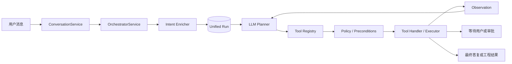

# 动态编排架构说明（v0.4）

## 1. 变更目标

v0.4 将主交互从“Router 分类到 Chat 或固定 Workflow”改为“统一 Orchestrator 动态选择 Tool”。普通聊天也是一个只有 `reply_to_user` 的 Run；DS、RTL 和工程执行则由同一 Planner 根据上下文选择不同 Tool。

核心原则：

- 用户决定目标和研发阶段；
- 大模型完善任务表达，但不得补造规格事实；
- 大模型决定下一步建议调用哪个 Tool；
- 确定性代码校验注册、权限、参数、审批和 Workspace；
- 每次 Tool Call、Observation、等待项和结果都进入统一 Run；
- 固定流程知识逐步迁移到 Skill/Playbook，安全门禁仍由代码强制执行。

## 2. 主调用链



`ConversationService` 现在只是兼容门面，不再包含 Chat/Workflow 二分判断。`OrchestratorService` 是唯一主入口，最多执行六个 Planner Step，防止模型无限循环。

## 3. 任务意图完善

原始用户消息保存为 `TaskIntent.raw_request`，系统另外生成派生意图：

```text
TaskIntent
├─ goal
├─ deliverables
├─ target_module
├─ known_context
├─ assumptions
├─ missing_information
├─ candidate_tools
├─ acceptance_criteria
├─ evidence
└─ confidence (1..10)
```

意图完善可以引用当前模块、上传文档清单、对话历史、Workspace 和已确认 DS。低风险默认值必须放进 `assumptions`；会改变结果的缺失信息放进 `missing_information`；FS/AS/ICD 中没有的工程事实禁止推断。

当缺失项会影响执行路径时，Planner 调用 `ask_user`，Run 进入 `waiting_for_user`。例如“帮我检查一下 scheduler”会询问用户希望代码评审、执行 Lint，还是结合规格检查设计一致性。

## 4. 动态 Tool Calling

真实模型使用原生 Function Calling：

- DeepSeek/OpenAI 兼容 Chat Completions：`chat.completions.create(..., tools=...)`；
- OpenAI Responses：`responses.create(..., tools=...)`。

Provider 将两种协议统一为：

```json
{
  "name": "tool_name",
  "arguments": {},
  "reason": "模型 Function Calling"
}
```

如果模型直接返回文本而没有 Tool Call，Provider 会将它归一化为 `reply_to_user`，因此不存在绕过统一编排的独立聊天分支。

离线测试使用 `DeterministicAgentRuntime`，它遵守同样的 `enrich_intent()` 和 `select_tool()` 契约，不消耗真实 API 配额。

## 5. 当前 Tool Catalog

### 编排 Tool

| Tool | 用途 | 副作用 |
|---|---|---|
| `reply_to_user` | 普通回答、解释和最终总结 | 对话输出 |
| `ask_user` | 缺失关键输入时暂停 | Run 等待用户 |
| `consult_architecture_agent` | 解释、质疑规格，不修改基线 | Observation |
| `consult_design_agent` | 微架构和实现分析 | Observation |
| `consult_verification_agent` | 可验证性和边界分析 | Observation |
| `create_ds_candidate` | 生成 DS 候选并执行多角色评审 | DS Task |
| `create_rtl_candidate` | 生成 RTL Candidate 与 Diff | Candidate Patch |
| `report_capability_gap` | 报告尚未接入的工具适配器 | Run 等待用户 |

### 工程 Tool

| Tool | 用途 | 约束 |
|---|---|---|
| `verilator_lint` | 对 HDL 执行 Verilator Lint | Workspace、文件参数、显式执行授权 |
| `discover_testcases` | 发现验证目录中的已有用例 | 只读 Workspace |

Tool 定义包含 `when_to_use`、`when_not_to_use`、输入/输出 Schema、前置条件、副作用、角色、Mutability、审批、幂等性和超时。Planner 能看到这些描述；Tool Executor 不信任模型参数，会再次做确定性校验。

## 6. Planner–Executor Loop

```text
创建 Run
→ 完善 TaskIntent
→ Planner 选择一个 Tool
→ 校验 Tool 是否已注册
→ 执行 Handler
→ 保存 Tool Call 和 Observation
→ 若仍需分析则重新规划
→ 若需要用户则暂停
→ 若产生候选修改则等待审批
→ 否则完成 Run
```

角色咨询 Tool 返回 Observation，Observation 会回灌给 Planner。DS、RTL 和 EDA 能力不再由前置 route 决定，而是 Tool 被选择后才设置专业 `RunType`，以兼容现有 UI、审批和恢复逻辑。

当前 DS Handler 内部仍复用已验证的 LangGraph DS 实现。这是迁移适配层，不再是主入口的固定路由。后续可逐步把 DS 节点拆为更细 Tool，并把推荐顺序放入 DS Skill。

## 7. Tool 与 Skill 的边界

- Tool 表示可执行动作及其结构化输入输出；
- Skill 表示完成某类专业任务的思考方法、检查表和禁区；
- Role Agent 表示真实生产职责和判断视角；
- Policy 表示模型不能绕过的系统规则。

例如“完成 DS”由 DS Skill 指导，Orchestrator 可调用架构、设计、验证、生成和评审 Tool；它不应长期保持为一个不可调整的硬编码流程。现阶段 `create_ds_candidate` 是兼容性较强的中粒度 Tool。

## 8. 不交给模型决定的规则

- FS、AS、ICD 不得直接修改；
- 规格事实缺失时不得猜测；
- 正式文件只允许通过 Patch + 用户审批修改；
- 本地进程执行必须满足 Tool 权限和授权；
- Tool 只能访问指定 Workspace；
- 未注册 Tool 不得执行；
- 每个 Run 最多六个 Planner Step；
- 仿真、CDC、综合和 STA 未接入时必须报告能力缺口；
- 用户始终决定是否进入下一研发阶段。

## 9. 主要代码位置

| 文件 | 职责 |
|---|---|
| `app/services/orchestrator_service.py` | 统一 Planner–Executor Loop |
| `app/agents/runtime.py` | 意图完善、Tool 选择、角色推理 |
| `app/models/provider.py` | Responses/Chat Completions Function Calling 适配 |
| `app/tools/registry.py` | Tool Catalog 与元数据 |
| `app/tools/orchestration.py` | 编排和角色 Tool 定义 |
| `app/tools/builtin.py` | 本地工程 Tool 定义与执行器 |
| `app/services/run_service.py` | Run 状态、审批、专业对象关联和持久化 |
| `app/domain/models.py` | TaskIntent、ToolSelection、Tool Definition 契约 |

## 10. 当前边界

- 当前一次只选择并执行一个 Tool，再依据 Observation 重新规划，尚未生成可视化 Run DAG；
- Tool 数量较少，因此当前把完整 Catalog 提供给 Planner；工具规模扩大后应先按角色、环境和能力检索过滤；
- DS 内部仍有兼容 LangGraph；
- 角色 Agent 当前共享同一模型配置；
- `ask_user` 后的通用重新规划恢复尚未完成，目前专业 DS/RTL/Tool 审批恢复沿用 RunService；
- 尚未实现 Sim、CDC、综合和 STA 的真实 Adapter。
