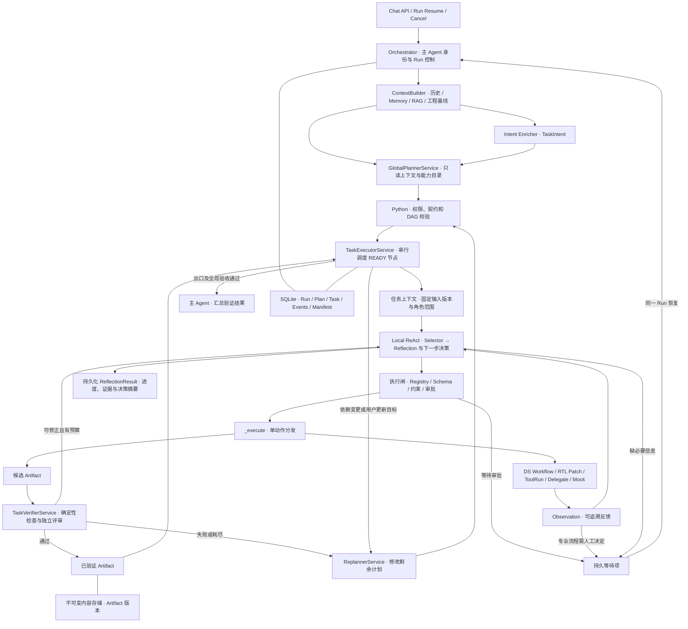

# chipDesignAgent 分层任务编排架构审查与技术设计

审查基线为提交 `107022e`，项目版本为 `0.6.0`。已确认架构方向为 Global Plan-and-Execute + Task-level ReAct + Independent Verifier + Replanner。文中「现状」对应当前代码，路径与行号均以该基线为准。第 7 节界定第一版范围，第 10 节定义首个待实施阶段。

## 1. 现状与改造边界

### 请求调用链

| 阶段 | 当前实现 |
| --- | --- |
| HTTP 入口 | `app/main.py:87` 挂载 `/api/v1`。`app/api/routes.py:161 chat()` 兼容旧客户端，`:172 send_conversation_message()` 以路径 Session ID 为准。两者经 `app/services/conversation_service.py:8 ConversationService.handle()` 调用 `OrchestratorService.handle()`。 |
| 会话与上下文 | `app/services/orchestrator_service.py:68 handle()` 建立 Token 统计域。`:105 _handle()` 解析 Session、确定主角色、写用户消息并触发 Memory 提取。`app/services/session_service.py:54 resolve()` 绑定项目和模块，角色可以随新消息切换。`app/services/context_builder_service.py:85 build()` 入库上传文档，选取角色可见的完整问答轮、逐轮摘要、长期记忆和 RAG chunk，返回含正文的 `effective_request` 与审计引用。 |
| 意图与 Run | `_handle()` 将 Memory 正文放入 `_memory_context`，将来源索引放入 `_context_manifest`。以 Registry 角色授权目录调用 `runtime.enrich_intent()` 并解析 `TaskIntent`，**然后**创建 Run、写 `active_run_id` 与 Manifest。因此 ContextBuilder 或 Intent 失败时，可能已有消息但没有 Run。`app/services/run_service.py:66 create_orchestration_run()` 保存派生意图，`context_builder_service.py:407 save_manifest()` 目前将 Observation IDs 固定写为 `[]`。 |
| 两段式工具决策 | `_handle()` 最多循环 6 轮。`app/services/tool_selector_service.py:30 select()` 通过 Registry 的启用角色目录筛选 Tool Metadata，去除越权结果并保留已授权的常驻工具。`orchestrator_service.py:498 _tool_context()` 展开 shortlist 的 JSON Schema。`app/agents/runtime.py:507 select_tool()` 调用 `app/models/provider.py:150 choose_tool()`，从 Responses 或 Chat Completions 归一化出一个 Tool Call，普通文本归一化为 `reply_to_user`。本地测试走 `runtime.py:131` 的规则实现。所谓 Planner 是这次单步决策，仓库中没有全局 TaskPlan、依赖图或独立验收。 |
| 执行与反馈 | `_handle()` 校验 shortlist，再查 Registry 的 `enabled/allowed_roles`，`:360 _execute()` 按工具名分发。专家委派返回非终态 Observation。DS、RTL、Mock EDA、真实工程工具启动、回复和提问等结束本轮循环，部分 Run 仍处于等待或运行态。Observation 只是字典列表，主要由委派产生，和调用及筛选轨迹一起由 `run_service.py:92 record_orchestration()` 写入 `runs.result_json`。 |
| 返回与恢复 | `_handle()` 写 Assistant 消息及摘要投递，`handle()` 汇总用量并对已完成 Run 触发 Memory 提取。`app/api/routes.py:297 resume_run()` 先按 `run_type` 调用 `RunService.resume()`，再写用户决定及状态回复。`run_service.py:513 get()` 会在读取时从关联 ToolRun 同步 Run 终态。 |

### 已有能力与必须先解决的耦合

| 组件 | 复用方式与改造 |
| --- | --- |
| ContextBuilder、Session、Memory、DocumentService | 保留角色隔离、预算、检索、摘要与 Memory 提取。抽出任务视图和可重建的输入快照。当前 RAG chunk 会替换 `effective_request.documents`，而 DS/RTL 也收到这一字段。新适配器对规划使用片段，对有基线要求的专业工作流使用经校验的完整文档版本。`ChatRequest.document_ids` 已声明，但现有构建链没有显式解析它，接入时校验每个 ID 的项目、模块和版本。 |
| Intent、Runtime、Selector、Registry | 保留 `TaskIntent` 和两阶段筛选，将 selector/query/observations 缩到当前契约。复用 `runtime` 的模型配置、Provider 和用量采集。`ToolSelection.arguments` 当前是任意字典，Provider 解析 JSON 也没有执行 Registry Schema 校验。新增后端校验；修正 `_tool_context(definitions or registry.list())`，空列表必须保持空列表。候选外选择按拒绝事件处理，避免当前替换成 `ask_user` 后未经同一执行闸重新确认权限的路径。 |
| 专业服务与 `_execute()` | 保留分发职责和 `TaskService`、`RTLService`、`PatchService`、`ToolRunService` 的专业对象。现有 `execute_*_tool()/complete_*` 会切换 `run_type` 并直接写 Run 状态、单值专业 ID 和结果。先拆出返回类型化结果的专业适配器，再由旧包装更新旧 Run。新分支的 `_execute()` 只接收已授权动作并返回结果/引用。DS/RTL 工具的 `instruction` Schema 目前与实际消费不完全一致，适配时对齐并禁止它覆盖契约或用户约束。 |
| Delegate | 复用 `delegation_service.py:58 delegate()` 的主专家白名单、持久记录、超时和 Memory 候选。`:204 _scoped_context()` 清空历史并只检索共享 Memory。`:240 _expert_callable()` 目前一次调用专业分析 Runtime，不运行工具循环。将委派生命周期与执行回调拆开，专家任务由同一 Task Executor 调度，专家的只读分析作为受控动作。 |
| 持久化与旧视图 | `app/storage/database.py:20 Database` 为 SQLite 访问层，业务 SQL 分散在 Service 中，仓库没有独立 Repository 层。`Database.transaction()` 使用 `BEGIN IMMEDIATE`。现有 `RunService.append_event()` 的取序和插入是两次调用，`_update()` 也是分离读写，新路径需将状态、事件和序号放到同一事务。旧路径使用现有 API 形状，逐步共享事务化实现。 |

## 2. 目标架构



### 规划与调度

1. 会话入口先事务化创建 Run、冻结 `primary_agent` 与项目/模块并关联用户消息。ContextBuilder 和 Intent 调用发生在提交之后，错误由 Run 捕获。原始指令始终可追溯，结构化的用户约束及确认输入由后端解析或确认后保存。历史、Memory、RAG 只提供证据，不能授予执行权限或替换已确认基线。
2. `GlobalPlannerService.propose()` 使用主模型的结构化 JSON 能力。输入包括原请求、`TaskIntent`、实际历史与摘要文本、Memory 正文、RAG 片段、基线版本与工程限制。角色目录来自 `app/agents/definitions.py:10 AgentDefinition` 和 Registry，跨角色候选与 `ALLOWED_EXPERTS` 取交集。规划端仅接收可授权的 Metadata，无执行器与审批能力。计划列出任务、依赖、能力和交付，不要求写出底层调用顺序。离线模式生成显式计划，保留原有确定性场景。
3. Planner 输出为草案，后端分配 ID、版本、状态和预算上限。每个节点必须声明输入、输出、依赖、约束和验收条件，根节点可声明空依赖，无额外输入的节点仍须显式给出空输入。后端验证节点唯一、依赖存在且无环、输入指向依赖声明的输出且类型匹配、验收器和能力已注册、目标与权限边界有效。要求恰好一个交付出口，所有其他任务都可到达该出口。简单问答由后端构造单节点计划，复杂工程请求由模型规划完整任务链。节点按角色、交付物或验收边界拆分，读取和分析等同一交付内部动作留在局部循环。默认单计划最多 8 个节点，可配置。可选工具提示只做能力验证，不含调用顺序、参数或执行授权。
4. `TaskExecutorService` 从当前计划查找所有可执行节点，检查前置状态和每个必需 Artifact，再按稳定排序键领取一个任务。列表次序只用来展示。领取与记录输入版本原子提交。下游上下文只从已验证的绑定读取 Artifact，必需件未通过则保持不可调度，可选件只允许缺省或绑定已验证版本。即使下游模型自行提供候选 Artifact ID，读取闸仍拒绝。未验证候选只允许同任务当前代次修正与 Verifier 使用。外部任务运行中让出工作线程，记录检查点，串行模式下 Run 仍只有一个活动节点。
5. 汇总节点由主 Agent 执行。正文与证据通过契约输入提供，最终发布前检查全局成功标准及引用是否仍有效。完成事件、最终 Artifact 引用、助手消息和后处理投递标记一起提交。出现失败时可展示部分结果及未达标项，Run 保留失败或等待状态。

草案校验失败时先按错误分类处理。JSON 格式、字段类型、环、节点过多、引用错配、越权能力等属于内部计划错误，记录脱敏诊断码、尝试号与用量。每次初始规划最多一次应用层纠正调用，传入有限的错误码及位置、原约束和目录。仍非法则将 Run 持久化为 `FAILED`，返回可理解的业务消息及 Run ID。Provider 现有 `generate_json()` 有一次格式修复，规划路径通过可选参数关闭该内层修复，由同一个两次调用额度覆盖格式与语义。超时等可重试错误共用这两次额度。初次规划纠正不消耗重规划次数。由后端确认的输入缺失打开用户等待，已知真实能力不可用则记录能力缺口。计划未经校验时不激活任何节点。

首版实际验收采用 Design 主角色的 UART 任务，计划为 `Design:rtl_analysis → Verification:impact_assessment → Design:final_report`，出口同时依赖前两个节点。读取 RTL 和设计分析属于第一个任务的两个局部动作。验证专家消费已验证的设计分析及其绑定的源文件版本，汇总读取两份已验证结论。具体能力与交付见第 7 节。

### Local ReAct 与执行闸

每轮传入 `TaskContract`、当前代次 `TaskState`、绑定的 Artifact 正文片段、角色可见上下文、新 Observation 和上轮验收结果。Selector 先从 `Registry.for_role(assigned_agent)` 与任务允许的能力和副作用范围交集筛选。Runtime 用一次 Function Calling 同时返回结构化 Reflection 与下一步动作。任务模式下，将各候选函数的参数包装为 `{reflection, tool_arguments}`，后端拆包为 `ReflectionResult` 和现有 `ToolSelection`，再按 Registry 原始 Schema 验证 `tool_arguments`。旧路径保留既有函数格式。

| Reflection 决策 | 绑定动作与后端行为 |
| --- | --- |
| `continue` | 选择一个经筛选的任务工具。后端校验、检查预算，再派发。 |
| `submit` | 对应 `submit_task_output`，提交交付草稿或待验 Artifact 引用，进入独立验收。 |
| `ask_user` | 对应 `ask_user`，提交明确问题及所缺输入。后端确认等待条件，专家问题经主 Agent 转达。 |
| `fail` | 对应 `report_task_failure`，返回缺口或无法推进的证据，由后端选择阻塞、失败或恢复路径。 |

首次决策可基于契约和已绑定输入，后续决策关联触发它的 Observation 或验收记录。后端验证条件 ID 属于当前契约，已满足与未满足集合互斥并覆盖验收条件，证据属于本次任务的可见输入，且决策与工具一致。持久化进度摘要、条件 ID、问题、决策和简短业务理由。反思是 Agent 的阶段性判断，验收表记录 Verifier 的结论。Reflection 与对应决策事件同事务落库，再派发工具，重启可恢复到该决策。格式非法、直接文本或越权选择计入决策额度并记录拒绝原因。若结果刚落库而预算已耗尽，保留 Observation 并写明后端停止原因。

执行闸按顺序验证候选集成员、Registry 最新状态与角色、任务范围、JSON Schema、Workspace 项目归属及路径、工程前置条件、审批授权。最终验证适配器实际收到的合并参数，禁用从模型参数写入 `role`、`workspace_id`、`user_approved`、授权记录或状态字段。对新路径使用显式审批记录，旧路径按原授权语义兼容。`requires_user_approval` 保护执行阶段，Patch 候选生成和正式应用分别由专业服务保护。后台 Worker 开始执行前再次确认动态权限和授权。所有通过、拒绝、失败、等待和回调都携带 `run_id/task_id/action_id`。直接访问专业 API 的调用者也复用对应的参数与工程安全检查。

同一份 Registry Schema 用于模型函数声明和服务端校验。Schema 未声明的参数若无业务用途，则明确拒绝。工具声明有默认值时，由适配器先补值再校验。批准动作只从用户操作入口产生。当前应用按本地单用户设计，`UserRole` 表示工程角色。若未来开放多用户访问，Run、Workspace、审批和 Blob 读取还需要独立的身份与访问控制。

| 契约用途 | 后端批准的任务约束 |
| --- | --- |
| UART 文件读取、设计分析、专家评估、报告 | `read_only=True`，`allowed_mutability=(READ, ANALYSIS)`。内部暂存证据和候选报告属于调度器记账，不授权写 Workspace。 |
| 明确要求生成 RTL Candidate 或 DS Candidate | 仅具备该能力的主角色可获得 `read_only=False`、`allowed_mutability=(READ, ANALYSIS, CANDIDATE_WRITE)`。约束来自用户明确目标和后端策略模板。RTL 还须绑定已确认 DS，候选只创建 Patch，应用由人工审批入口处理。专家及纯分析任务不授予候选写入能力。 |
| 明确要求真实 Verilator Lint | 单独批准主角色的 Lint 能力，`read_only=False`、`allowed_mutability=(READ, ANALYSIS, EXECUTION)`。工具启用、环境就绪、输入文件与运行参数绑定、人工审批四项均须满足。 |

`allowed_mutability` 只缩小 Registry 权限。后端拒绝 `read_only=True` 与写入/执行动作并存的契约。模型任务目录不暴露正式写入和外部写入能力，Patch 批准与应用由既有专业入口执行。

| 后端配置 | 默认值 | 计数边界 |
| --- | --- | --- |
| `max_action_steps` | 8 | 每 Task 执行代次。首次领取并准备派发 `action_id` 时计数，执行失败也计。审批前挂起、恢复同一动作、轮询和重复回调无需另计。额度耗尽仍可提交验收、提问或报告失败。 |
| `max_repair_attempts` | 3 | 每 Task 执行代次。验收失败后，只有可修复且后端进入修正时才递增。首次验收加最多三轮修正，共享该代次剩余动作与决策额度。 |
| `max_decisions` | 16 | 每 Task 执行代次。每次发起合并的 Reflection 与动作选择前计数，包括无效返回和模型调用错误。最后一个决策槽仅允许提交、提问或报告失败。Selector 与 Verifier 调用计入 Run 总模型用量。 |
| `max_replans` | 2 | 每 Run。完整重规划每次提案先计数，非法提案也计。第一版保留配置位，暂不自动发起重规划。 |
| `max_plan_tasks` | 8 | 每个候选计划版本校验节点总量，重规划同样受限。 |

后端冻结实际生效的配置和计数，契约预算可以收紧。等待恢复、验证失败修正和服务重启均沿用同一代次。后端另设单次超时与 Run 总模型额度。

### 单动作执行结果

旧 `_execute()` 的 `terminal=True` 既可能表示回复或 Mock 完成，也可能是 DS 中断、等待 Patch 审批、仅启动 ToolRun。新路径返回 `TaskActionResult`。它包含 `outcome`、摘要、证据、专业对象引用、候选产物引用及结构化等待请求。状态由 Task Executor 根据 `outcome` 和契约决定。

| `outcome` | 调度处理 |
| --- | --- |
| `observed` | 持久化执行反馈与候选引用，返回局部循环。DS 交付、读取文件、专家分析均可产生这一结果。 |
| `waiting_for_user` / `waiting_for_approval` | 持久化等待项及当前动作检查点。恢复同一个 `action_id` 或按补充信息更新任务输入。 |
| `awaiting_external` | 保存专业对象 ID，等待 ToolRun 等可对账终态。 |
| `failed` | 记录动作失败或能力缺口，允许在任务预算内继续决策。不可修复时由后端阻塞或终止。 |

提交验收是任务控制动作，由 Task Executor 路由到 Verifier。专业工具的返回值无法写 `TaskState.status` 或顶层 Run 状态。旧 `_execute()` 通过包装器继续产生旧 `terminal/message` 响应。为工具注册增加编排入口范围。新 UART 能力与任务控制动作只进入任务 shortlist，旧 Chat Selector 和独立 ToolRun 入口保持原有可见范围。

### Verifier 与正式交付

`TaskVerifierService.verify(contract, state, observations, candidates)` 先验证引用范围、来源动作、可读取性和内容哈希，再检查必需输出的存在性、数量、类型、结构与工程状态。验收规则由后端注册，契约引用规则 ID 和受限配置，例如 JSON Pydantic 模型、DS Markdown 章节、工作区快照、批准应用的 Patch 状态与结果哈希、真实 EDA ToolRun 的退出状态与日志。启用并获审批的 Verilator 通过已有 ToolRun 产出语法证据；Verifier 消费该证据，缺少时返回失败或可修复建议。Mock 输出仅能满足模拟链路验收。

复杂分析采用独立评审调用，明确要求引用已提供的证据 ID，后端校验引用归属、范围、完整性以及硬性验收结果。状态、审批、只读约束依据服务记录与动作账本校验。评审输出异常、缺证据或规则未知均不得放行。结构化结果包含 `passed/failed_criteria/repairable/suggestions/evidence`，随执行代次和待验 Artifact 集落库。通过后将输出标记为可消费并完成任务，两个变更在同一事务；失败保留候选与原因作为修正输入。

### Replanner 与 Delegate

- Replanner 收到当前不可变计划、任务状态、已绑定及已验证 Artifact、受限 Observation、失败原因和明确关联的最新用户决定。返回相对当前版本的编辑提案，包含替换、添加、取消的节点和理由，以及建议重跑节点。后端应用差异生成新版本并重新验证整个 DAG。默认每 Run 至多 2 次重规划，按调用计数并另受总额度限制。无合法方案或超限时停止自动调度。
- 已完成节点、历史契约、产物与审批记录全部保留。重跑适用于上游输入变化或已验证交付被证实无效。用户改目标时，优先增加或替换剩余节点，必要时用新节点承接不同的已完成契约。只有显式失效才为既有节点开启新执行代次。已应用 Patch、已确认基线受保护，后续修改必须形成新候选和独立审批。
- 重新验证发布新版本时，对比下游实际绑定的版本、内容哈希与验收相关的来源/审批语义。相同内容且语义等价可保留已完成消费者及其历史绑定；变化或失效时按依赖传播，只有消费受影响输入的节点重跑。若依赖是控制边且验收仍有效，按契约保留。运行中的结果使用当前计划及代次栅栏验证后才可发布。等待中的旧批准随被替换对象失效。
- 替换上游输出期间暂停其依赖节点和最终发布，待新版本验证后再比较。证实失效的旧输出立即停止用于新执行。全局验收失败时，如果证据表明某份既有交付无效，按上述规则显式失效并重跑。若只是出口需要补充信息，可新增交付节点并重新指定出口，保留原有成果。
- 对非主角色节点，Task Executor 以冻结的主角色调用 Delegate 包装层，校验 `ALLOWED_EXPERTS` 及全 Run 委派次数，生成关联任务和代次的 `delegation_tasks` 记录，再运行有时间预算的本地循环。专家只获得共享 Memory、选定文档和允许交付的 Artifact，历史默认空，执行范围为读取与分析，无嵌套委派和写入权限。Architecture 当前没有可用的编排 Tool，需要在 Registry 显式注册专家只读分析及任务提交能力，或使用受控单动作适配器。专家通过 Delegate 返回结构化结果与证据，仍经过同一 Verifier；主 Agent 是唯一对用户发出任务提问和汇总的角色。旧 `consult_*` 仍走原分支，避免新计划的专家节点被重复委派。

## 3. Pydantic 契约

建议放入 `app/domain/orchestration.py`。现有 `TaskStatus` 专用于 DS，`ArtifactStatus` 专用于 Workspace。`TaskState` 是一个执行代次的视图，`observations/artifact_ids` 由查询组装，动作级恢复信息独立持久化。Planner/Replanner 只能提交草案 DTO，服务为其分配可信 ID，构造以下对象。字段结构由 Pydantic 校验，跨对象、Registry、规则、存储和时间一致性由服务校验。

```python
from typing import Annotated, Literal

from pydantic import AwareDatetime, BaseModel, ConfigDict, Field, JsonValue

from app.domain.enums import AgentRole, Mutability


Key = Annotated[str, Field(min_length=1, max_length=120)]
Text = Annotated[str, Field(min_length=1, max_length=8_000)]
Hash = Annotated[str, Field(pattern=r"^[a-f0-9]{64}$")]
Positive = Annotated[int, Field(ge=1)]
Count = Annotated[int, Field(ge=0)]


class ContractModel(BaseModel):
    model_config = ConfigDict(extra="forbid", frozen=True)


class RunInput(ContractModel):
    kind: Literal["run_input"]
    key: Key


class TaskOutputRef(ContractModel):
    kind: Literal["task_output"]
    task_id: Key
    output_key: Key


class InputSpec(ContractModel):
    key: Key
    artifact_type: Key
    source: Annotated[RunInput | TaskOutputRef, Field(discriminator="kind")]
    required: bool = True


class OutputSpec(ContractModel):
    key: Key
    artifact_type: Key
    media_type: Key
    schema_id: Key | None = None
    required: bool = True


class Criterion(ContractModel):
    criterion_id: Key
    description: Text
    rule_id: Key
    output_keys: tuple[Key, ...] = ()
    parameters: dict[str, JsonValue] = Field(default_factory=dict)


class TaskConstraints(ContractModel):
    read_only: bool = True
    allowed_mutability: tuple[Mutability, ...] = (Mutability.READ, Mutability.ANALYSIS)
    user_constraint_ids: tuple[Key, ...] = ()
    notes: tuple[Text, ...] = ()


class ExecutionPolicy(ContractModel):
    max_action_steps: int = Field(default=8, ge=0)
    max_repair_attempts: int = Field(default=3, ge=0)
    max_decisions: int = Field(default=16, ge=1)


class RunExecutionPolicy(ContractModel):
    max_plan_tasks: int = Field(default=8, ge=1)
    max_replans: int = Field(default=2, ge=0)


class TaskContract(ContractModel):
    task_id: Key
    title: Text
    goal: Text
    assigned_agent: AgentRole
    capability_requirements: Annotated[tuple[Key, ...], Field(min_length=1)]
    tool_hints: tuple[Key, ...] = ()
    inputs: tuple[InputSpec, ...]
    outputs: Annotated[tuple[OutputSpec, ...], Field(min_length=1)]
    constraints: TaskConstraints
    depends_on: tuple[Key, ...]
    acceptance_criteria: Annotated[tuple[Criterion, ...], Field(min_length=1)]
    execution_policy: ExecutionPolicy = Field(default_factory=ExecutionPolicy)


class TaskPlan(ContractModel):
    plan_id: Key
    run_id: Key
    goal: Text
    tasks: Annotated[tuple[TaskContract, ...], Field(min_length=1)]
    success_criteria: Annotated[tuple[Criterion, ...], Field(min_length=1)]
    final_task_id: Key
    created_at: AwareDatetime
    version: Positive
    status: Literal["active", "superseded", "closed"]


class EvidenceRef(ContractModel):
    kind: Literal["artifact", "document_version", "chunk", "observation", "tool_run", "message"]
    ref_id: Key
    locator: Text | None = None


class Observation(ContractModel):
    observation_id: Key
    run_id: Key
    task_id: Key
    generation: Positive
    action_id: Key
    tool_name: Key
    status: Literal["succeeded", "failed", "waiting", "denied", "cancelled", "unknown"]
    summary: Text
    evidence: tuple[EvidenceRef, ...] = ()
    artifact_ids: tuple[Key, ...] = ()
    error: Text | None = None
    created_at: AwareDatetime


class ReflectionResult(ContractModel):
    progress: Literal["starting", "in_progress", "ready_to_submit", "blocked"]
    progress_summary: Text
    satisfied_criteria: tuple[Key, ...]
    unmet_criteria: tuple[Key, ...]
    issues: tuple[Text, ...]
    decision: Literal["continue", "submit", "ask_user", "fail"]
    reason: Text
    evidence: tuple[EvidenceRef, ...] = ()


class ReflectionRecord(ContractModel):
    reflection_id: Key
    run_id: Key
    task_id: Key
    generation: Positive
    decision_sequence: Positive
    action_id: Key
    observation_ids: tuple[Key, ...] = ()
    verification_id: Key | None = None
    result: ReflectionResult
    created_at: AwareDatetime


class ProfessionalRef(ContractModel):
    kind: Literal["ds_task", "patch", "tool_run", "delegation"]
    object_id: Key


class ActionWaitRequest(ContractModel):
    kind: Literal["clarification", "ds_resolution", "tool_approval", "patch_approval"]
    message: Text
    required_input_keys: tuple[Key, ...] = ()


class TaskActionResult(ContractModel):
    outcome: Literal[
        "observed", "waiting_for_user", "waiting_for_approval",
        "awaiting_external", "failed",
    ]
    summary: Text
    evidence: tuple[EvidenceRef, ...] = ()
    candidate_artifact_ids: tuple[Key, ...] = ()
    professional_refs: tuple[ProfessionalRef, ...] = ()
    wait: ActionWaitRequest | None = None
    error_code: Key | None = None


class TaskState(ContractModel):
    run_id: Key
    task_id: Key
    generation: Positive
    status: Literal[
        "pending", "ready", "running", "waiting_for_user", "waiting_for_approval",
        "completed", "failed", "blocked", "cancelled",
    ]
    phase: Literal["selecting", "dispatching", "awaiting_external", "verifying", "repairing"] | None = None
    current_iteration: Count = 0
    action_count: Count = 0
    repair_attempts: Count = 0
    observations: tuple[Observation, ...] = ()
    artifact_ids: tuple[Key, ...] = ()
    wait_id: Key | None = None
    failure_reason: Text | None = None
    started_at: AwareDatetime | None = None
    completed_at: AwareDatetime | None = None


class ContentRef(ContractModel):
    backend: Literal["managed_blob"]
    object_key: Hash
    media_type: Key
    byte_size: Count


class Artifact(ContractModel):
    artifact_id: Key
    run_id: Key
    name: Key
    artifact_type: Key
    source_task_id: Key
    source_generation: Positive
    source_action_id: Key
    output_key: Key
    version: Positive
    content_hash: Hash
    content_ref: ContentRef
    status: Literal["staged", "verified", "rejected", "superseded", "invalidated"]
    evidence: tuple[EvidenceRef, ...] = ()
    metadata: dict[str, JsonValue] = Field(default_factory=dict)
    created_at: AwareDatetime


class VerificationResult(ContractModel):
    passed: bool
    failed_criteria: tuple[Key, ...] = ()
    repairable: bool = False
    suggestions: tuple[Text, ...] = ()
    evidence: tuple[EvidenceRef, ...] = ()
```

- `plan_id` 唯一标识一次计划修订，`(run_id, version)` 标识 Run 内版本序列。`task_id` 在同一 Run 内稳定，契约快照归属计划版本，执行代次归属任务。同一代次只引用其实际领取的契约版本，计划升级可以继承未改变的执行代次。
- Artifact 的逻辑版本线是 `(run_id, source_task_id, output_key)`。每个 output key 每次提交最多一个版本，多文件交付可用受校验的索引 Artifact 引用清单。验证和发布以本次提交的 Artifact ID 集为准。专业状态用类型化服务引用关联，模型的 `metadata` 只能承载展示字段。
- `RunInput` 绑定该 Run 输入修订中经校验的服务引用，例如确认的 DS 内容、文档版本或 Workspace 快照。`TaskOutputRef` 绑定上游版本。`required=false` 可表示可选消费，缺失显式记录。强制全局成功条件用出口输出及从出口可达的证据校验，所有输出 key、规则参数、引用归属由验证器复核。
- `ReflectionResult` 是模型输出。后端附加 `ReflectionRecord` 的关联字段；`action_id` 指本次决策的账本记录，包含控制动作。新 Observation 和验收记录由后端关联。`TaskActionResult` 由后端适配器构建。等待结果必须带匹配类型的 `wait`，外部等待须有专业引用，失败须有稳定错误码，非等待结果的 `wait` 必须为空。

## 4. 数据库与可恢复执行

保持 SQLite 和 `Database.transaction()`。`task_snapshots`、`patches`、`tool_runs`、`artifacts`、`delegation_tasks` 保留为各专业对象的事实源。任务路径的版本、执行状态和血缘由以下表管理。所有 JSON 只保存小型契约、展示摘要或引用，并设大小限制。新表统一使用 UTC 时间。

| 表或变更 | 主键、字段与索引 |
| --- | --- |
| `runs` | 增加 `engine_version`，历史默认为 legacy，新路径值为 hierarchical。新增可空 `active_plan_id`、`root_message_id`、`active_wait_id`、`final_artifact_id`、`state_version`（默认 0）、`replan_count` 和后端冻结的执行策略。新增 `(session_id, updated_at)` 列表索引。 |
| `orchestration_run_inputs` | PK `(run_id, revision)`，保存根消息/补充消息引用、原始输入快照引用、项目范围、经确认的约束、文档版本/快照 ID、Intent 和全局 Manifest ID。可恢复参数在此保存，审批记录独立管理。 |
| `orchestration_plans` | PK `plan_id`，FK `run_id`，唯一 `(run_id, version)`，活动状态用 `run_id WHERE status='active'` 部分唯一索引。保存目标、输入修订、验收规则、出口 ID、前一版本、创建时间。 |
| `orchestration_tasks`、`orchestration_plan_tasks`、`orchestration_task_edges` | 任务身份 PK `(run_id, task_id)`；计划节点 PK `(plan_id, task_id)`，含契约 JSON、展示次序、有效代次。边 PK `(plan_id, task_id, depends_on)`，两端复合 FK 指向同计划节点，反向索引 `(plan_id, depends_on, task_id)`。 |
| `orchestration_task_attempts` | PK `(run_id, task_id, generation)`，FK 到任务及实际契约版本。保存状态、阶段、计数、失败原因、开始/结束时间、状态版本、lease owner/expiry/fence、下次调度时间。索引 `(run_id, status)` 和 `(status, next_wakeup_at)`。旧代次只读，是否有效由活动计划的节点映射决定。 |
| `orchestration_actions`、`orchestration_observations` | Action PK `action_id`，唯一 `(run_id, task_id, generation, action_sequence)`，记录 shortlist、解析后参数引用与摘要、授权/幂等键、执行状态与专业引用。Observation PK `observation_id`，FK action 及代次，唯一 `(action_id, event_key)` 去重开始、等待、终态等反馈。按任务代次及序号查询。 |
| `orchestration_reflections` | PK `reflection_id`，唯一 `(run_id, task_id, generation, decision_sequence)`，唯一 FK `action_id`。保存触发的 Observation IDs、可空的验收记录 ID、限长结构化 Reflection 和时间。与决策账本及 `reflection_recorded` 事件同事务写入，按序查询。 |
| `orchestration_artifacts`、`orchestration_input_bindings` | Artifact PK `artifact_id`，FK 来源动作和代次，唯一 `(run_id, source_task_id, output_key, version)`，保存内容哈希、存储键、状态与来源。输入绑定 PK `(run_id, consumer_task_id, generation, input_key)`，FK 精确到 Artifact ID，或绑定 Run 输入修订及键。建 `(artifact_id, consumer_task_id, generation)` 反向索引，支持精确失效和重跑。 |
| `orchestration_verifications`、`orchestration_replans` | 验收记录以任务代次及验收序号唯一，记录规则版本、提交 Artifact IDs 和结构化检查结果；全局验收关联计划版本与出口。重规划记录唯一 `(run_id, attempt_no)`，含触发事件、旧/新版本、编辑差异、受影响节点、结果、原因及模型用量。失败提案也留审计。 |
| `orchestration_waits` | PK `wait_id`，关联 Run 及可空的任务代次/动作 ID，含等待类型、批准目标及哈希、用户决定、可用动作、输入修订、截止时间和状态。Run 级条件唯一索引限制一个有效人工等待，`(run_id, client_request_id)` 唯一去重同次决定。 |
| `orchestration_professional_links`、`orchestration_jobs` | Link 以 `(action_id, object_kind, object_id)` 唯一关联 DS Task、Patch、ToolRun、Delegate，专业对象可反查所有者和代次。由适配器验对象类型与项目范围，专业启动使用预留 ID/幂等键并和 link 原子登记。Jobs 用持久任务表记录待派发/收集工作，按 `(status, ready_at)` 领取，以动作/事件键唯一约束去重。 |
| `run_events`、`context_manifests` | 增加可空 `orchestration_task_id`、`generation`、`plan_id`，事件另加 `action_id` 和小型结构化 payload，Manifest 增加 `phase`、`artifact_ids_json`、`input_revision`、`content_ref`。保留 Run 索引并增加按任务代次检索索引。全局 Manifest 的任务字段为 NULL。复合键或事务校验保证附属记录与 Run 一致。 |

Artifact 文件进入后端管理的不可变内容目录，以实际字节的 SHA-256 寻址，使用受控路径解析、临时文件和原子替换。先写并校验内容，再提交版本行。中断遗留的无引用 blob 可在宽限期后回收。分配版本号和发布在事务中完成。旧 `workspace_service.py:123 ArtifactService.create()` 将多个版本写到同一路径，历史行可作来源引用，只有可验证的字节快照才能作为新输入。大段 DS、RTL、报告、日志正文由引用读取，旧 API 必须的展示内容按需从专业对象或 Artifact 组装。

Manifest 跟随阶段记录实际使用的消息、摘要、Memory、RAG、Observation 和精确 Artifact 版本，记录检索时间、取舍和序列化输入哈希。为恢复保存预算后的上下文输入快照或其可重建不可变引用。可变 Memory 内容需要快照，来源 ID 与内容哈希分别保留。快照沿用源角色与项目访问边界，模型只接收必要正文。

在 `database.py:_initialize()` 增加有版本号、可重复执行的增量迁移，在新增列之后建相关索引。当前若干专业表使用位置式 `INSERT … VALUES`，新增列前必须改为显式列名，优先用关联表避免改专业表布局。迁移回归使用既有数据库夹具；旧 Run 不回填虚构 TaskPlan，保留原事件、专业 ID、Run Type 和旧恢复逻辑。

### 原子性与并发

1. Run 状态、节点代次、事件序号、等待项和 Job 变更在短事务中提交，模型和外部进程在事务外运行。通过期望状态、活动版本、代次和递增 fence 拒绝过期 Worker。Lease 到期后检查外部对象或恢复检查点，可安全重试的动作才重新派发。外部效果不明时持久化 UNKNOWN Observation 并等待人工处理，避免重复执行。
2. `active_run_id` 只决定 UI 焦点，不参与授权或调度。同一 Session 可有多个 Run，角色和输入修订按 Run 冻结，历史按角色及根消息 sequence 截断，避免并发后来消息混入计划。提交回复显式携带 `turn_id/run_id`。提供按 Session 查询 Run 的分页接口，补充信息显式定位 Run 与等待项。
3. 正式写入由 PatchService 管理。以规范化 Workspace 路径锁定同一目标，审核时绑定候选哈希、基线内容及存在状态。跨进程需要数据库领取/锁和写前复核。`replace` 与数据库提交之间用持久应用意图及实际哈希对账，遇到第三方变更停止应用并报告冲突。Patch 单独审批路由和 Run Resume 共用该入口，并通知关联任务。
4. `ToolRunService.start()` 当前使用进程内线程池，`_execute()` 结束前先写 parsing、日志和问题记录。新路径先登记专业 ID 与 Job，再提交 Worker，完成时写持久终态通知；由重启后的 reconcile 扫描遗留记录并按 action 消费，GET 可保持只读。处理中失败需要落终态，特别是日志/Issue 持久化异常。现有执行器缺少可确认的取消能力，运行中取消沿用 409，直到增加可验证的进程取消与回收。

## 5. 状态与等待协议

| 对象 | 合法迁移与状态负责人 |
| --- | --- |
| Run | `PLANNED → RUNNING`。规划期间仍可打开 Run 级用户等待。`RUNNING ↔ WAITING_FOR_USER / WAITING_FOR_APPROVAL` 由当前有效等待项驱动。所有有效节点完成、出口 Artifact 已验证且全局验收通过时，由 Task Executor 提交 `COMPLETED`。不可修复、重规划用尽或系统失败进入 `FAILED`。合法取消进入 `CANCELLED`。终态无出边。 |
| Plan | 校验成功才持久化为 `active`。接受重规划时，旧版本 `superseded` 与新版本 `active` 在同一事务生效。Run 终结时关闭活动版本。无效草案只记校验或重规划失败事件。 |
| Task 代次 | `PENDING → READY → RUNNING`。等待项打开时进入对应等待态，经绑定的输入或审批恢复到 `RUNNING`。ToolRun 等待用 `RUNNING/awaiting_external`。仅 Verifier 通过可完成。已启动且执行或验收耗尽为 `FAILED`，依赖或能力不可满足为 `BLOCKED`，显式取消或未完成节点移除为 `CANCELLED`。这些终态写入完成时间，重跑新建代次。 |
| Artifact | `STAGED → VERIFIED / REJECTED`，验证通过才可输入下游。允许在 Run 中因新版本发布而 `VERIFIED → SUPERSEDED`，历史读取按精确绑定。证据无效可进入 `INVALIDATED`，触发重规划和消费链失效。拒绝、取消留下的候选不可发布。Workspace 的 `accepted` 或 Patch 的 `applied` 独立管理。 |
| 等待项 | `OPEN → RESOLVED / EXPIRED / CANCELLED`，用户动作由后端按类型和当前对象状态验证。补充信息可生成新 Run 输入修订；目标或约束变更触发 Replanner。审批绑定动作、规范化参数哈希、Workspace、对象版本和代次。补充参数改变批准目标时，生成新的等待项。 |

Run 等待状态是当前等待项的投影，由同一写事务维护。DS 的 `waiting_for_user`、Patch 的 `patch_ready`、外部 ToolRun 的 `queued/running/parsing` 只由适配器翻译为任务检查点或 Observation。DS `delivered` 只证明候选可验，Patch `rejected` 只证明拒绝决定已处理。若契约要求正式应用，拒绝不可作为交付成功。若仅要求生成待评审候选，可验证候选但不得将其作为已应用 RTL。要求真实检查通过的任务也不能消费 Mock 成功结果。

继续使用 `POST /runs/{run_id}/resume`。新路径扩展 `RunResumeRequest` 的可选 `wait_id`、`client_request_id`、`expected_state_version`、`document_ids` 和已确认基线引用。新 UI 提交这些定位字段；过渡期旧客户端仅在当前恰有一个类型明确且兼容的等待项时可按旧请求恢复。恢复事务先写用户决定与消息、再消费等待项及生成恢复 Job，恢复后的任务上下文显式包含该消息和新输入。通用补充信息有合法的 `provide_resolution` 处理分支。普通新消息默认创建新 Run。遇到过期等待项或竞争决定返回 409，重复的同一请求返回既有处理结果。

第一版等待记录至少包含 `run_id/task_id/generation/action_id`、输入修订、等待类型、问题或审批目标、允许的用户动作、参数或候选哈希。打开等待项时连同决策、Reflection、计数和检查点提交。恢复先核对 Run、等待项、代次及当前权限，再事务性领取用户决定。补齐输入后沿用计数，按同一契约继续。真实工具批准后重验原参数哈希和执行范围，派发已记录动作。若新信息改变了契约目标或授权范围，第一版记录变更并提示重新发起 Run，完整重规划路径再支持在同一 Run 应用计划调整。未知外部结果保留待对账检查点，禁止无条件重复派发。

规划前发现缺少决定性信息，可打开无 `task_id` 的全局等待项。任务级提问和 DS 中断保留当前代次与计数。真正不可恢复的能力缺口可标记阻塞并进入重规划，不能用反复提问延长执行。等待期限可配置，过期按类型触发重新请求、阻塞或终止。恢复后继续保存 Token 用量，最终对话摘要与 Memory 提取采用持久 Job 幂等投递。只有经过验收的 Run 结果进入现有 Run Memory 提取路径，专家结论仍只形成候选。

## 6. 主流程伪代码

下列原子操作均校验当前 Run 版本、任务代次和 Worker fence。模型调用与 IO 在事务之外，执行结果经检查点重新进入同一调度器。

```python
async def handle_chat(request):
    run, root_message = create_run_and_message(request)
    try:
        context = build_global_context(run, request, root_message)
        intent = enrich_intent(context, authorized_tools(run.primary_agent))
        snapshot = persist_inputs_manifest_and_intent(run, context, intent)
        await plan_or_wait(run, snapshot)
        await drive(run.id, until_yield=True)
    except OrchestrationError as error:
        record_failure_or_recovery_checkpoint(run.id, error)
    return render_chat_response(run.id, root_message.turn_id)


async def plan_or_wait(run, snapshot):
    if decision_required_before_planning(snapshot):
        return open_wait(run, kind="clarification", task=None)
    if is_simple_question(snapshot):
        return activate_plan_and_enqueue(run, validate_plan(single_task_draft(snapshot), snapshot, run))
    feedback = None
    for attempt in (1, 2):
        try:
            proposal = await planner.propose(
                raw_request=snapshot.raw_request,
                intent=snapshot.intent,
                context=snapshot.model_context,
                capabilities=policy.capability_metadata(run),
                validation_feedback=feedback,
                repair_json=False,
            )
            plan = validate_plan(proposal, snapshot, run)
        except (InvalidPlan, RetryablePlannerError) as error:
            feedback = record_sanitized_planner_error(run.id, attempt, error)
            continue
        return activate_plan_and_enqueue(run, plan)  # plan_created, plan_validated
    return fail_planning_with_public_status(run.id)


def validate_plan(proposal, snapshot, run):
    contracts = parse_and_assign_server_ids(proposal)
    check_limits_and_unique_keys(contracts)
    dag = build_dependency_graph(contracts)
    check_references_and_toposort(dag)
    check_input_sources_outputs_and_required_types(dag, snapshot)
    check_capabilities_roles_registry_and_constraints(dag, run, snapshot)
    check_verifier_rules_and_output_schemas(dag)
    check_single_reachable_final_task(dag, run.primary_agent)
    return build_validated_plan(run, snapshot, dag)


async def drive(run_id, until_yield=False):
    while within_worker_slice(until_yield):
        state = load_checkpoint(run_id)
        if state.is_terminal or state.has_open_wait:
            return
        if state.needs_replan:
            if not state.replanning_enabled:
                return finish_with_blocked_or_failed_task(state)
            await replan(state)
            continue
        if state.waits_for_external_result:
            return  # ToolRun 或专业服务终态事件唤醒
        if state.all_active_tasks_completed:
            return await aggregate_and_finish(state)
        task = claim_current_or_ready_task(state)  # READY 同时要求依赖及输入版本可用
        if task is None:
            return record_blocked_and_enqueue_replan(state)
        await execute_scoped_task_slice(task)
    enqueue_continuation(run_id)


async def execute_scoped_task_slice(task):
    # 外部专家在 Delegate 包装中执行同一 local_step。
    context = load_or_build_task_context(task, save_manifest=True)
    if task.has_resumed_or_finished_action:
        return consume_saved_action_result(task)
    if task.phase == "verifying":
        return await verify_submission(task)
    if task.decision_budget_exhausted:
        return fail_and_enqueue_replan(task, "decision_budget")
    decision = reserve_decision_slot(task)
    shortlist = selector.select_for_task(
        task.contract, context, task.observations, controls_only=decision.is_last
    )
    try:
        reflection, choice = await runtime_reflect_and_select(task, context, shortlist)
        validate_reflection_and_action_binding(reflection, choice, task)
    except InvalidLocalDecision as error:
        return record_rejected_decision(task, decision, error)
    action = record_decision_and_reflection(task, decision, reflection, choice, shortlist)
    # action_selected, reflection_recorded
    checked = gate.validate(action, task, shortlist)
    if checked.is_invalid:
        return record_denial(task, action, checked.reason)
    if checked.requests_user_input:
        return open_wait(task.run_id, kind="clarification", task=task, action=action)
    if checked.reports_failure:
        return resolve_failure_or_capability_gap(task, action, checked)
    if checked.submits_output:
        stage_outputs_and_mark_verifying(task, action, checked)
        return await verify_submission(task)
    if task.action_budget_exhausted:
        return record_denial(task, action, "action_budget")
    if checked.needs_approval:
        return open_wait(task.run_id, kind="approval", task=task, action=action)
    claim_dispatch_and_count_once(task, action)
    outcome = await execute_one(checked, idempotency_key=action.id)
    return persist_outcome_and_schedule(task, action, outcome)
    # 专业对象等待、外部运行或同步完成均有 Observation/检查点。
    # task_started, tool_executed, observation_recorded 随相关状态变更写入。


async def verify_submission(task):
    result = await verifier.verify(
        task.contract, task.state, task.observations, task.staged_artifacts
    )
    if result.passed:
        return publish_artifacts_and_complete(task, result)
        # verification_passed, task_completed
    record_verification_failure(task, result)  # verification_failed
    if result.repairable and can_repair_with_remaining_budget(task, result):
        return begin_repair_once_and_requeue(task, result)
    return fail_and_enqueue_replan(task, result)  # task_failed


async def replan(state):
    ticket = reserve_replan_attempt_or_finish(state)  # replanning_started
    if ticket is None:
        return
    try:
        delta = await replanner.propose_delta(
            state.active_plan, state.task_attempts, state.artifact_refs,
            state.observation_summaries, state.trigger, state.latest_user_input,
        )
        draft = apply_permitted_delta(state, delta, ticket.base_plan_version)
        affected = compute_invalidated_consumers(state, draft)
        candidate = validate_plan(draft, state.current_inputs, state.run)
    except ReplanValidationError as error:
        return record_replan_rejection_and_apply_budget(ticket, error)
    commit_plan_swap_and_generations(ticket, candidate, affected)  # plan_updated


async def aggregate_and_finish(state):
    report = resolve_verified_final_output(state.active_plan)
    verification = await verifier.verify_run(
        state.active_plan.success_criteria, report, state.bound_evidence
    )
    if not verification.passed:
        return record_global_failure_and_enqueue_replan(state, verification)
    commit_run_completion(state, report, verification)  # run_completed
```

恢复 Job 使用已持久化的动作分支。用户授权工程工具时复核当前 Registry 与绑定哈希，再派发同一 action；Patch 决策走 `PatchService.decide()`；DS 决策走 `TaskService.resume_task()`；新增基线或目标触发必要的上下文刷新与重规划。ToolRun 完成事件根据 link 唤醒对应代次，以业务终态与日志生成 Observation 和待验 Artifact。重复通知、迟到的 Worker 或被替代计划的输出只能记录审计，不能重新发布。对于已继承到新计划的同一代次，是否采纳由当前映射及其输入有效性判断。

## 7. 第一版 MVP 与后续实施

### 第一版范围

1. **A · 执行契约和真实能力。** 建立计划草案验证、Reflection 与单动作结果契约、执行闸和 UART 只读工具。保留旧聊天默认路径。第 10 节给出本阶段的文件、接口和门槛。
2. **B · 串行闭环。** 在开发开关后将 Global Planner、串行 DAG、Local ReAct、Observation、Reflection、Verifier 和基本 SQLite 持久化连成一条 UART 链路。落库最小集合包含 Run 输入及计划、节点契约和依赖、任务代次与计数、动作、Observation、Reflection、Artifact 与输入绑定、验收、等待和事件。Artifact 从第一版即采用不可变内容、版本与哈希，新的执行沿用已绑定版本。单服务进程负责执行，使用每 Run 的串行入口、短事务、状态条件更新和唯一幂等键。启动时扫描未结束检查点，恢复明确可重试的只读动作，按专业引用对账结果未知的动作。等待、用户恢复和审批沿用第 5 节约束。
3. **C · 真实 Lint 可选扩展。** 在 B 的串行链路上接入现有 ToolRun 与显式工具审批。配置启用且确认 Verilator 可用时，才允许新路径规划真实 Lint。环境未满足时返回能力缺口。DS/RTL Candidate 保持旧路径及审批语义，直到专业适配与完整恢复通过独立验收。

第一版启用 `max_action_steps=8`、`max_repair_attempts=3`、`max_decisions=16`、`max_plan_tasks=8`。保留 `max_replans=2` 配置和失败事件接口，任务修正耗尽后持久化失败/阻塞并结束该 Run，供用户带明确补充条件重新发起。多 Worker lease 与队列、全量重规划差异合并和自动版本失效传播属于后续阶段。首版固定输入修订与 Artifact 绑定；确需替换已消费输入时停止受影响 Run 并提示重新发起。公开开关按入口逐项启用。

### UART 真实能力与端到端验收

| 能力 | 仓库现状与第一版方案 |
| --- | --- |
| Workspace RTL 读取 | `app/tools/builtin.py` 现有工具只有用例发现和禁用的 Verilator。新增 Registry 工具 `read_rtl_source`。Workspace 来自 Run 受信输入，文件必须属于同项目、受控根与任务明确允许的路径集合。只读打开常规 HDL 文件，限制后缀、大小、文本编码与输入预算，记录实际字节哈希和行范围。适配器返回本次读取的候选源码快照引用，拒绝超范围路径、目录、不可读或缺失文件。 |
| Design 与 Verification 分析 | `app/services/delegation_service.py:240 _expert_callable()` 映射通用专业 Runtime，`app/agents/specialists.py:79/126` 的现有提示主要面向规格分析。新增专用 Registry 能力 `analyze_rtl_design` 和 `assess_rtl_verification`，由同一个主 Runtime / Agent Registry 进入各自角色的 RTL 分析入口。前者消费实际源码快照并提交带行号证据的结论；后者经 Delegate 消费已验证的设计分析与源码快照，提交功能影响、验证关注点及其证据引用。只读隔离、共享 Memory 和无嵌套委派策略照旧。缺少真实模型或能力时按环境错误处理。测试可注入确定性模型输出，正式演示使用真实配置与真实文件。 |
| Verilator Lint | `app/tools/builtin.py:43 _verilator_lint()` 已使用受控文件列表、`shell=False` 和超时，`:151` 默认禁用。诊断目前只报告 Mock 环境。本次审查在当前 PATH 找不到 `verilator`，未运行真实 Lint。C 阶段以部署配置启用并检查可执行程序，明确展示禁用、环境缺失、等待审批、已实际运行。使用固定快照及受控依赖，执行记录绑定输入哈希，复用 ToolRun 日志和问题解析，修正超时输出的类型归一化。基础 UART 报告是源码分析；仅当显式请求 Lint 时增加独立节点与审批，通过真实 ToolRun 的退出码及日志验收。 |

验收用例使用检入的最小 UART 测试夹具，写入测试专用 Workspace。Design 节点先读取文件，再分析收发状态、计数条件或复位行为，提交 `rtl_snapshot` 与 `design_analysis` 两个产物。Verifier 校验哈希、必需字段及引用行范围后发布。Verification 专家节点绑定这两个产物，提交带证据的 `verification_assessment`。主 Agent 汇总为 `final_report`，逐项标明源码事实、推断和检查建议。测试断言读取真实字节、专家绑定同一版本、每个任务提交前有 Reflection、最终结论来源可追踪。真实环境演示另记录模型和工具实际可用性；C 阶段在安装 Verilator 的环境中用有效 UART 与故意有语法错误的 HDL 分别验证实际通过和失败。缺能力、缺输入或验收未过均有显式状态，Mock 只用于独立的模拟场景。

### 完整架构的增量实施

各阶段分别交付和测试。用显式 feature flag 控制新 Run，启动时写入 `engine_version`，回滚开关只影响新请求。旧 Run 和已进入新路径的 Run 各自按固定引擎恢复。

| 阶段 | 文件、接口与数据变更 | 阶段验收 |
| --- | --- | --- |
| 1. 执行契约与安全闸 | MVP A，详见第 10 节。旧包装和 API 继续运行，建立新路径的候选约束、参数校验及类型化专业结果接口。 | 角色、候选集、参数、Workspace 和审批门槛的独立测试，现有专业入口回归。 |
| 2. 计划、任务与追溯 | 新增 `app/domain/orchestration.py`、`app/services/global_planner_service.py`、`app/storage/orchestration_repository.py`。迁移计划、节点、边、输入修订、代次、Manifest 和事件字段。扩展 `context_builder_service.py`、`agents/runtime.py` 和 `api/routes.py`，提供只读 `GET /runs/{id}/plans`、`GET /runs/{id}/tasks`。在隔离测试或调试入口生成计划。 | 图乱序、缺依赖、环、输入类型错配、无可达出口、越权能力、非法 Tool 提示。断言 Planner 收到正文与来源、专家视图剔除私有内容。验证重复迁移和旧 Run JSON 不变。 |
| 3. 串行 DAG、Local ReAct 与验收 | 新增 `task_executor_service.py`、`task_verifier_service.py` 与 Artifact 管理，扩展 `orchestrator_service.py`、`context_builder_service.py`、`delegation_service.py`。启用动作、Observation、Reflection、验证、Artifact 及绑定表。先接入只读分析、普通聊天和受控专家。 | 乱序 DAG 与分支汇合，失败上游阻挡下游，候选不可见，Reflection 和拒绝记录可追踪，8 次动作和 3 次修正按各自条件计数且修正共享动作额度，专家权限与上下文隔离，Mock 不能满足真实 EDA 规则，Run 结果 JSON 不含大正文。 |
| 4. 专业状态、用户等待与恢复 | 扩展 `run_service.py`、`api/routes.py`、`task_service.py`、`rtl_service.py`、`patch_service.py`、`tool_run_service.py`。引入等待、专业关联、Job 与领取栅栏，统一独立审批 API 和 Run 决策入口。更新 `frontend/src/{App.tsx,api.ts,types.ts}` 的等待卡、轮询、任务列表与恢复。接入 DS、RTL Patch 和工程 ToolRun。 | DS 中断重启后恢复且不重建，未批准/拒绝 Patch 无正式写入，过期与并发审批，文件更新后拒绝陈旧 Patch，进程或服务重启后对账，重复完成事件和回调不重复调度，两个 Run 同会话互不串线。 |
| 5. 重规划与灰度 | 新增 `replanner_service.py`，完成重规划历史、版本切换、输入失效传播与 Run 总预算。按入口逐步启用新引擎。保留旧读写投影与诊断视图。 | 修正耗尽触发重规划，非法方案限次，完成节点默认保留，相同哈希及语义不重跑，变化或失效仅重跑受影响消费者，计划更新后旧审批与晚到结果被拦截，开关回退后已创建的新旧 Run 均可恢复。 |

## 8. 兼容性决策与风险

| 范围 | 当前行为、首版接入与风险 |
| --- | --- |
| DS Workflow | `app/workflows/ds_workflow.py:297 build_ds_workflow()` 的 LangGraph 保留准备、架构/设计/验证分析、冲突讨论、人机中断、生成及多视角评审。`task_service.py:18 create_ds_task()` 在调用返回后保存 SQLite 快照；`:43 resume_task()` 同进程恢复 LangGraph 中断，重启后走 `:114 _resume_persisted()`，该回退按保存状态重新生成并评审。顶层适配器关联同一 DS Task ID，保留既有 AS 前置条件、角色禁用和自定义评审，验收只补交付契约层。首次专业调用开始前应预留 ID 与动作检查点，避免进程崩溃后凭猜测创建第二个任务。 |
| RTL Candidate / Patch | `rtl_service.py:21 create_candidate()` 生成候选与 Patch。`patch_service.py:74 decide()` 复核 before 内容，只有 approve 应用，现有工作区写入使用临时文件替换。保留 Diff 和独立端点。当前旧 `RunService.resume()` 把 approve 和 reject 都映射为 Run 完成，新路径把「审批已处理」与「契约所需输出已达标」分开。候选与应用后 RTL 使用不同交付类型。 |
| ToolRun 与 EDA | `tool_run_service.py:38 start()` 创建独立异步执行记录。当前真实 `verilator_lint` 在 `tools/builtin.py:120` 注册且禁用，`run_mock_eda` 不启动进程。保留启停与显式审批。EDA Issue 保留关联 ToolRun 的专业队列。通过终态通知和对账驱动任务继续执行。仅当退出状态和所需日志均可追溯时，Verifier 才可验证相应标准。 |
| 中途补充信息 | 现有普通 `ask_user` 的等待无通用 Resume 分支。新路径由等待项和 Run 输入修订提供通用恢复，用户决定先落库再运行。已完成或失败的终态 Run 保持可审计，新指令创建可引用其 Artifact 的新 Run。 |
| 并发 Session / Workspace | 当前 `active_run_id` 只有一个，事件序号也存在读写竞争。用 Run ID、计划版本、代次、输入快照与事务隔离；跨 Run 的真实文件写入仍按目标路径竞争控制。会话角色切换只影响后续 Run，恢复授权由原 Run 和当前后端权限共同决定。 |
| 旧 API 与前端 | 旧历史 Run 保持 `RunView`、原 `RunType`、单值 `legacy_task_id/tool_run_id/patch_id` 和已有恢复分支。新 Run 固定 `run_type=orchestration`，多专业对象在任务视图展开；旧兼容字段仅对存在唯一对应对象的 Run 投影。当前 `frontend/src/App.tsx:714` 按 `rtl_implementation` 显示审批卡，`:377` 依赖 `legacy_task_id` 选择 DS Resume 路径。阶段 4 改为以当前等待项的类型和专业引用渲染，继续支持旧视图。新路径的获取接口只读，旧 ToolRun GET 投影保留到独立迁移。 |
| 延迟与调用成本 | 全局规划、独立验收和重规划新增模型调用。简单问答保持单任务，并以确定性检查验收输出。串行调度首版使用明确模型决策和总预算、分阶段 Manifest，以及可恢复异步处理，避免延长单次 HTTP 到整个工程任务完成。 |

## 9. 基线验证

在提交 `107022e` 的隔离副本中用项目虚拟环境运行 `python -m pytest`，结果为 **96 passed**。测试配置强制使用确定性 Runtime。基线包含 19 条现有 Pydantic 用量序列化警告和 1 条隔离目录 pytest 缓存权限警告。真实模型、真实 EDA 及本文拟议功能尚未验证。

## 10. 第一实施阶段 A 的变更清单与验收

本阶段交付可独立验证的 Planner 入口、动作安全闸、结果契约及 UART 能力。新接口先供内部调用及注入式测试使用。正式聊天入口仍使用旧编排，SQLite 新表和公开 Run 恢复字段在 B 阶段随串行闭环启用。

### 准备修改的文件

| 文件 | 预期修改 |
| --- | --- |
| `app/domain/orchestration.py`（新增） | 第 3 节的 TaskPlan、TaskContract、TaskState、Observation、Artifact、ReflectionResult、ReflectionRecord、TaskActionResult 和执行策略。加入草案 DTO 与动作边界输入，隔离服务端字段。 |
| `app/services/global_planner_service.py`（新增） | 注入模型与权限目录，区分单节点问答、完整工程计划、用户输入缺失和能力不可用。实现两次调用上限、计划验证和结构化诊断。 |
| `app/models/provider.py`、`app/agents/runtime.py`、`app/agents/specialists.py` | 规划路径显式关闭 Provider 内部 JSON 修复，保留旧默认。新增任务模式 Reflection 选择与 RTL 专业分析入口，复用主模型配置及角色定义。 |
| `app/tools/registry.py`、`app/tools/orchestration.py`、`app/tools/builtin.py` | Registry Schema 校验及共享授权检查，登记 UART 能力与任务控制动作。受控 HDL 读取和 Schema 放在工具层，工程进程 executor 继续使用现有签名。 |
| `app/services/workspace_service.py` | 复用受控路径解析，供读取动作校验 Workspace 与项目归属，读取限定路径内的常规文本 HDL。 |
| `app/services/tool_selector_service.py`、`app/services/orchestrator_service.py` | 增加任务候选筛选与类型化动作入口，分离旧 `terminal` 兼容包装，修复空 shortlist 退回全目录的情况。 |
| `app/services/delegation_service.py`、`app/services/tool_run_service.py` | 专家包装支持注入的受控 RTL 分析和限定输入，复用现有委派白名单与超时。工程工具复用 Registry 参数校验，保留既有审批与禁用状态。 |
| `pyproject.toml` | 若服务端 Schema 校验引入库，声明直接依赖并固定受支持的 Schema 方言。 |
| `tests/test_task_contracts.py`、`tests/test_task_action_gate.py`、`tests/fixtures/uart.sv`（新增） | 覆盖非法计划、Reflection/动作契约、真实文件读取、证据、权限和专家输入隔离。现有测试继续作为兼容基线。 |

### 接口与数据边界

| 内部接口 | 输入与返回 |
| --- | --- |
| `GlobalPlannerService.plan(request, intent, context, capabilities, policy)` | 接收完整受信规划输入。模型返回 `TaskPlanDraft`，仅含目标、草案节点 key、契约、依赖、出口与验收规则，服务验证并映射服务端 ID。结果为已校验计划、确认的输入等待、能力缺口或已归类的计划失败。草案中无 Run 状态、批准记录、版本号或工具实参。 |
| `ToolSelectorService.select_for_task(contract, context, controls_only=False)` | 返回任务授权 shortlist 与筛选轨迹。任务控制项也由 Registry 注册、角色允许并受 shortlist 约束。 |
| `runtime.reflect_and_select(task_context, shortlist)` | 返回 `ReflectionResult` 与 `ToolSelection`。任务模式用包装后的完整 Schema。后端绑定 `decision_sequence/action_id`、触发证据和时间。既有 `runtime.select_tool()` 接口继续兼容。 |
| `authorize_task_action(context, selection, shortlist, approval=None)` | 校验实时 Registry、角色、任务能力和可变性、参数 Schema、输入引用与审批。返回内部 `AuthorizedAction`、结构化等待请求或拒绝结果。普通参数与后端受信字段分开存放。 |
| `OrchestratorService.execute_task_action(context, authorized_action)` | 输入后端生成的 `TaskActionContext` 和已授权动作，返回 `TaskActionResult`。Context 至少包含 Run、任务、代次和动作 ID，主角色与执行角色，受信项目/Workspace 范围，固定输入引用、有效约束和计数。适配器通过受控暂存接口产生候选引用。 |
| `read_rtl_source(relative_path)` | Workspace 和允许路径来自 Context。返回 `RTLSourceSnapshot`，含 `relative_path`、字节数、行数、`content_hash` 和受控内容引用。工具参数不含任意磁盘路径、项目或权限字段。 |
| `analyze_rtl_design(snapshot_ref)`、`assess_rtl_verification(snapshot_ref, design_ref)` | Design 能力生成 `RTLDesignAnalysis`，Verification 能力生成 `RTLVerificationAssessment`。输入引用由当前任务读取闸解析。设计分析至少有摘要和带证据的发现；验证评估至少有功能影响、建议检查和证据。证据结构含固定源码引用及从 1 开始的行范围，后端校验文件归属、哈希和行界。 |

第一阶段的类型测试使用第 3 节模型。草案节点结构沿用 TaskContract 的业务字段，以局部 key 表达依赖，后端再映射为稳定任务 ID。UART 能力测试注入暂存接口并读取实际 HDL 文件。生产用 Blob 与绑定读写在 B 阶段接入。批准令牌和 Workspace 由后端会话与专业服务解析，模型只能提交任务工具参数与 Reflection。

### 测试验收标准

| 验收面 | 可判定通过条件 |
| --- | --- |
| 计划与异常 | 问答单节点；三节点 UART 依赖有效；第 9 节点、循环依赖、越权能力、错误验收规则和不存在的输入引用均被拒绝。首次非法可纠正，连续两次失败终止且无动作执行。面向用户的错误只含业务说明与 Run 关联，诊断可按受控错误码追踪。 |
| Reflection 与动作协议 | 首次与工具反馈后的模型决策均解析出 Reflection 和动作；两者不匹配、验收条件集合重复/重叠、虚构证据引用或模型声称能直接完成任务均无法进入成功状态。已有 Provider 两种工具调用协议维持兼容。 |
| 工具、权限与审批 | 空 shortlist、候选外选择、禁用 Registry 工具、跨项目路径、越界链接、非法参数、无审批执行和专家写入均不会派发。明确批准的主角色 RTL Candidate 契约只允许候选写入，正式应用仍受 Patch 审批保护。 |
| UART 证据与专家 | 真实文件读取后得到和字节一致的哈希。测试模型接收限定范围内的源码，验证专家接收同一版本与设计分析。错版本、越界证据、缺文件、私有历史泄漏和嵌套 Delegate 均由测试覆盖。 |
| 兼容与回归 | 现有 96 项测试保持通过，重点包括 DS 中断恢复、RTL Diff 审批、禁用真实 Verilator、Mock EDA、角色隔离和模型调用归一化。新增测试默认禁用网络模型与外部 EDA 进程。 |

B 阶段启用开关前再验收整条 UART DAG、SQLite 重启、反思记录与等待恢复、修正共享 8 次动作额度，以及 Verifier 拒绝时下游无法读取候选。既有审批流程继续跑回归。C 阶段验证真实 Verilator 路径及审批只派发一次。

## 11. 阶段 B 开发入口

在单进程后端启动前设置 `$env:CHIP_AGENT_HIERARCHICAL_ENABLED = '1'`。创建 Workspace、将 HDL 文件放入该工作区，并向 `POST /api/v1/chat` 或会话消息入口发送以下请求。普通请求省略 `orchestration_mode`，继续走旧流程。只读问答可显式指定 `orchestration_mode: "chat"`。

```json
{
  "project_id": "demo",
  "module_name": "uart",
  "message": "检查 UART RTL 的复位和发送边界行为，并请验证专家评估",
  "orchestration_mode": "rtl_analysis",
  "workspace_id": "<同项目 Workspace ID>",
  "rtl_path": "rtl/uart.sv"
}
```

- 用 `GET /api/v1/runs/{run_id}/plans` 查看计划，`GET /api/v1/runs/{run_id}/tasks` 查看状态、Observation、Reflection、验收结果及已验证 Artifact 元数据。Run 完成后的 `result.final_artifact_id` 指向最终报告，使用 `GET /api/v1/runs/{run_id}/artifacts/{artifact_id}` 读取正文。
- 若返回 `pending_user_request`，向 `POST /api/v1/runs/{run_id}/resume` 发送 `action: "provide_resolution"`、对应的 `wait_id`，以及 `content` 或规划前缺失的 `workspace_id/rtl_path`。可附加 `client_request_id` 对重试去重。关闭开关后，已有分层 Run 仍按原引擎恢复。
- 首版按内容哈希将不可变正文存入独立 SQLite BLOB 表。计划、任务状态、动作和验收各自持久化，Run 只保存最终 Artifact 引用。启动时恢复安全的只读动作，对结果不明的专家调用对账并终止该 Run。现有 DS、RTL Candidate 和审批继续走原入口，真实 Lint 接入属于阶段 C。

## 12. 阶段 C 真实 Verilator Lint

启动单进程后端前，设置以下环境变量。可执行文件已经在 PATH 时，可以省略路径变量。Windows 可指向原生 `verilator_bin.exe`。使用便携部署时，按该部署的说明配置运行库和 `VERILATOR_ROOT`。

```powershell
$env:CHIP_AGENT_HIERARCHICAL_ENABLED = '1'
$env:CHIP_AGENT_VERILATOR_ENABLED = '1'
$env:CHIP_AGENT_VERILATOR_PATH = 'C:\tools\verilator\bin\verilator_bin.exe'
```

在第 11 节的 `rtl_analysis` 请求中增加 `"run_lint": true`。可用 `"lint_top_module": "uart"` 指定顶层，默认取 `module_name`。诊断端点通过 `--version` 探测可用性。未启用或版本探测失败时，Run 返回明确的能力缺口。

计划增加独立的主角色 Lint 节点。节点绑定设计任务已经验收的 `.sv` 或 `.v` 快照。阶段 C 支持无预处理指令的自包含单文件，不接受额外文件、包含目录或任意命令行参数。审核项显示文件、顶层、Verilator 版本和源码 SHA-256。后端将批准关联到 Run、任务、动作、参数、快照和可执行文件标识。

等待审批时，通过 `POST /api/v1/runs/{run_id}/resume` 提交以下结构。拒绝使用 `"action": "reject"`，拒绝后结束该 Run。若需要更改输入范围，创建新的 Run。

```json
{
  "action": "approve",
  "wait_id": "<pending_user_request.wait_id>",
  "client_request_id": "<本次批准的稳定请求 ID>"
}
```

批准后后台登记并启动一个 ToolRun，客户端可以轮询 Run。`result.lint_tool_run_id` 指向 `GET /api/v1/tool-runs/{id}` 和对应 Issue 列表。日志也保存在 Workspace 的 `logs` 目录。独立验收复核退出码、绑定快照、执行命令和持久化日志摘要。成功才发布 `lint_result` 给报告节点。失败保留 ToolRun 与诊断。重启可恢复尚未领取的队列记录，已领取且结果不明的进程不会自动重跑。旧聊天入口及独立 ToolRun 的默认禁用策略继续沿用。
