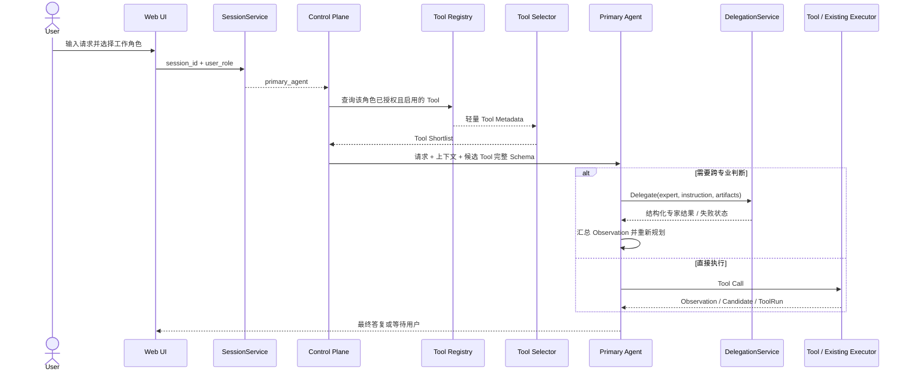

# 角色驱动 Multi-Agent 架构（v0.5）

## 1. 为什么进行这次重构

v0.4 已经把普通聊天、DS、RTL 和工程执行统一成 Tool Calling，但仍存在三个结构性问题：

1. 所有请求都由一个逻辑 Orchestrator Agent 规划，Design、Verification 更像被咨询的子角色；
2. 角色协作只是一次模型函数调用，没有独立任务、次数限制、超时或可查询结果；
3. Planner 每轮接收全部 Tool Schema，工具数量增加后会膨胀上下文并提高误选概率。

v0.5 不推翻 Run、Workspace、Patch、ToolRun 或 DS 子图，而是在主链外层做渐进式重构：**用户工作角色决定主 Agent；跨专业协作通过 Delegate；Tool 先按权限过滤，再由轻量模型选出候选集。**

## 2. 核心架构决策

### 2.1 工作角色决定主 Agent

当前支持两种用户工作角色：

| 用户工作角色 | 主 Agent | 主要能力 |
|---|---|---|
| `design_engineer` | `design` | 普通问答、DS/RTL Candidate、设计侧工程工具、委派验证/架构专家 |
| `verification_engineer` | `verification` | 普通问答、验证分析、已有用例及允许的工程工具、委派设计/架构专家 |

主 Agent 不是简单的 Prompt 标签。它同时决定：

- 本轮主系统提示词；
- Tool Registry 权限过滤结果；
- 可以委派的专家集合；
- Run 中的 `primary_agent` 和事件 Actor；
- 最终向用户汇总结果的角色。

`OrchestratorService` 仍作为确定性控制平面存在，但不再是业务主 Agent。它负责保存 Run、执行循环、检查权限和派发 Tool；专业判断和 Tool 选择均以当前 `primary_agent` 身份进行。

### 2.2 Delegate 是受控专家协作，不是主 Agent 切换

当前委派关系为：

```text
Design Agent
├─ Delegate → Verification Expert
└─ Delegate → Architecture Expert

Verification Agent
├─ Delegate → Design Expert
└─ Delegate → Architecture Expert
```

每次 Delegate 都创建持久化 `DelegationTask`，至少记录：

- 父 Run、发起角色、专家角色；
- 任务类型和明确 instruction；
- 输入文档及版本引用；
- 只读、禁止嵌套委派等约束；
- 状态、结论、证据、建议、错误和人工介入标记。

安全边界如下：

- 每个 Run 最多 3 次委派；
- 单次默认超时 90 秒；
- 专家只获得裁剪后的任务上下文，不继承主 Agent 的完整私有聊天历史；
- 当前专家任务为只读分析，不能直接执行写操作；
- 专家不能再次 Delegate，避免递归和失控成本；
- 委派失败或超时不会让专家接管会话，而是作为 Observation 返回主 Agent。

### 2.3 两阶段动态 Tool 选择

Tool 选择分为两阶段：

```text
Tool Registry 全量目录
        │
        ▼
按主 Agent 权限和 enabled 状态硬过滤
        │
        ▼
只发送轻量 Metadata 给 Selector Model
name / description / when_to_use / category
        │
        ▼
得到最多 N 个 Tool 名称
        │
        ▼
仅把候选 Tool 的完整 JSON Schema 发给主 Agent
        │
        ▼
主 Agent 选择 Tool 和参数
        │
        ▼
执行前再次做权限与 enabled 校验
```

这个顺序很重要：权限过滤发生在 Selector Model 之前。因此无权 Tool 不会出现在候选元数据中，也不会因为模型提示注入而获得执行资格。

`reply_to_user` 和 `ask_user` 是基础 Tool，默认始终加入候选集。Selector 返回未知、禁用或越权名称时会被丢弃；没有有效结果时回退到 Intent 候选加基础 Tool。主 Agent 若仍选择候选集之外的 Tool，控制平面会拒绝并转为安全询问。

## 3. 一次请求的完整运行路径



顶层最多执行 6 个规划步骤。达到限制时 Run 进入 `waiting_for_user`，不会无限循环。

## 4. 会话角色与上下文隔离

`conversations` 表持久化 `session_id → user_role → primary_agent`。客户端每次请求都可显式携带 `user_role`，也可复用已经保存的会话角色。

同一会话允许切换角色，但不能无条件迁移私有上下文：

- 项目文档、Workspace 标识等共享工程资产可以继续使用；
- 角色切换的首个后端请求清空传入的历史，并记录 `conversation_role_changed` 事件；
- 网页切换角色时同时清空本地消息历史和旧 Run/Task 展示，防止下一轮再次发送旧角色消息；
- 已持久化的 Run、Artifact、Patch 和 DelegationTask 不会被删除，仍可审计。

当前工作角色是本地单用户产品中的运行身份，不等价于企业登录权限。若进入多人部署，还需在它之前增加真实用户认证和项目 ACL。

## 5. 数据与接口

### 5.1 新增或扩展对象

| 对象 | 关键字段 | 用途 |
|---|---|---|
| `ConversationView` | `user_role`, `primary_agent` | 保存会话工作角色 |
| `RunView` | `primary_agent` | 标识本 Run 的最终负责 Agent |
| `ToolShortlist` | `selected_tools`, `reason`, `used_fallback` | 记录轻量选择结果 |
| `DelegationRequest` | 发起/目标角色、instruction、artifact、constraints | 专家任务契约 |
| `DelegationResult` | status、conclusion、evidence、error | 专家任务结果 |

### 5.2 HTTP API

| 方法 | 路径 | 说明 |
|---|---|---|
| `POST` | `/api/v1/chat` | 统一入口，可传 `user_role` |
| `GET` | `/api/v1/conversations/{session_id}` | 查询当前工作角色和主 Agent |
| `PUT` | `/api/v1/conversations/{session_id}/role` | 显式切换会话角色 |
| `GET` | `/api/v1/tools?role=verification` | 查看某角色可见 Tool |
| `GET` | `/api/v1/runs/{run_id}/delegations` | 查询 Run 的专家委派记录 |

`/tasks/ds`、`/rtl/candidates`、`/tool-runs` 等专业接口继续作为兼容、测试和外部集成入口保留；正式网页仍应从聊天入口进入角色主 Agent。

## 6. 模型配置

主 Agent 和轻量 Selector 可使用不同模型名称，但当前共享 Provider、Base URL 和 API Key：

```toml
[model]
provider = "deepseek"
model = "deepseek-chat"
selector_model = "deepseek-chat"
selector_max_tools = 6
selector_max_output_tokens = 1000
```

对应环境变量：

- `CHIP_AGENT_SELECTOR_MODEL`
- `CHIP_AGENT_SELECTOR_MAX_TOOLS`
- `CHIP_AGENT_SELECTOR_MAX_OUTPUT_TOKENS`

没有启用真实模型时，`DeterministicRuntime` 提供可测试的关键词回退。它用于离线验证控制流，不代表真实语义能力。

## 7. 代码落点

| 文件 | 职责 |
|---|---|
| `app/services/session_service.py` | 会话角色持久化和主 Agent 解析 |
| `app/services/tool_selector_service.py` | 权限优先、Metadata-only 的候选 Tool 选择 |
| `app/services/delegation_service.py` | 专家任务约束、执行、超时和持久化 |
| `app/services/orchestrator_service.py` | 确定性控制平面和 Planner–Executor Loop |
| `app/tools/registry.py` | Tool 权限、启停、分类和 Metadata 视图 |
| `app/tools/orchestration.py` | 两个主 Agent 的 Tool 能力声明 |
| `app/agents/runtime.py` | 主模型与 Selector 模型调用、确定性回退 |
| `app/storage/database.py` | Conversation、Run 主 Agent 和 DelegationTask 表 |
| `frontend/src/App.tsx` | 当前工作角色选择与角色切换隔离 |
| `frontend/src/ModelSettingsModal.tsx` | Selector 模型及候选数量配置 |

## 8. 已验证行为

专项测试位于 `tests/test_role_based_runtime.py`，覆盖：

- 用户角色持久化并正确选择主 Agent；
- Verification Agent 看不到 DS/RTL 写入 Tool；
- Selector 只从授权 Tool 中产生有限候选；
- Selector 返回越权名称时由后端丢弃；
- Verification 主 Agent 可 Delegate 给 Design 专家；
- 委派结果持久化并可通过 API 查询；
- 同一会话切换角色后主 Agent 更新且产生审计事件。
- Architecture Expert 不能嵌套委派。

原有测试继续覆盖 DS、RTL Patch、Lint、模型设置、统一 Run、上传和恢复流程。

## 9. 当前边界与下一步

已经实现的是角色主 Agent 控制面、受控专家委派和两阶段 Tool 选择。以下能力仍不应在面试或产品说明中夸大：

- Selector 与主 Agent 目前共享同一个 Provider 和 API Key，还没有独立限流与熔断；
- Provider 尚未把 token usage 返回控制平面，当前只记录模型名、候选数量、回退标记和延迟；
- Delegate 目前是同进程异步调用，不是独立队列或分布式 Worker；
- 没有企业用户认证，`user_role` 是工作模式而非组织授权；
- Architecture Expert 只读，不能批准或修改 FS/AS；
- Sim、CDC、综合、STA Adapter 仍需按统一 Tool 模板接入；
- DS 内部仍复用稳定的 LangGraph 子流程，后续可逐步拆成更细粒度 Tool，但不需要为这次重构一次性重写。

这就是“渐进式重构”的边界：先改变顶层责任、协作协议和上下文规模，再逐步替换内部执行器，而不是同时重写所有已经验证过的工程能力。
