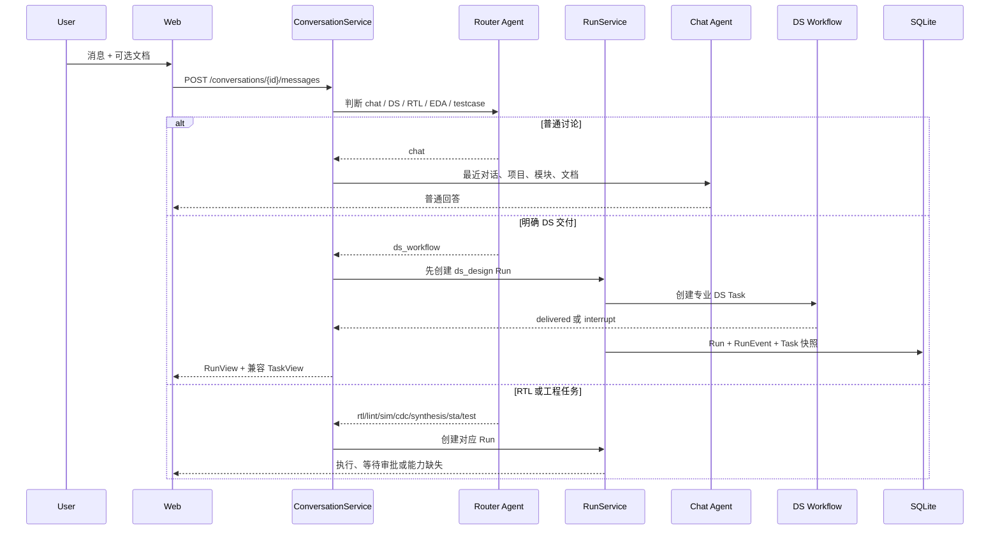
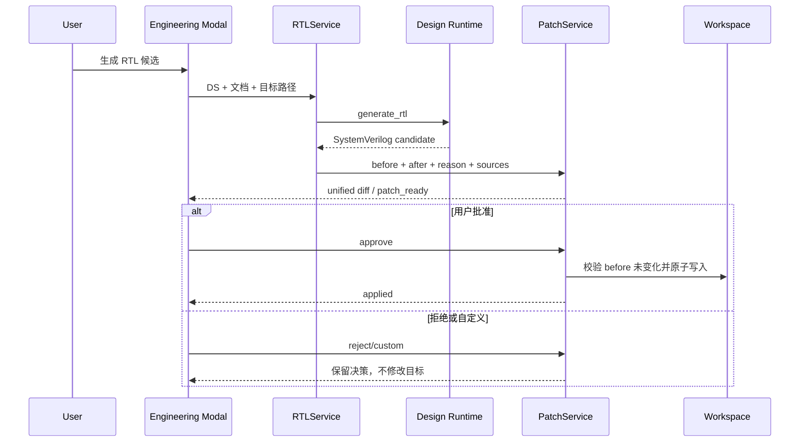
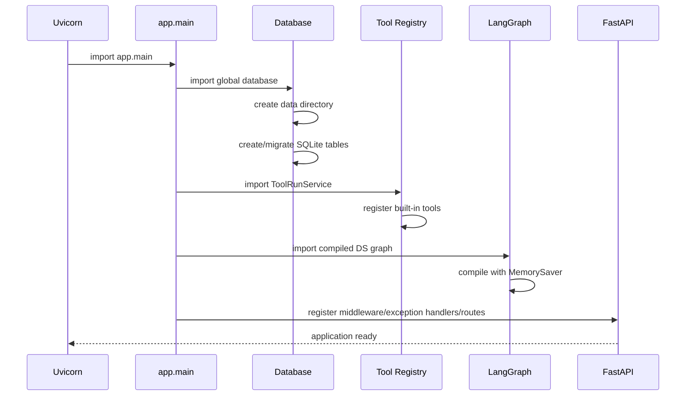
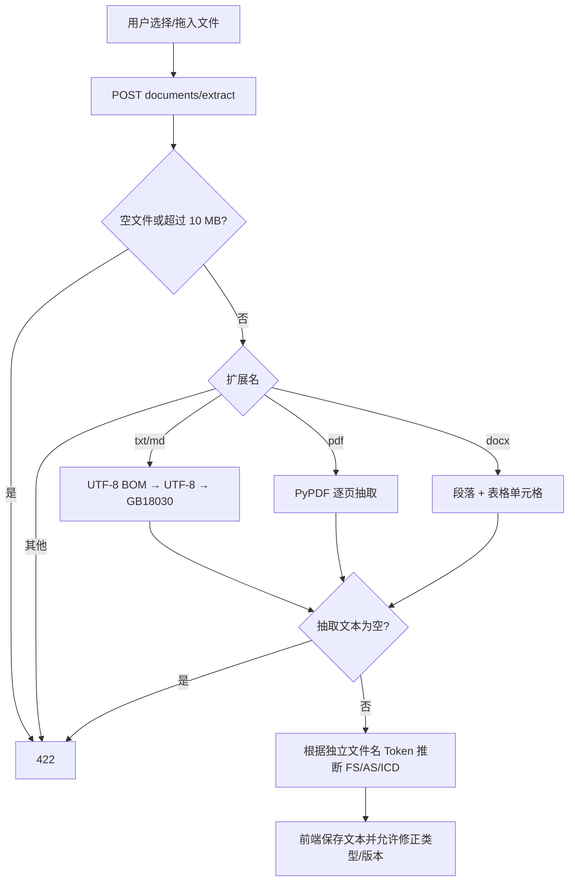
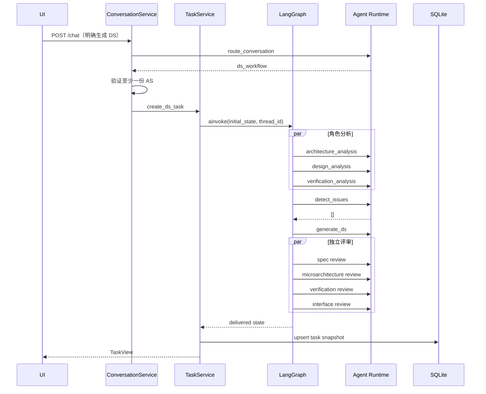
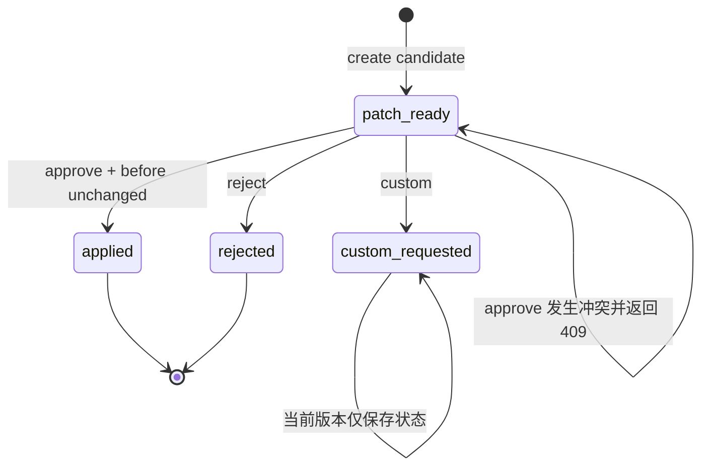
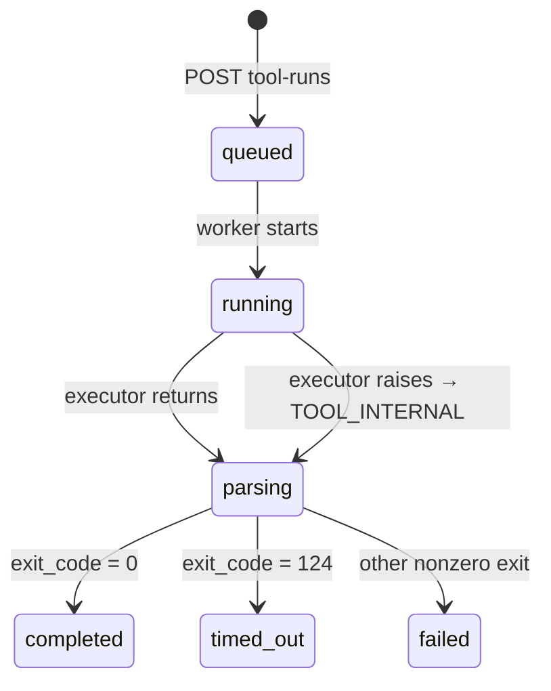
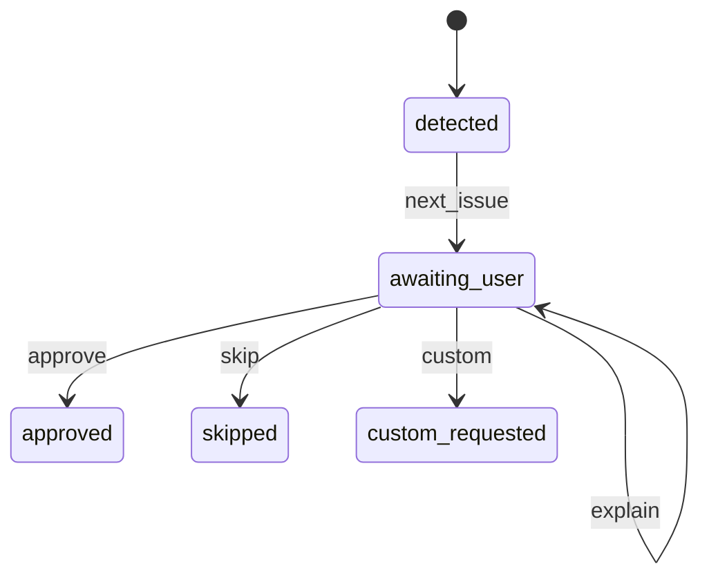

# 运行逻辑说明（v0.3 控制面）

## 1. 启动

```powershell
.\scripts\setup.ps1
.\scripts\run-web.ps1
```

`run-web.ps1` 隐藏启动 Uvicorn `127.0.0.1:8000`，以前台方式启动 Vite `127.0.0.1:5173`；Vite 把 `/api` 代理到后端。

首次导入应用时，SQLite 会自动建表，Tool Registry 会注册内置 Tool，Workspace 根目录在 `data/workspaces`。

## 2. 页面初始化

1. 初始化示例项目和模块；
2. 读取公开模型设置；
3. 显示真实模型或模拟运行时；
4. 用户可以直接聊天，不要求先上传 FS/AS；
5. 右上角提供工程工作台、系统自检和模型设置。

浏览器刷新仍会清空当前聊天和上传列表；后端持久化的 Task/Workspace 不会自动重新绑定到新页面会话。

## 3. 对话、Orchestrator 和统一 Run



上传文件只增加上下文，不自动触发流程。用户决定任务阶段；Router 只识别明确动作，不会因存在文档自动推进。明确 DS 任务必须至少包含 AS。

统一 Run 和专业执行记录分层：

```text
Run（用户任务控制面）
├─ DS Task（LangGraph 专业状态）
├─ RTL Patch（候选修改与审批）
└─ ToolRun（一次外部进程执行）
```

因此 `runs.run_id` 和 `tool_runs.run_id` 含义不同，前者面向用户任务，后者面向工具进程。

DS 图仍为：生产角色分析 → 规格冲突 → 最多 1～3 轮内部讨论 → 必要时等待用户 → DS → 四类默认评审和自定义评审 → 交付。

## 4. 等待真实架构结论与重启恢复

正常运行时使用 LangGraph `interrupt` 和相同 `thread_id` 恢复。TaskService 同时把去除不可序列化 Interrupt 对象后的状态和 `pending_user_request` 写入 SQLite。

后端重启后：

1. `GET /tasks/{id}` 从 SQLite 恢复 TaskView；
2. 若快照处于等待用户，`POST /resume` 走兼容恢复路径；
3. 保存用户结论/问题单引用；
4. 重新生成 DS 和评审；
5. 写回 delivered/cancelled 快照。

局限：这条路径不是从 LangGraph 精确节点 Checkpoint 恢复，已完成的模型节点不会按持久化图语义逐节点重放。

## 5. RTL 候选和 Patch



确定性运行时只生成安全骨架和 TODO；真实模型基于 DS 生成候选，但均受同一 Diff Review 保护。

## 6. ToolRun

### 启动

1. 前端选择 Workspace、Tool、Role 和参数；
2. 对需要授权的 Tool，用户必须明确点击执行；
3. 后端校验 Workspace、Tool、角色和批准位；
4. 创建 `queued` Run 并立即返回 Run ID；
5. 线程池执行，状态进入 `running`；
6. 收集 stdout/stderr，状态短暂进入 `parsing`；
7. 日志写入 `logs/<run_id>.*.log`；
8. 生成 Issue 后进入 `completed`、`failed` 或 `timed_out`。

### Verilator Lint

- 可执行文件由 PATH 查找；
- HDL 文件必须存在于 Workspace 且后缀允许；
- `top_module` 必须满足标识符白名单；
- 使用 `subprocess.run(command_list, shell=False)`；
- 当前超时 300 秒；
- 当前机器未安装时生成 `TOOL_ENVIRONMENT` Issue。

## 7. 单 Issue 闭环

日志解析后每条 Issue 包含：工具、严重度、错误码、文件/行号、原始日志引用、指纹、根因判断、证据、影响、修改建议、1～10 置信度和建议复验。

`GET /tool-runs/{run_id}/issues/next` 只把队列中第一条未处理问题设为 `awaiting_user`。用户动作：

- `approve`：记录接受建议；当前版本不会自动生成/应用修复 Patch；
- `skip`：标记跳过并进入下一条；
- `custom`：保存自定义原则；当前版本尚未自动重新生成 Patch；
- `explain`：保持当前问题活跃。

因此 v0.2 已实现“单问题展示和决策记录”，但“自动修复 → 应用 → 最小复验 → resolved/reopened”仍是下一步。

## 8. 模型选择

```text
CHIP_AGENT_MODEL_ENABLED 显式 false
    → Deterministic Runtime
否则 effective settings.ready
    → LLM Runtime
否则
    → Deterministic Runtime
```

配置优先级：环境变量 > `data/model_settings.json` > `config/model.toml`。网页保存的 Key 使用 Windows DPAPI；测试强制关闭真实模型。

## 9. 状态序列

统一 Run：

```text
planned → running → completed / failed / cancelled
                  ↘ waiting_for_user
                  ↘ waiting_for_approval
```

Run 等待原因不是只有人工架构结论，还可能是缺少 AS、已确认 DS、Workspace、Tool 授权或真实 Tool Adapter。

DS：

```text
requested → executing → internal_discussion? → waiting_for_user?
→ reviewing → delivered
```

ToolRun：

```text
queued → running → parsing → completed / failed / timed_out
```

EngineeringIssue：

```text
detected → awaiting_user → approved / skipped / custom_requested
```

`patch_ready/applied/verifying/resolved/reopened` 已在枚举中保留，但当前自动修复链尚未串通。

## 10. 失败行为

| 场景 | 行为 |
|---|---|
| 文件解析失败 | 422，前端显示原因 |
| DS 缺少 AS | 创建 waiting_for_user Run，不创建专业 DS Task |
| 模型调用/JSON 失败 | 结构化错误、请求编号和诊断建议 |
| Workspace 路径穿越 | 422 |
| 无权限或未授权 Tool | 403 |
| Tool 不存在/Workspace 不存在 | 404 |
| Verilator 未安装 | Run failed + `TOOL_ENVIRONMENT` Issue |
| Patch Review 期间目标变化 | 409，不覆盖文件 |
| 后端重启 | 已落库结果可查；运行中 Tool 不自动续跑 |

### 10.1 各任务的当前编排行为

| 用户明确请求 | RunType | 当前动作 |
|---|---|---|
| 完成/评审 DS | `ds_design` | 调用 DS Workflow，Task 与 Run 双向关联 |
| 生成/实现 RTL | `rtl_implementation` | 要求已确认 DS，生成 Candidate/Patch，等待审批 |
| 执行 Lint | `lint` | 查找项目 Workspace，明确执行意图视为授权，启动 Verilator ToolRun |
| 执行已有用例 | `test_execution` | 调用 `discover_testcases`，不自动生成验证计划 |
| 执行仿真/CDC/综合/STA | 对应 RunType | 当前未注册 Adapter，保存 `tool_adapter_required`，不伪造结果 |

直接 `/tasks/ds`、`/rtl/candidates` 和 `/tool-runs` 仍可用于测试与系统集成，但正式网页的主路径是 Conversation → RunService。

## 11. 自检

`GET /diagnostics` 不调用外部模型，不产生费用。检查后端、默认配置、本地设置、模型就绪状态、数据目录、SQLite、Tool Registry 和 Verilator PATH。

## 12. 进程启动与组件初始化顺序

### 12.1 后端导入阶段

Uvicorn 导入 `app.main:app` 时发生以下初始化：



如果 SQLite Schema 初始化失败，应用导入会失败；如果 Verilator 不存在，应用仍可启动，因为可执行文件检查发生在诊断或运行 Tool 时。模型设置也不会在启动时发出外部请求。

### 12.2 前端启动阶段

Vite 加载 React 后，`App` 只读取公开模型配置，不自动读取 Workspace、Task 或运行历史，也不自动调用真实模型。用户必须显式打开工程工作台或发送消息。

## 13. 请求公共处理链

所有 `/api/v1` 请求先经过请求编号中间件：

```text
接收 X-Request-ID（若有）或生成随机 ID
→ 执行 FastAPI Route
→ 成功：把 X-Request-ID 写入响应
→ 未处理异常：分类错误、记录同 ID 日志、返回结构化 error
```

结构化错误示例：

```json
{
  "error": {
    "code": "MODEL_INVOCATION_FAILED",
    "message": "模型没有返回有效 JSON",
    "request_id": "68c7b50cb863",
    "suggestions": ["运行系统自检", "检查模型名称、Base URL、API Key 和网络连接"]
  }
}
```

前端 `parseResponse` 优先显示结构化错误；若只有 FastAPI `detail` 则降级显示 detail；未知 500 会引导用户运行自检。

## 14. 文档抽取详细流程



后端当前不保存原始二进制文件。前端发起 Chat/DS 时，把抽取后的全文、用户确认类型和版本作为 JSON 传入。因此浏览器刷新会丢失尚未形成后端 Task/Artifact 的上传上下文。

## 15. 普通聊天详细流程

1. 前端截取最近 20 条消息，连同项目、模块、当前问题和可选文档发送；
2. ConversationService 调用 Runtime 的 Router；
3. Deterministic Router 使用明确动作词和 DS/RTL/EDA/用例目标词组合判断；真实 Router 使用结构化 JSON；
4. route 为 chat 时，不校验 AS，也不创建 Task；
5. Chat Agent 接收历史、项目、模块和文档上下文；
6. 返回 `ChatResponse`，其中 `task=null`，前端显示“普通聊天”标签。

聊天历史目前只由浏览器提交，后端没有 Conversation 表。`session_id` 用于响应关联，但尚未形成可恢复的服务端会话。

## 16. DS 工作流逐节点说明

| 节点 | 读取 | 写入 | 失败影响 |
|---|---|---|---|
| `prepare_context` | request、disabled_agents | status、quality_warnings、discussion_round、event | Task 失败 |
| `architecture_analysis` | 文档、模块 | architecture_analysis、event | Task 失败 |
| `design_analysis` | AS/文档、模块 | design_analysis/submodules、event | Task 失败 |
| `verification_analysis` | 文档、模块 | verification_analysis、event | Task 失败 |
| `detect_conflicts` | request | issues、status、event | Task 失败 |
| `discussion` | issues、round | 增加轮次、更新 Issue、event | Task 失败 |
| `await_user` | issues | Interrupt；恢复后写 user_resolution | 进入等待状态 |
| `generate_ds` | request、design_analysis、resolution | ds_markdown、reviewing、event | 不产生候选 |
| 四类 Review | request、ds_markdown | 各自 Finding 列表、event | 当前整体调用失败 |
| `custom_review` | custom_reviewers | custom_findings、event | 当前整体调用失败 |
| `aggregate_findings` | 所有 Finding | findings、delivered、event | Task 不交付 |

### 16.1 Agent 禁用

被禁用的分析角色使用最小占位结果继续；被禁用的 Reviewer 返回空列表。`prepare_context` 对每个禁用的默认角色增加质量警告。禁用只影响可选角色，不绕过路径、Patch 或 Tool 权限。

### 16.2 并行汇合

Architecture、Design、Verification 从 `prepare_context` 扇出，三者全部到达后才进行冲突检测；DS 生成后多个 Review 扇出，并在 Aggregate 节点汇合。`events` 使用列表追加 Reducer，防止并行分支覆盖彼此事件。

### 16.3 模型调用数量

真实模型模式下，一次无冲突、无自定义 Reviewer 的 DS 通常包括 Router、三个分析、冲突检测、DS 生成和四个 Review。实际调用数会随路径和格式修复增加，因此生产化需要按节点记录 Token、耗时和费用。

## 17. DS 正常路径时序



如果用户直接调用 `/tasks/ds`，则跳过 Conversation Router，其余路径相同。

## 18. 冲突、Interrupt 与恢复细节

### 18.1 进程内恢复

1. `detect_conflicts` 返回非空 Issue；
2. `discussion` 增加轮次，直到请求中的上限；
3. `await_user` 调用 LangGraph `interrupt(payload)`；
4. `ainvoke` 返回包含 `__interrupt__` 的状态；
5. TaskService 保存热状态，并把 Interrupt Payload 单独序列化到 SQLite；
6. 用户提交 Resolution；
7. TaskService 使用同一 thread_id 调用 `Command(resume=...)`；
8. Graph 从 await_user 节点继续到取消或 DS 生成。

### 18.2 重启后兼容恢复

内存中的 `__interrupt__` 和 MemorySaver 已丢失，但 SQLite 仍有 request、分析结果、Issue、事件和 `_pending_user_request`。新 TaskService 加载快照后：

- cancel：直接写 cancelled；
- 其他动作：保存 Resolution，调用 Runtime 重新生成 DS，并重新运行默认/自定义 Review，最后写 delivered。

这条路径不会恢复原始 LangGraph 执行栈，也可能再次产生模型费用。它保证业务可以继续，但不是严格的 exactly-once 工作流恢复。

## 19. RTL Candidate 与 Patch 状态机



### 19.1 新文件

目标不存在时 before 为空，Diff 从空文件生成。批准前文件仍不存在；批准时若目标仍不存在则创建。

### 19.2 修改已有文件

创建 Patch 时读取完整 before。批准时再次读取；任何差异都会拒绝应用，即使变化发生在 Patch 不涉及的其他行。这种策略保守但安全。

### 19.3 Apply 顺序

```text
读取数据库 Patch
→ 检查状态是否允许决策
→ 解析并校验 Workspace 路径
→ 比较当前目标与 before
→ 临时文件写入 after
→ atomic replace
→ 更新 status/applied_at
```

当前没有回滚 API；若应用后用户要撤销，应基于当前内容创建反向候选 Patch，而不是直接篡改历史状态。

## 20. ToolRun 详细状态转换



枚举还定义 `preparing`、`collecting`、`cancelled`，但当前执行器尚未使用这些中间状态，也没有取消端点。文档和前端不应把预留枚举描述成已实现能力。

### 20.1 创建阶段

- 验证 Workspace 存在；
- 从 Registry 查找 Tool；
- 检查 Role 是否在 allowed_roles；
- 若 requires_user_approval=true，检查请求批准位；
- 写入 queued Run；
- 提交线程池；
- 返回 202。

### 20.2 执行阶段

线程将状态改为 running，调用 Tool Executor。Executor 返回实际命令数组、exit_code、stdout 和 stderr。未捕获异常被转换为 `TOOL_INTERNAL`，而不是让 Run 永久停留 running。

### 20.3 收集与解析

Service 把状态改为 parsing，保存最大约一百万字符的 stdout/stderr，并把日志写到 Workspace。随后解析标准化 Issue，最后根据 exit_code 写终态。

## 21. Verilator Lint 参数与结果

请求示例：

```json
{
  "workspace_id": "...",
  "tool_name": "verilator_lint",
  "role": "design",
  "arguments": {
    "files": ["rtl/dma_ctrl.sv", "rtl/dma_pkg.sv"],
    "top_module": "dma_ctrl"
  },
  "user_approved": true
}
```

校验顺序：

1. PATH 中查找 Verilator；
2. `files` 必须为非空数组；
3. 每个路径必须在 Workspace；
4. 后缀只能为 `.sv/.svh/.v/.vh`；
5. 文件必须存在；
6. top module 必须匹配 HDL 标识符格式；
7. 构造 `verilator --lint-only -Wall ... --top-module ...`；
8. 以 Workspace 为 cwd、`shell=False` 执行；
9. 超时返回 124 和 `TOOL_TIMEOUT`。

工具不存在时不会验证后续文件参数，而是优先返回环境错误。这表示当前最先阻断的是执行环境。

## 22. 日志标准化和 Issue 排队

### 22.1 解析

当前解析器识别：

- `%Error-CODE: file:line:column: message`；
- `%Warning-CODE: ...`；
- `TOOL_ENVIRONMENT`；
- `TOOL_ARGUMENT`；
- `TOOL_INTERNAL`；
- `TOOL_TIMEOUT`。

每条结果产生 stage、severity、code、message、file、line 和 fingerprint。当前 stage 主要区分 lint 与通用 tool_execution。

### 22.2 启发式分析

| Code 类型 | 根因模板 | 默认置信度 |
|---|---|---:|
| TOOL_ENVIRONMENT | 工具环境不满足，不是 RTL 错误 | 10 |
| WIDTH | 位宽、signed 或截断不一致 | 8 |
| MULTIDR* | 多过程或连续赋值驱动同一信号 | 8 |
| LATCH | 组合分支未完整赋值 | 8 |
| 其他 | 需结合源码和 DS 判断 | 6 |

这些是建议，不是最终根因。真实 Agent 分析尚未在 ToolRun 后自动调用。

### 22.3 队列推进



每次 `next_issue` 按 queue_index 返回第一条仍活跃的问题。`approve` 当前只保存决策，不会自动进入 patch_ready；`skip` 保留风险；`custom` 不会自动生成新 Patch；`explain` 不推进队列。

## 23. Workspace 和 Artifact 运行逻辑

创建 Workspace 时：

1. 用 project_id 生成安全 slug；
2. 追加 Workspace UUID 前缀避免同名冲突；
3. 在配置根目录内解析绝对路径；
4. 创建 `rtl`、`dv`、`constraints`、`candidates`、`artifacts`、`logs`；
5. 写入 SQLite；
6. 返回 Workspace 的绝对根路径。

创建 Artifact 时：

1. 校验相对路径；
2. 原子写入内容；
3. 查询同路径最大版本并加一；
4. 计算 SHA-256；
5. 保存类型、状态、来源和时间。

当前顺序是先写文件再插入 Artifact；若数据库写入失败，可能留下未登记文件。生产化需要补偿逻辑或暂存区。

## 24. 并发、幂等与重复请求

| 操作 | 当前幂等性 | 重复调用结果 |
|---|---|---|
| 创建 Workspace | 非幂等 | 生成新的 Workspace |
| 创建 DS Task | 非幂等 | 新 Task、新模型调用 |
| Resume Task | 条件幂等 | 首次后不再等待，再次调用返回 409 |
| 创建 RTL Candidate | 非幂等 | 新 Patch，可能再次调用模型 |
| Approve Patch | 条件幂等 | 应用后再次批准返回 409 |
| Start ToolRun | 非幂等 | 创建并执行新 Run |
| Issue explain | 近似幂等 | 保持 awaiting_user，但更新决策内容 |

当前 API 没有 Idempotency-Key。网络重试可能重复创建 Task、Patch 或 Run。生产环境应为高成本 POST 支持客户端幂等键，并将其与用户、项目和请求 Payload Hash 绑定。

## 25. 配置热更新运行逻辑

保存模型设置时：

1. 前端提交公开字段和可选新 Key；
2. ModelSettingsService 读取现有 Provider Key；
3. 新 Key 使用 DPAPI 加密；
4. 使用临时文件替换 `data/model_settings.json`；
5. 返回公开掩码视图；
6. 前端清空 Key 输入；
7. 后续每次 Runtime 调用重新读取 effective settings，无需重启。

环境变量始终优先于网页设置，因此用户可能在页面保存新值但实际仍由环境变量覆盖。公开视图中的 `api_key_source` 用于解释这一情况。

## 26. 端到端示例：从 DS 到 Lint

```text
用户上传 FS/AS/ICD
→ 发送“生成 dma_ctrl DS”
→ Router 选择 ds_workflow
→ RunService 创建 ds_design Run
→ 三角色分析、冲突检测
→ 无冲突：生成 DS、四类评审、保存 Task
→ 用户打开工程工作台
→ 创建/复用 Workspace
→ Design Runtime 生成 rtl/dma_ctrl.sv Candidate
→ PatchService 返回 Diff
→ 用户批准
→ 校验 before、原子写入 RTL
→ 用户明确授权 Verilator Lint
→ ToolRun queued/running/parsing/failed 或 completed
→ 保存原始日志、生成标准化 Issue
→ 前端一次展示一条 Issue
→ 用户 approve/skip/custom/explain
```

当前链路在 Issue 决策后停止。目标链路还应包括“生成修复 Patch → 再次批准 → 应用 → 最小 Lint 复验 → resolved/reopened”。

## 27. 运行时数据落点总表

| 数据 | 产生位置 | 保存位置 | 前端刷新后 |
|---|---|---|---|
| 当前聊天消息 | React | 浏览器内存 | 丢失 |
| 上传抽取文本 | React/API 响应 | 浏览器内存 | 丢失 |
| 模型设置 | 设置页面 | JSON + DPAPI/环境变量 | 保留 |
| DS Task 快照 | TaskService | SQLite | 保留，可按 ID 查询 |
| LangGraph Checkpoint | Workflow | MemorySaver | 丢失 |
| Workspace 目录 | WorkspaceService | 文件系统 + SQLite | 保留 |
| Artifact 内容 | ArtifactService | 文件系统 + SQLite 元数据 | 保留 |
| Patch before/after | PatchService | SQLite | 保留 |
| ToolRun | ToolRunService | SQLite | 保留 |
| 原始工具日志 | ToolRunService | SQLite 截断副本 + Workspace 文件 | 保留 |
| EngineeringIssue/决策 | ToolRunService | SQLite | 保留 |

## 28. 测试时运行逻辑

`tests/conftest.py` 在测试收集阶段设置 `CHIP_AGENT_MODEL_ENABLED=false`。因此：

- Router、Chat、DS、RTL 都走 Deterministic Runtime；
- 不读取用户保存的启用状态发起模型请求；
- 测试结果不受网络、配额或模型版本影响；
- Provider JSON 测试通过 Mock 单独验证格式修复；
- Phase 2 测试使用真实临时 SQLite 或受控全局 Workspace 验证路径和审批不变量。

前端通过 `tsc -b && vite build` 验证类型和生产打包。当前页面检查是人工/Computer Use 验收，尚未建立 Playwright 自动回归套件。

## 29. 当前恢复语义总结

| 对象 | 可查询 | 可继续 | 精确恢复 |
|---|---:|---:|---:|
| 已交付 DS Task | 是 | 不适用 | 保存最终投影 |
| 等待用户 DS Task | 是 | 是，兼容路径 | 否 |
| MemorySaver 节点状态 | 进程内 | 进程内可以 | 重启后否 |
| 已完成 ToolRun | 是 | 不适用 | 日志/结果保留 |
| 运行中 ToolRun | 数据行可见 | 否 | 否 |
| Patch Ready | 是 | 可批准/拒绝 | 是，但依赖目标未变化 |
| 已应用 Patch | 是 | 不自动回滚 | 历史保留 |

“可查询”“可继续”和“精确恢复”是三个不同能力。当前 v0.2 主要完成前两者的一部分，不能描述为完整容错工作流。
